<a name="top"></a>
<p align="center">
  <a href="https://mkcinema-site.pages.dev">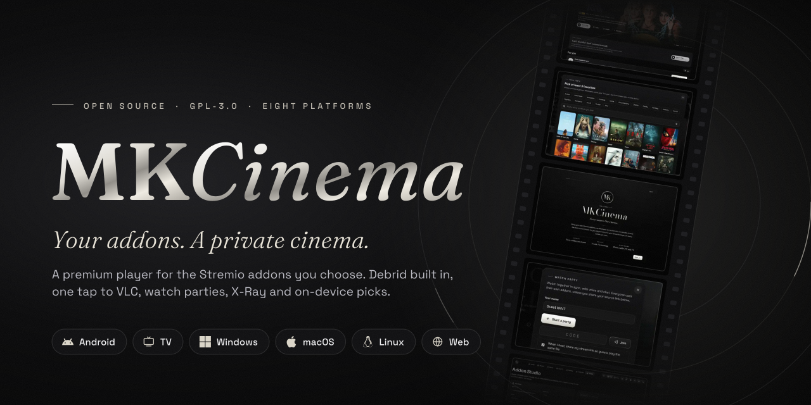</a>
</p>

<p align="center">
  <a href="https://github.com/itbelikethatbruh/MKCinema/releases/latest"></a>
  <a href="LICENSE"></a>
  <a href="https://github.com/itbelikethatbruh/MKCinema/commits/main"></a>
  <a href="https://mkcinema.pages.dev"></a>
  <a href="https://ko-fi.com/mkcinema"></a>
</p>

<p align="center">
  
  
  
  
  
  
  
  
</p>

<p align="center">
  <a href="https://mkcinema.pages.dev"><b>Open the app</b></a> &nbsp;·&nbsp;
  <a href="https://mkcinema-site.pages.dev"><b>Website</b></a> &nbsp;·&nbsp;
  <a href="#download"><b>Download</b></a> &nbsp;·&nbsp;
  <a href="#features"><b>Features</b></a> &nbsp;·&nbsp;
  <a href="#new"><b>What's new</b></a> &nbsp;·&nbsp;
  <a href="#compare"><b>Compare</b></a> &nbsp;·&nbsp;
  <a href="#marquee"><b>Now showing</b></a> &nbsp;·&nbsp;
  <a href="#build"><b>Build</b></a> &nbsp;·&nbsp;
  <a href="CHANGELOG.md"><b>Changelog</b></a>
</p>

<br>

> **MKCinema** is a free, open-source premium player for the Stremio addons you choose. It brings your catalogues, debrid account and subtitles together in one library you can style your way (five looks, a colour wheel and an Anime mode), with a player built for phones, tablets, desktops and TVs that can even send the sound to your phone.
>
> It ships no titles, channels or streams of its own. Catalogues come from Cinemeta, subtitles from OpenSubtitles, and the only built-in source is official trailers. Everything else comes from addons you install yourself.

<a name="download"></a>
<p></p>

<p align="center">
  <a href="https://github.com/itbelikethatbruh/MKCinema/releases/download/v1.6/MKCinema.apk">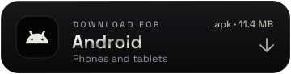</a>
  <a href="https://github.com/itbelikethatbruh/MKCinema/releases/download/v1.6/MKCinema-TV.apk">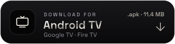</a>
  <a href="https://github.com/itbelikethatbruh/MKCinema/releases/download/v1.6/com.mkcinema.app_1.1.0_all.ipk">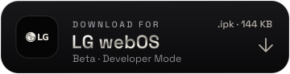</a>
  <a href="https://github.com/itbelikethatbruh/MKCinema/releases/latest/download/MKCinema.exe">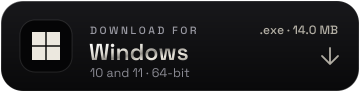</a>
  <a href="https://github.com/itbelikethatbruh/MKCinema/releases/download/v1.6/MKCinema-1.1-mac.zip">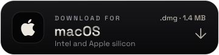</a>
  <a href="https://github.com/itbelikethatbruh/MKCinema/releases/download/v1.6/mkcinema_1.1_amd64.deb">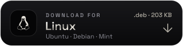</a>
  <a href="https://mkcinema.pages.dev"></a>
</p>

<p align="center"><sub>
  Release <a href="https://github.com/itbelikethatbruh/MKCinema/releases/tag/v1.6">v1.6</a> &nbsp;·&nbsp;
  Linux also as <a href="https://github.com/itbelikethatbruh/MKCinema/releases/download/v1.6/mkcinema-1.1-linux-x86_64.tar.gz">.tar.gz</a> &nbsp;·&nbsp;
  Fire TV: type <code>mkctv.pages.dev</code> into the Downloader app &nbsp;·&nbsp;
  Samsung TV (2023+): <a href="tizen/README.md">install with TizenBrew</a>
</sub></p>

Every app opens the same MKCinema in its own window, so it always runs the latest version. Sign in with email and your library, progress, addons and settings follow you between devices.

> [!NOTE]
> The Windows and Mac apps are not code-signed by Microsoft or Apple yet. On Windows, click **More info › Run anyway** the first time. On a Mac, open the app once, then go to **System Settings › Privacy & Security › Open Anyway**. Android asks you to allow installs from your browser; on a TV, allow the Downloader app instead. LG TVs only install store apps, so the webOS package needs Developer Mode. Samsung (Tizen) isn't supported yet because Samsung requires apps to be signed through its developer program. Only download MKCinema from this repository or [the website](https://mkcinema-site.pages.dev).

<a name="features"></a>
<p></p>

<a name="new"></a>
### New in 2.15 to 2.20

<table>
<tr>
<td width="33%" valign="top"><br><b>Listen on your phone</b><br><sub>The film plays on the TV and its sound comes out of your phone, live and in stereo, so you can use headphones while the house sleeps. It works from the phone remote, so there is no app to install.</sub></td>
<td width="33%" valign="top">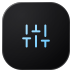<br><b>A player rebuilt</b><br><sub>Edge-to-edge picture, times beside the bar, and options in four tabs: Playback, Picture, Audio and More. Playback stats on <kbd>I</kbd>, every shortcut on <kbd>?</kbd>.</sub></td>
<td width="33%" valign="top"><br><b>Volume to 200 %</b><br><sub>A real boost through the audio engine. The slider turns champagne past 100 % so you know you're boosting. The mouse wheel works too.</sub></td>
</tr>
<tr>
<td width="33%" valign="top"><br><b>Anime mode</b><br><sub>An Anime tab with Trending, Airing now, Most popular and Top rated, and an Anime look in crimson and violet with sakura and Miko, our mascot.</sub></td>
<td width="33%" valign="top"><br><b>Styled anime subtitles</b><br><sub>Fansub fonts, signs, positions and karaoke render as they were made (libass), and subtitles and chapters inside MKV files show up by themselves.</sub></td>
<td width="33%" valign="top"><br><b>AniList and MyAnimeList</b><br><sub>Episodes you finish are marked on your list, and your lists come in on import. Trakt and Simkl still work alongside.</sub></td>
</tr>
<tr>
<td width="33%" valign="top"><br><b>Five looks, any colour</b><br><sub>Noir, Midnight, Velvet, Sepia and Anime, plus one colour wheel that tints the whole app. Your choice follows your account.</sub></td>
<td width="33%" valign="top">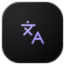<br><b>Speaks your language</b><br><sub>Menus in English, Español, Português, Français, Deutsch, Italiano and हिन्दी. It follows your device, or pick one in Settings.</sub></td>
<td width="33%" valign="top"><br><b>MDBList rows</b><br><sub>Add any MDBList list as a row on Home with your own free API key.</sub></td>
</tr>
<tr>
<td width="33%" valign="top"><br><b>Gestures that feel native</b><br><sub>Hold for 2× speed, swipe the left side for brightness, the right for volume, and sideways to seek. Speed is remembered per title, subtitle timing per file.</sub></td>
<td width="33%" valign="top"><br><b>Every skip, every chapter</b><br><sub>Intro, recap, credits and preview times from TheIntroDB and AniSkip, plus the file's own chapters.</sub></td>
<td width="33%" valign="top"><br><b>Support built in</b><br><sub>Settings › Support runs a Diagnostic and a speed test, and Send log gives you a six-character code to paste into a bug report. Nothing is sent until you tap it.</sub></td>
</tr>
</table>

### Everything else

<table>
<tr>
<td width="33%" valign="top"><br><b>Your addons, your rules</b><br><sub>Install any Stremio addon by link, reorder them, and see results from each one the moment it answers.</sub></td>
<td width="33%" valign="top"><br><b>Debrid built in</b><br><sub>Bring your own key from the debrid service you already use and press Test. Cached results are marked ⚡ and play right away.</sub></td>
<td width="33%" valign="top"><br><b>One tap to VLC</b><br><sub>Hand any stream to VLC, Infuse, MX Player, Just Player, mpv, IINA or PotPlayer. Only players your device supports are listed.</sub></td>
</tr>
<tr>
<td width="33%" valign="top"><br><b>Your own media servers</b><br><sub>Connect Plex, Jellyfin or Emby and the films you own sit next to your addon sources. Smart Play picks your own copy first.</sub></td>
<td width="33%" valign="top"><br><b>The TV's own player</b><br><sub>On Android TV and Fire TV, streams play in the TV's hardware player, so HEVC, HDR and Dolby Vision play natively, with frame-rate matching. MKCinema still picks the source and saves your place.</sub></td>
<td width="33%" valign="top"><br><b>Torrents without debrid</b><br><sub>Every app (Windows, Mac, Linux, Android and TV) can play torrent sources themselves. Off until you turn it on, download only, and the cache is deleted when you stop.</sub></td>
</tr>
<tr>
<td width="33%" valign="top"><br><b>Watch party</b><br><sub>Share a six-character room. Play, pause and seek stay in sync, with chat, reactions and push-to-talk, peer to peer.</sub></td>
<td width="33%" valign="top"><br><b>X-Ray</b><br><sub>Pause for a second to see the cast, actor bios, release facts, and the picture and sound details.</sub></td>
<td width="33%" valign="top"><br><b>Your Picks</b><br><sub>A <i>For you</i> row from your favourites and history. Ask in plain words, like “funny crime series”. It runs entirely on your device.</sub></td>
</tr>
<tr>
<td width="33%" valign="top"><br><b>Skip Intro, next episode</b><br><sub>Skip intros, endings and credits (anime too, from any addon), with a 10-second countdown to the next episode while its sources load.</sub></td>
<td width="33%" valign="top"><br><b>Automatic failover</b><br><sub>If a source shows no picture or stalls, MKCinema moves to the next one by itself.</sub></td>
<td width="33%" valign="top"><br><b>Audio languages</b><br><sub>When a stream carries several languages or a commentary, pick one in the player’s Audio tab. Files the browser can’t switch open in VLC or your own player.</sub></td>
</tr>
<tr>
<td width="33%" valign="top"><br><b>A real Library</b><br><sub>Watchlist, In progress, Watched and your own lists, with sorting and filters. Lists follow your account.</sub></td>
<td width="33%" valign="top">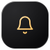<br><b>New episodes</b><br><sub>A row under Continue watching, and one quiet notice when a series you follow gets a new episode.</sub></td>
<td width="33%" valign="top"><br><b>Source rules</b><br><sub>Hide cam copies, set a lowest resolution, a largest file size and an HDR preference, block words, and choose which debrid service goes first.</sub></td>
</tr>
<tr>
<td width="33%" valign="top"><br><b>Source Check</b><br><sub>Fakes, samples, archives and the wrong episode are hidden; cinema recordings and odd sizes are flagged, and every pick says why.</sub></td>
<td width="33%" valign="top"><br><b>Top 10 and Shortlist</b><br><sub>Top 10 today, Under 90 minutes, Hidden gems, Award winners and twenty quick picks to skip or save.</sub></td>
<td width="33%" valign="top"><br><b>Browser only mode</b><br><sub>No player installed? MKCinema lists only the sources your browser can play with picture and sound.</sub></td>
</tr>
<tr>
<td width="33%" valign="top"><br><b>Seats</b><br><sub>A seat for everyone in the house with its own picture, watchlist and progress. Kids seats show Animation and Family only, behind a grown-up PIN.</sub></td>
<td width="33%" valign="top"><br><b>Phone as a remote</b><br><sub>Scan a code and your phone becomes a trackpad with volume, skip, audio presets and subtitles.</sub></td>
<td width="33%" valign="top"><br><b>Made for the big screen</b><br><sub>Android TV, Google TV, Fire TV, LG webOS and Samsung, with a platinum focus ring, remembered rows, voice search and an optional side menu.</sub></td>
</tr>
<tr>
<td width="33%" valign="top"><br><b>Ambient Mode</b><br><sub>Leave the TV idle and your Home becomes a living screensaver: each film as a layered 3D scene with its own atmosphere. OK opens the film, Back returns.</sub></td>
<td width="33%" valign="top"><br><b>Peak Cinema</b><br><sub>Can't decide? Surf 90-second scenes from films in your catalogs and watchlist, filtered by mood, and keep watching from that exact second.</sub></td>
<td width="33%" valign="top"><br><b>Channels and guide</b><br><sub>Your own M3U, Xtream or file playlists with an XMLTV guide, favourites, and Split Screen for up to four streams at once.</sub></td>
</tr>
<tr>
<td width="33%" valign="top"><br><b>Subtitles that fit</b><br><sub>OpenSubtitles built in, your own files by drag and drop, and a sync strip you drag into place.</sub></td>
<td width="33%" valign="top"><br><b>Send to TV and keep control</b><br><sub>Cast to a Chromecast or Google TV, control playback from the lock screen, headphones or media keys, and keep watching in picture-in-picture on Android.</sub></td>
<td width="33%" valign="top"><br><b>Spoiler Guard</b><br><sub>Blur the stills of episodes you haven't watched yet. Off until you turn it on.</sub></td>
</tr>
<tr>
<td width="33%" valign="top"><br><b>Plugins and themes</b><br><sub>Add community features and looks from a reviewed gallery in <a href="plugins/">plugins/</a>. Each file is checked against its checksum before it runs.</sub></td>
<td width="33%" valign="top"><br><b>Show it on Discord</b><br><sub>The Windows app can show “Watching” and the title on your Discord profile, with the poster and time left. Off until you turn it on.</sub></td>
<td width="33%" valign="top"><br><b>Move from Stremio</b><br><sub>Import your library, progress and addons in one step. Scrobble to Trakt or Simkl.</sub></td>
</tr>
<tr>
<td width="33%" valign="top"><br><b>Your keys stay yours</b><br><sub>Keys live on your device and, if you sign in, in your own row that only you can read.</sub></td>
<td width="33%" valign="top"><br><b>Addon Studio</b><br><sub>Design a Stremio addon visually, try it inside MKCinema straight away, then export a ready-to-run addon server.</sub></td>
<td width="33%" valign="top"><br><b>One-tap addon install</b><br><sub>An addon's setup page ends with Install, and MKCinema opens, shows the addon's name and asks before it adds it.</sub></td>
</tr>
</table>

<a name="free"></a>
## Free, all of it

Everything below ships today and costs nothing. No plans, no ads.

- **Seats** for the whole house (main seat plus 7), each with its own watchlist, progress, picks and Home, and an optional PIN.
- **Kids seats by age rating** where you live (US, Brazil, India, UK or Germany), not just by genre. Pick up to 6, 9 or 12.
- **Arrange Home:** hide, move or rename any row, addon catalogs included. Each seat keeps its own, synced with your account.
- **Source rules** across every addon: lowest resolution, largest or smallest file, preferred audio language, blocked words.
- **Subtitles that sync themselves** in the built-in player, plus a delay you can drag into place.
- **Skip intro**, ending and credits.
- **Downloads** in the Android and Windows apps.
- **Four looks** and a colour wheel.

Coming from Stremio? **Settings › Account › Import from Stremio** (also in the welcome tour) copies your addons, library, Continue watching and watched episodes in one step. Your password goes only to Stremio and is never saved.

<a name="compare"></a>
## How MKCinema compares

MKCinema does more out of the box than Stremio, Plex, Jellyfin or Kodi in the rows below. Nuvio is the closest match and has many of the same features, so its column says where. Every Nuvio mark was checked against Nuvio's own source code (mobile, TV, Smart TV and desktop), its FAQ and its release notes. Every row is something you can check in each app's own docs, source or issue tracker. If a row is wrong, [open an issue](https://github.com/itbelikethatbruh/MKCinema/issues) and we'll fix it.

| | **MKCinema** | Stremio | Plex | Jellyfin | Kodi | Nuvio |
|---|:---:|:---:|:---:|:---:|:---:|:---:|
| Stremio addons and your own Plex, Jellyfin or Emby server in one library | ✅ | ❌ | ❌ | ❌ | ❌ | ◐ ¹⁵ |
| Watch party with synced playback, chat and voice | ✅ | ❌ | ◐ ¹ | ◐ ² | ❌ | ◐ ¹⁶ |
| Skip intro, ending and credits, anime included from any addon | ✅ | ◐ ³ | ◐ ⁴ | ◐ ⁵ | ❌ | ✅ |
| Moves to another source by itself if one stalls | ✅ | ❌ | — | — | ❌ | ❌ ²³ |
| Source rules across every addon: hide cam copies and fakes, set a lowest resolution and a largest file size, block words | ✅ | ◐ ¹³ | — | — | ◐ ¹³ | ◐ ¹⁷ |
| Subtitle sync you can drag into place, with a transcript | ✅ | ◐ ⁶ | ◐ ⁶ | ◐ ⁶ | ◐ ⁶ | ◐ ¹⁸ |
| Seats for the household, with PINs and kids seats by age rating | ✅ | ◐ ⁷ | ✅ | ✅ | ✅ | ◐ ²² |
| Phone becomes a remote by scanning a code, no app needed | ✅ | ❌ | ◐ ⁸ | ◐ ⁸ | ◐ ⁸ | ❌ ¹⁹ |
| Your own M3U or Xtream channels with an XMLTV guide | ✅ | ❌ | ❌ ⁹ | ✅ | ✅ | ❌ |
| Split Screen, up to four streams at once | ✅ | ❌ | ❌ | ❌ | ❌ | ❌ |
| The TV's sound on your phone, for headphones, with no app to install | ✅ | ❌ | ❌ | ❌ | ❌ ¹⁴ | ❌ |
| Ask for picks in plain words, worked out on your device | ✅ | ❌ | ❌ | ❌ | ❌ | ❌ |
| Browse films by their best 90-second scenes (Peak Cinema) | ✅ | ❌ | ❌ | ❌ | ❌ | ❌ |
| Design your own Stremio addon visually (Addon Studio) | ✅ | ❌ | ❌ | ❌ | ❌ | ❌ |
| Plugins and themes from a reviewed gallery, each file checked before it runs | ✅ | ❌ ¹² | ❌ | ✅ | ✅ | ◐ ²⁰ |
| Import your Stremio library, progress and addons | ✅ | — | ❌ | ❌ | ❌ | ❌ |
| Runs in a browser with nothing to install or host | ✅ | ✅ | ◐ ¹⁰ | ❌ ¹⁰ | ❌ | ❌ ²¹ |
| Free and open source | ✅ GPL-3.0 | ◐ ¹¹ | ❌ | ✅ | ✅ | ✅ GPL-3.0 |

<sub>✅ built in · ◐ partly, or only on some devices · ❌ not built in · — doesn't apply</sub>

**Where Nuvio is ahead:** it has native apps for iPhone (via AltStore/SideStore), Samsung Tizen and LG webOS, a Google Play listing, a native ExoPlayer/mpv player on Android TV, and automatic subtitle sync. It also has offline downloads, torrents without debrid and its own account sync, like MKCinema.

<details>
<summary><b>Notes and sources</b></summary>

1. Plex removed Watch Together from its new mobile and TV apps in 2025. It stays in the Plex web app, without voice. ([Android Authority](https://www.androidauthority.com/plex-watch-together-removed-3529939/))
2. Jellyfin SyncPlay keeps playback in sync, but has no built-in voice.
3. Skip Intro is one of the perks of Stremio's paid Supporter plan, launched in June 2026 at $39.99 a year. ([Stremio plans](https://www.stremio.com/plans), [launch coverage](https://troypoint.com/stremio-supporters/))
4. Needs a Plex Pass.
5. Jellyfin 10.10 can show a skip button, but a plugin has to find the intros first. Support varies by client.
6. These apps offer a subtitle delay setting only.
7. Up to 6 profiles, PINs and child-safe profiles come with Stremio's paid Supporter plan ($39.99 a year, since June 2026). The free plan has one profile per account. ([Stremio plans](https://www.stremio.com/plans))
8. You need the app installed on the phone (Plex, Jellyfin, or Kore/Yatse for Kodi).
9. Plex Live TV needs a tuner. M3U playlists need a third-party bridge.
10. Plex and Jellyfin need a media server that you run yourself to play your own files.
11. The Stremio apps are open source, but its streaming server is not.
12. Stremio has no plugin or theme support of its own. Third-party mods add some to its desktop app.
13. Some Stremio addons and Kodi add-ons have their own filters, but each is set up separately inside that addon. Neither app filters across all sources.
14. Some TV makers offer private listening through their own remote app (Roku, for example), but only for their own devices. None of these four apps has it built in.
15. Nuvio connects Jellyfin and Emby (both marked beta on [nuvio.tv](https://nuvio.tv)). We found no Plex support.
16. Nuvio's watch party has synced playback, QR invites and text chat. It has no voice: the only microphone use in its code is voice search.
17. Nuvio's filters (resolution, file size, audio, hide or only) apply to its built-in Direct Debrid results, not to every addon.
18. Nuvio has automatic subtitle sync and a delay setting, but no drag-to-sync or transcript.
19. Nuvio's QR codes open phone pages for sign-in, addons and settings. There is no playback remote.
20. Nuvio has plugins, added by repository URL, and custom theme colours. There is no reviewed gallery.
21. "NuvioWeb" is Nuvio's build for Samsung and LG TVs. There is no public browser version.
22. Nuvio has up to six profiles with PINs, but no kids mode based on age ratings.
23. When playback fails, Nuvio can retry in its other player engine (ExoPlayer or mpv). It doesn't move to another source by itself.

</details>

<sub>Checked November 2026 against each app's public docs and issue trackers, and for Nuvio its [site](https://nuvio.tv), [FAQ](https://nuvio.tv/faq) and [source on GitHub](https://github.com/NuvioMedia). Apps change, so open an issue if something's out of date.</sub>

### Coming from VLC?

VLC is a great file player, and MKCinema keeps it one tap away for the formats a browser can't decode. What MKCinema adds is everything around the player:

- **A library, not a file list.** Posters, ratings, your watchlist, Continue watching and new episodes, synced across every device you sign in on.
- **Sources found for you.** Your addons and debrid service are searched at once, fakes and cam copies are filtered out, and Smart Play picks the best one. If it stalls, the next one takes over.
- **Things a file player can't do.** Listen on your phone, watch parties with voice, Skip Intro on any episode, X-Ray, and your phone as a remote by scanning a code.
- **Your settings follow the film.** Speed per title and subtitle timing per file are remembered, and you pick up at the same second on another device.

<a name="screenshots"></a>
<p></p>

<p align="center"></p>

<table>
<tr>
<td width="40%" align="center">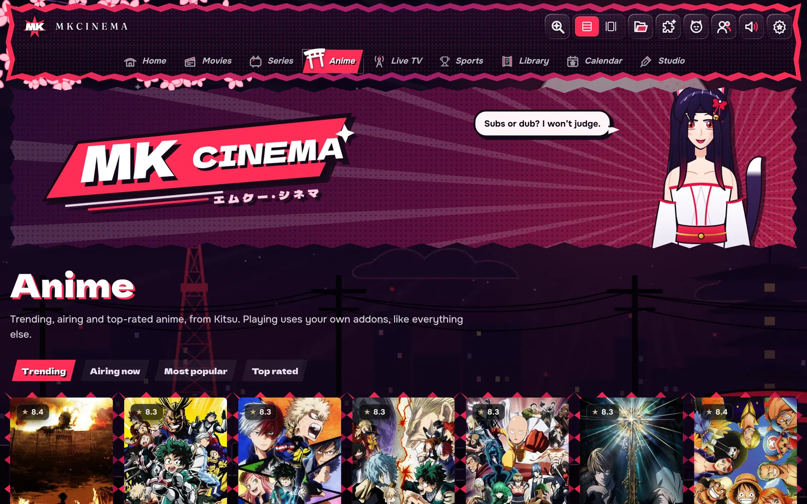<br><sub>The Anime tab: trending, airing now, most popular, top rated</sub></td>
<td width="40%" align="center">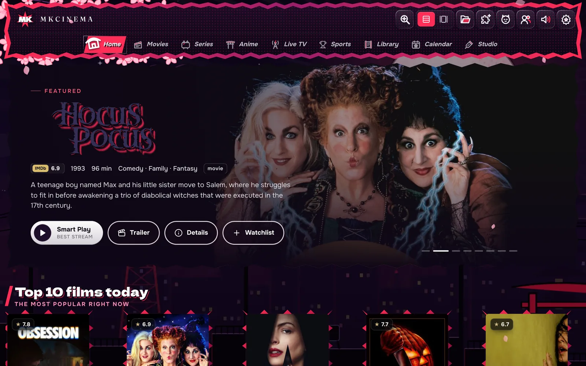<br><sub>The Anime look, with sakura and Miko</sub></td>
<td width="20%" align="center" rowspan="2">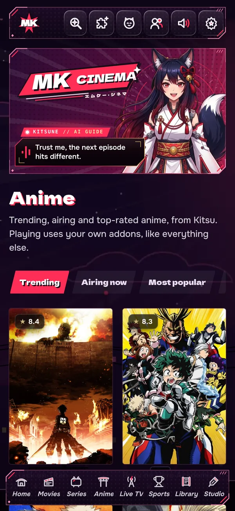<br><sub>Phones are first-class</sub></td>
</tr>
<tr>
<td align="center"><br><sub>The Audio tab: 200 % volume, Listen on phone and a film’s audio languages</sub></td>
<td align="center"><br><sub>On a TV: big type, a focus ring and remembered rows</sub></td>
</tr>
</table>

<table>
<tr>
<td width="40%" align="center">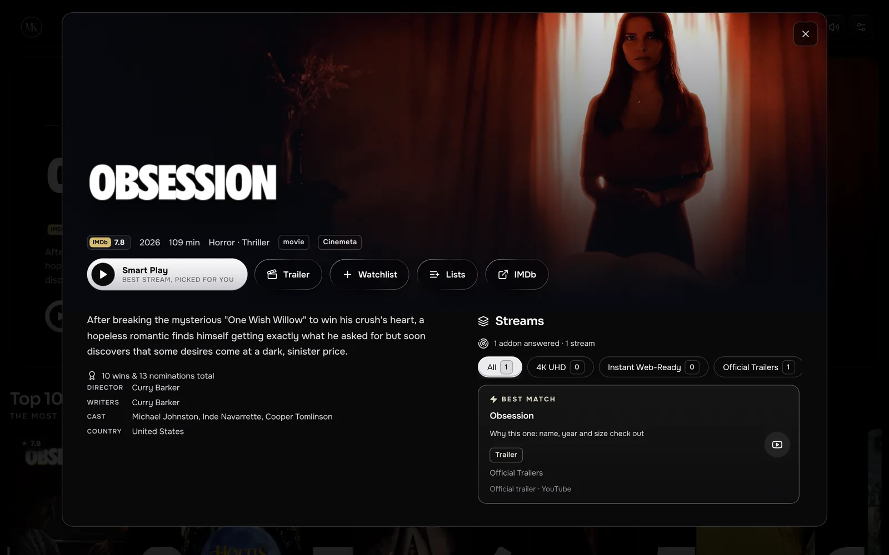<br><sub>Every pick says why</sub></td>
<td width="40%" align="center">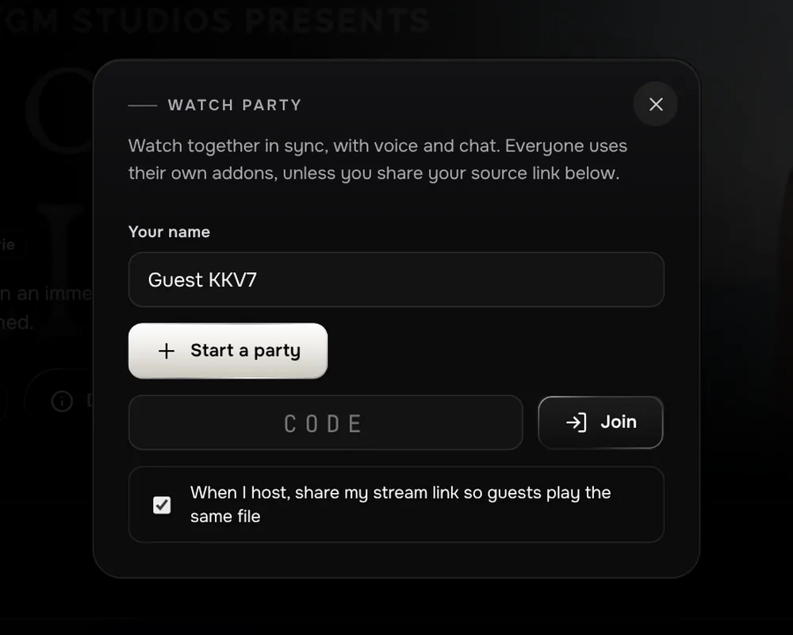<br><sub>Watch party with synced playback and voice</sub></td>
<td width="20%" align="center" rowspan="2">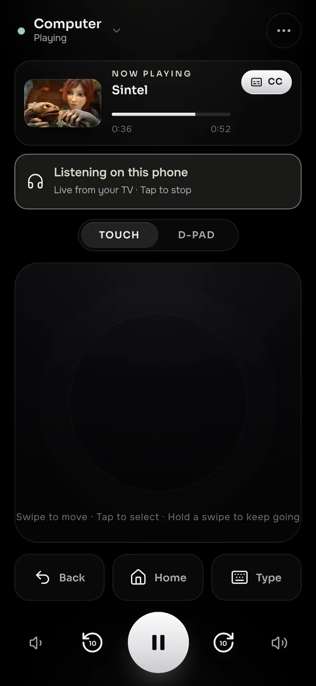<br><sub>Listen on phone</sub></td>
</tr>
<tr>
<td align="center">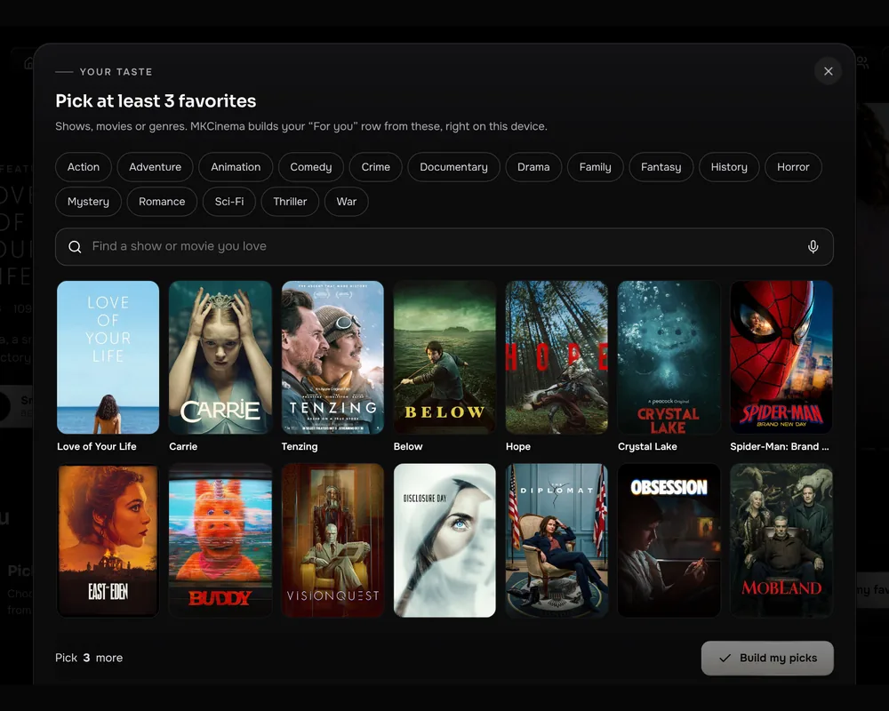<br><sub>Your Picks, built on your device</sub></td>
<td align="center">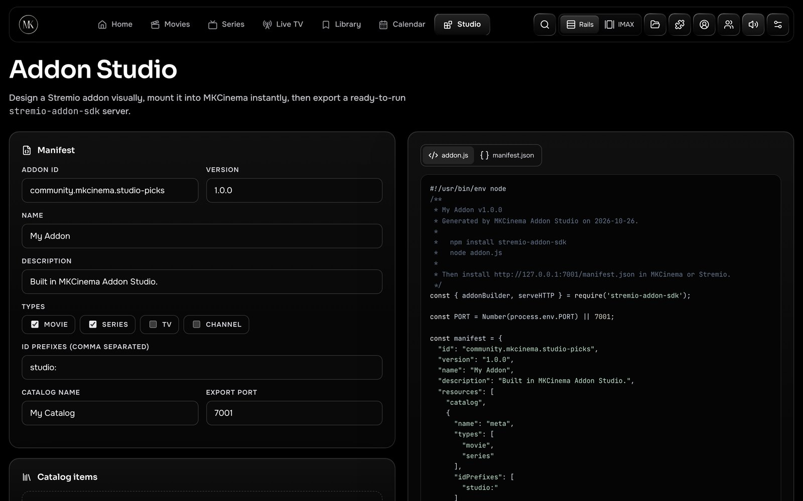<br><sub>Addon Studio: design a Stremio addon visually</sub></td>
</tr>
</table>

<p align="center"><sub>The player shots show <a href="https://studio.blender.org/films/sintel/">Sintel</a> © Blender Foundation, CC BY 3.0. Poster and backdrop art comes from the catalogues and belongs to its owners.</sub></p>

<a name="marquee"></a>
<p></p>

<p align="center">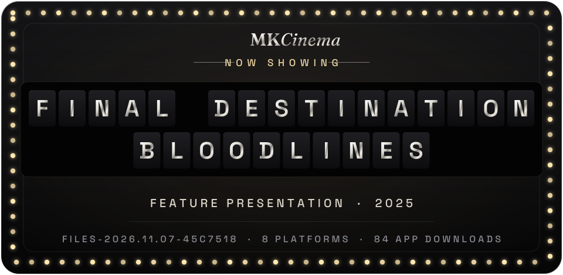</p>

<p align="center"><sub>A major film from 2025 and 2026 takes the marquee, a new one every day.</sub></p>

<a name="how"></a>
<p></p>

<p align="center">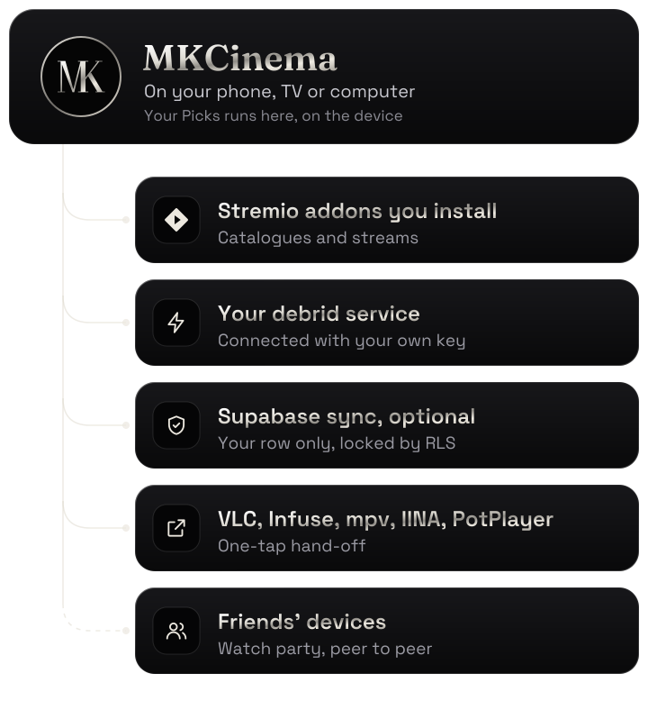</p>

- **Your keys stay yours.** Debrid keys live in your browser and, if you sign in, in your own Supabase row, which row-level security keeps readable only by you. You can turn sync off and keep them on one device.
- **No tracking.** No ads, no cookies and no profiles. The only measurement is an anonymous visit count (Cloudflare Web Analytics: page, browser, country, load speed), which you can turn off in Settings › Data. It never sees your addons, keys or what you watch, and Your Picks never sends your taste to an outside service.
- **Bring your own sources.** MKCinema only plays what your addons return. You are responsible for using them lawfully where you live.

### Repository

| Folder | What it is |
|---|---|
| [`app/`](app) | The web app (`index.html`), PWA files, the companion server (`mkcinema-server.js`), the Supabase schema (`supabase.sql`) and the debrid relay Edge Function. See [`app/README.md`](app/README.md). |
| [`site/`](site) | The website at [mkcinema-site.pages.dev](https://mkcinema-site.pages.dev). |
| [`android/`](android) | Android, Android TV, Google TV and Fire TV app: a full-screen WebView with intent hand-off to video players, a TV launcher banner and remote control support. `MKCinema.apk` and `MKCinema-TV.apk` are the same file. |
| [`webos/`](webos) | LG webOS app (beta): a hosted web app package. See [`webos/README.md`](webos/README.md). |
| [`tizen/`](tizen) | Samsung TV module for TizenBrew (beta): opens the web app and registers the remote's media keys. See [`tizen/README.md`](tizen/README.md). |
| [`windows/`](windows) | Windows app: Go and Microsoft Edge WebView2. |
| [`mac/`](mac) | Mac app: WKWebView through JavaScript for Automation, packaged as a .zip (and a .dmg when the dmg tools are installed). |
| [`linux/`](linux) | Linux app: C and WebKitGTK 4.1, packaged as .deb and .tar.gz. |

<a name="build"></a>
<p></p>

<details>
<summary><b>Web app and companion server</b></summary>

```sh
cd app
npm install
node mkcinema-server.js
# App:   http://127.0.0.1:7000/
# Addon: http://127.0.0.1:7000/manifest.json
```

The server adds official trailers as a source, a CORS proxy for streams that need headers, and audio rescue (EAC3, AC3, DTS and TrueHD to AAC) when ffmpeg is installed. The app also runs as static files on any host, such as Cloudflare Pages.
</details>

<details>
<summary><b>Android</b></summary>

Needs the Android SDK (build-tools 35 and platform 35) and JDK 17 or later. Create your own signing key first:

```sh
cd android
mkdir -p keystore && openssl rand -base64 24 > keystore/password.txt
keytool -genkeypair -keystore keystore/mkcinema.jks -storepass "$(cat keystore/password.txt)" \
  -alias mkcinema -keyalg RSA -keysize 4096 -validity 10000 -dname "CN=MKCinema"
ANDROID_HOME=~/Android/Sdk sh build.sh   # writes build/MKCinema.apk
```

Change `package` in `AndroidManifest.xml` for your own fork so it doesn't clash with official releases.
</details>

<details>
<summary><b>LG webOS</b></summary>

```sh
npx @webos-tools/cli ares-package webos -o build   # writes build/com.mkcinema.app_1.1.0_all.ipk
```

Install it on a TV in Developer Mode with `ares-install`. See [`webos/README.md`](webos/README.md).
</details>

<details>
<summary><b>Windows</b></summary>

Builds from Windows, Linux or macOS with Go 1.24 or later. See [`windows/BUILD.md`](windows/BUILD.md).

```sh
cd windows
go install github.com/akavel/rsrc@latest
rsrc -arch amd64 -ico mkcinema.ico -manifest app.manifest -o rsrc_windows_amd64.syso
GOOS=windows GOARCH=amd64 CGO_ENABLED=0 go build -trimpath -ldflags "-s -w -H windowsgui" -o MKCinema.exe .
```
</details>

<details>
<summary><b>macOS</b></summary>

The app is a standard `.app` bundle that runs `main.js` with the system's JavaScript for Automation, so it needs no compiler. To package it on Linux, install `hfsprogs` and build [mozilla/libdmg-hfsplus](https://github.com/mozilla/libdmg-hfsplus), then:

```sh
cd mac
DMGTOOLS=/path/to/libdmg-hfsplus/build sh package.sh   # writes build/MKCinema-1.1-mac.zip (and .dmg)
```
</details>

<details>
<summary><b>Linux</b></summary>

```sh
sudo apt install gcc libwebkit2gtk-4.1-dev python3-pil
cd linux
sh package.sh   # writes build/mkcinema_1.0_amd64.deb and the .tar.gz
```
</details>

<a name="faq"></a>
<p></p>

<details>
<summary><b>Does MKCinema provide movies or shows?</b></summary>

No. MKCinema hosts and links to no content. It plays what your own addons return, plus official trailers.
</details>

<details>
<summary><b>Which debrid service and player should I use?</b></summary>

Use the debrid service you already have, or compare a few and pick the one that suits you. MKCinema works with all the common ones. For a player, **VLC** is the easy choice: it's free and plays almost any file. Settings › Get started walks you through both.
</details>

<details>
<summary><b>Do I need an account?</b></summary>

No. Everything works without one. Sign in with email only if you want sync between devices.
</details>

<details>
<summary><b>Is iPhone supported?</b></summary>

No. iPhone and iPad are not supported platforms.
</details>

<details>
<summary><b>Can I move from Stremio?</b></summary>

Yes. Settings › Account › Import from Stremio copies your library, progress and addons. Your Stremio password is used once and never stored.
</details>

<a name="support"></a>
<p></p>

<p align="center">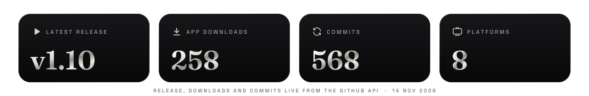</p>

MKCinema is made by **Drake Christopher**, with no ads and no paid tier. If it has become your favourite way to watch, you can help in three ways:

- **Star the repo.** It's free and helps other people find MKCinema.
- **Share it** with a friend who still juggles five apps to watch one film.
- **Donate** on Ko-fi, one-off or monthly, by card or PayPal, to keep it growing.

<p align="center"><a href="https://ko-fi.com/mkcinema"></a></p>

### Contributing

Bug reports, ideas and pull requests are welcome. Read [CONTRIBUTING.md](CONTRIBUTING.md) first, and report security problems privately as described in [SECURITY.md](SECURITY.md).

### License

MKCinema is free software under the [GNU General Public License v3.0](LICENSE), created by Drake Christopher. You may study, change and share it under that license, with the extra terms in [NOTICE](NOTICE) that GPL-3.0 section 7 allows: forks must credit MKCinema and its author, must say they are modified, and must use their own name and icon, because the MKCinema name and MK logo are not covered by the license. Local file playback ideas are adapted from [addyosmani/webvlc](https://github.com/addyosmani/webvlc) (MIT). The README artwork is drawn by [`.github/readme/generate.py`](.github/readme/generate.py) with Fraunces and Space Grotesk (SIL Open Font License) and brand marks from [Simple Icons](https://simpleicons.org) (CC0).

MKCinema is an independent project and is not affiliated with or endorsed by Stremio. Stremio, VLC and other names and logos belong to their owners and are used only to describe compatibility.

<p align="center"><a href="#top">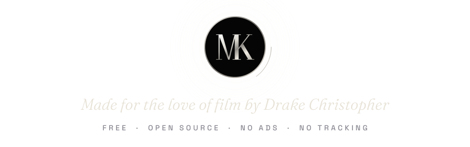</a></p>
