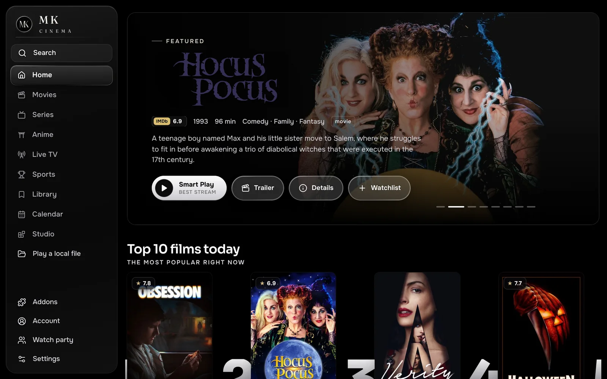
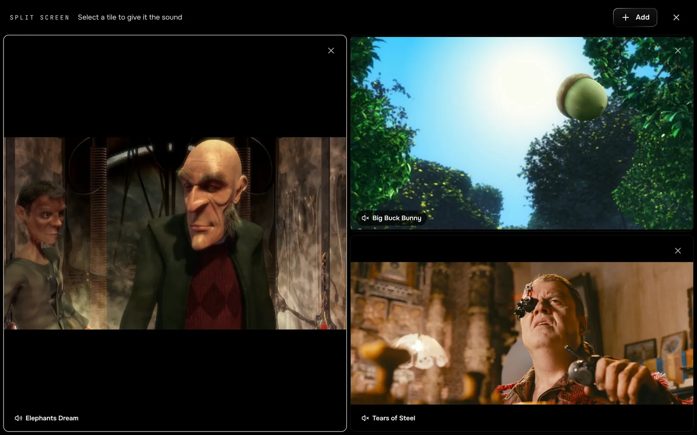
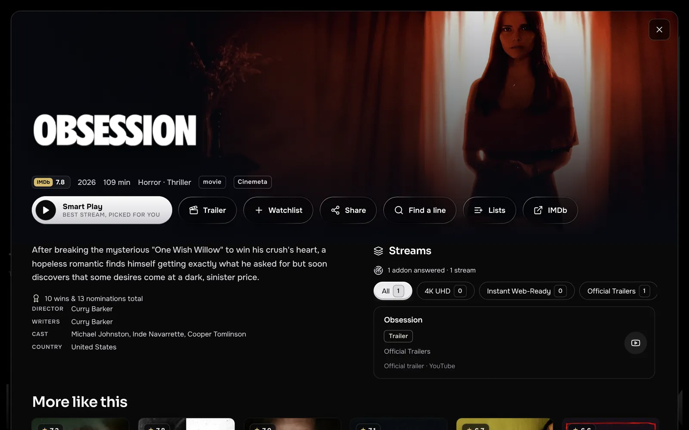
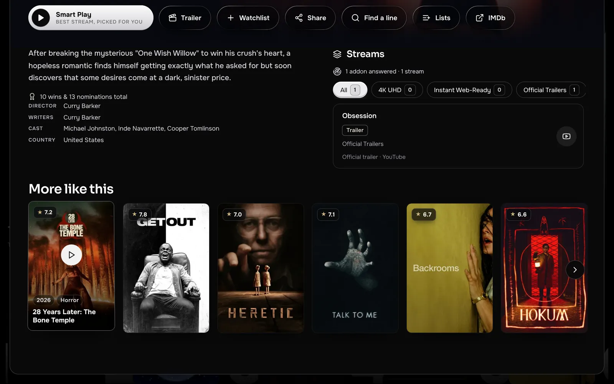
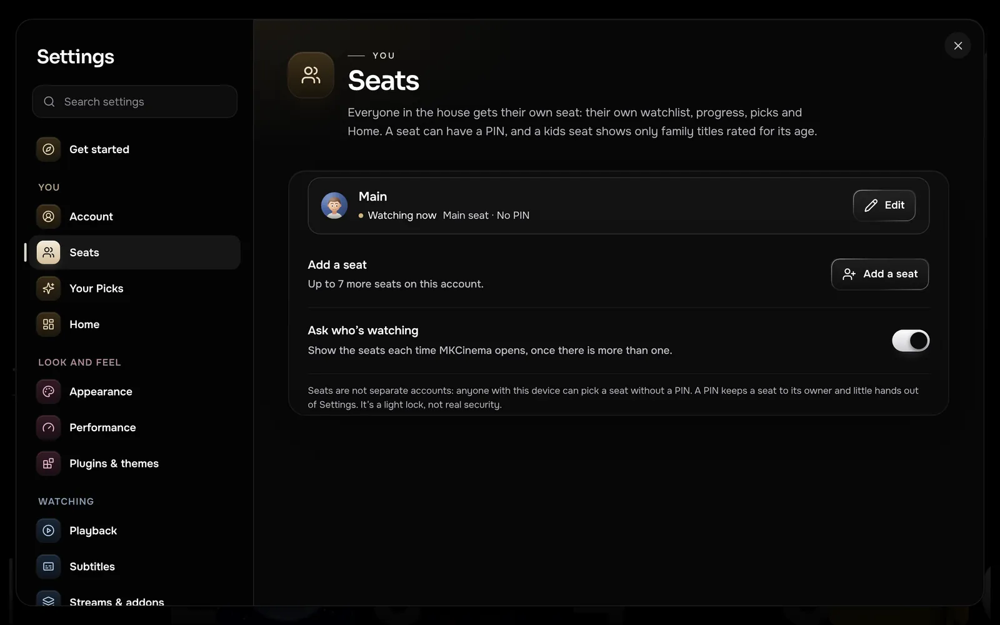
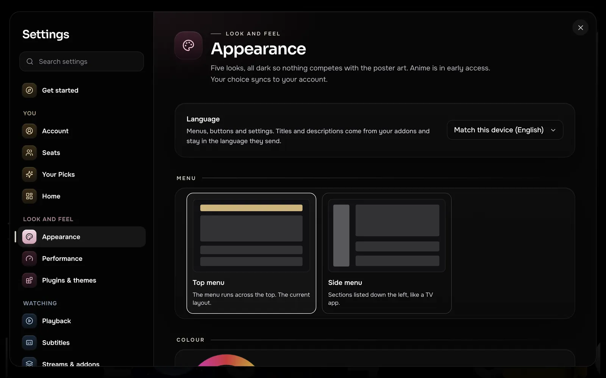
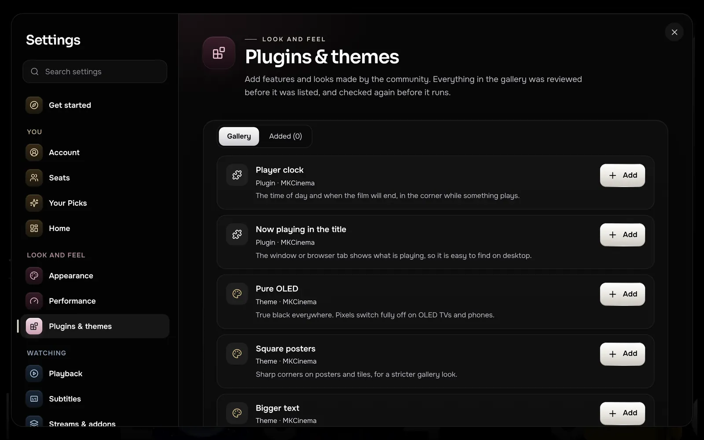
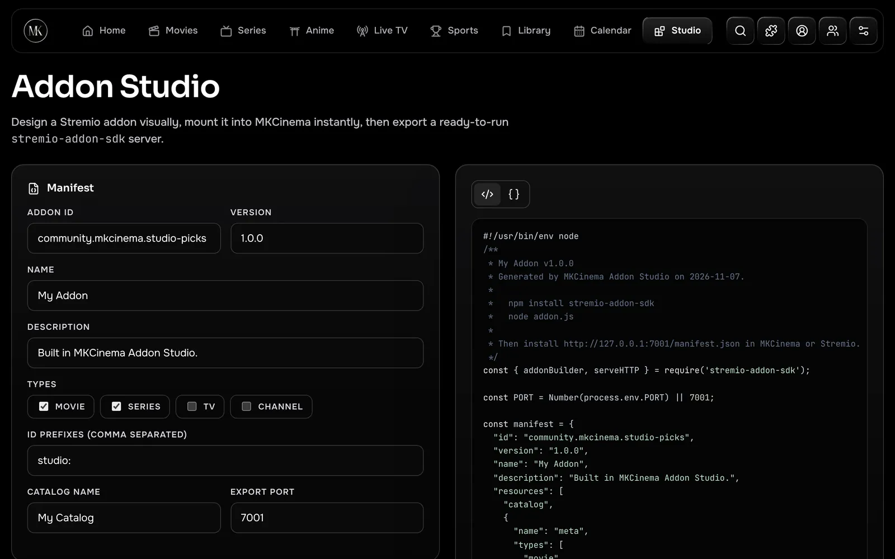
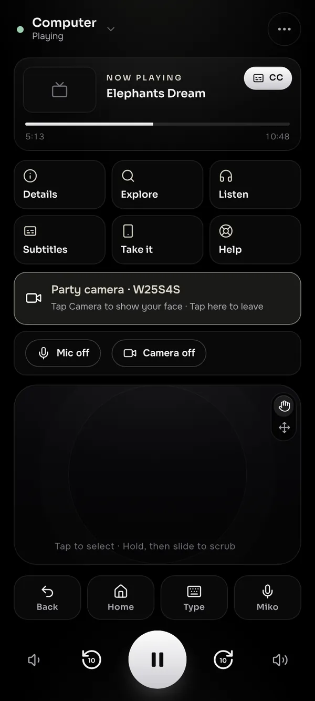

<p align="center">
  <a href="https://mkcinema.app"></a>
</p>

<h1 align="center">MKCinema</h1>

<p align="center">
  <b>Your addons look better here.</b><br>
  A free, open-source player for Stremio addons, built for phones, computers and TVs.<br>
  <i>No ads. No paywalls. No tracking. Just your addons, at their best.</i>
</p>

> [!IMPORTANT]
> **Web 2.45 is live.** Ratings addons now show real IMDb, TMDB and Rotten Tomatoes scores, debrid notice clips are caught, and SDK addons get a settings screen, all with no changes from the addon's developer. [See what's new](CHANGELOG.md).

<p align="center">
  
  <a href="LICENSE"></a>
  <a href="https://github.com/itbelikethatbruh/MKCinema/releases/latest"></a>
  <a href="https://github.com/itbelikethatbruh/MKCinema/releases"></a>
  <a href="https://github.com/itbelikethatbruh/MKCinema/commits/main"></a>
  <a href="https://ko-fi.com/mkcinema"></a>
</p>

<p align="center">
  <a href="https://app.mkcinema.app"><b>Open the web app</b></a> ·
  <a href="docs/install.md"><b>Download</b></a> ·
  <a href="https://mkcinema.app">Website</a> ·
  <a href="#what-makes-mkcinema-different"><b>What makes it different</b></a> ·
  <a href="docs/features.md">Features</a> ·
  <a href="CHANGELOG.md">Changelog</a> ·
  <a href="https://ko-fi.com/mkcinema">Ko-fi</a>
</p>

---

## Showcase

<p align="center"></p>

<p align="center"><br><sub>Split Screen: up to four streams at once, and the sound follows the tile you pick</sub></p>

<table>
<tr>
<td width="50%" align="center"><br><sub>Film page: Smart Play, Find a line, sources from every addon</sub></td>
<td width="50%" align="center"><br><sub>More like this on every film page</sub></td>
</tr>
<tr>
<td width="50%" align="center"><br><sub>The player: audio languages, 200% volume, Listen on phone</sub></td>
<td width="50%" align="center"><br><sub>On a TV: built for the remote</sub></td>
</tr>
<tr>
<td width="50%" align="center"><br><sub>Seats for everyone in the house, with PINs and kids seats</sub></td>
<td width="50%" align="center"><br><sub>Five looks, a colour wheel, top or side menu</sub></td>
</tr>
<tr>
<td width="50%" align="center"><br><sub>Plugins and themes from a reviewed gallery</sub></td>
<td width="50%" align="center"><br><sub>Addon Studio: build a Stremio addon visually</sub></td>
</tr>
<tr>
<td width="50%" align="center"><br><sub>The Anime look</sub></td>
<td width="50%" align="center"><br><sub>Watch parties with synced playback and voice</sub></td>
</tr>
</table>

<table>
<tr>
<td width="33%" align="center"><br><sub>Your phone as a remote, no app needed</sub></td>
<td width="33%" align="center"><br><sub>Listen on phone</sub></td>
<td width="33%" align="center"><br><sub>Phones are first-class</sub></td>
</tr>
</table>

<p align="center"><sub>Player and Split Screen shots show <a href="https://studio.blender.org/films/">Blender open movies</a> (CC BY). Poster and backdrop art comes from the catalogs and belongs to its owners.</sub></p>

## What makes MKCinema different

**Things we haven't seen in any other player.** Every one of these is live in MKCinema today.

### Your addons, made better

They work better in MKCinema with no changes from the people who make them.

| Feature | What it does |
|---|---|
| **Real ratings** | Ratings addons that show their scores as rows in the source list become IMDb, TMDB and Rotten Tomatoes ratings on the title line, with a rating next to every episode. |
| **No more notice clips** | When a debrid addon plays a 20 or 30 second notice video instead of the film, MKCinema explains the problem in plain words and moves on to the next source. |
| **Settings screens** | Addons built with the Stremio addon SDK that describe their settings get a proper settings form, which works with a TV remote and keeps the addon in place in your list. |

### It knows the line, not just the second

MKCinema follows a film by its dialogue, so it knows where you are in any version of it.

| Feature | What it does |
|---|---|
| **Watch party on any version** | Friends can each use their own source, even a different release or frame rate. MKCinema lines everyone up by the dialogue. |
| **Find a line** | Type words someone says and play from that moment, in the player or on a film's page. |
| **Subtitles on your phone** | Everyone reads their own language on their own phone, in step with the TV. |
| **Same line on any source** | Resume and automatic source switching land on the line you left, even on a different version. |
| **Share this moment** | A link that opens your friend's MKCinema at the same line, on whatever source they have. |
| **Couch match** | Everyone swipes on their phone, and the first title you all like plays on the TV. |

### For addon developers who want more

One optional, data-only `mkcinema` field in your manifest. MKCinema draws everything with its own components, addon code never runs, and other apps simply ignore it.

| Feature | What it does |
|---|---|
| **Addon looks** | Row styles (poster, wide, square, Top 10) and where catalogs appear: Home, Discover or Library. |
| **Badges and panels** | Poster badges, film-page info panels and per-episode ratings on any title. |
| **Library sync** | Your lists as Library tabs, and a copy of the viewer's watchlist if they allow it. |
| **Playback events and skips** | Start, pause and finish events, plus intro, recap and credit times. |

Specs: [addon looks](docs/addon-looks.md) and [addon extras](docs/addon-extras.md).

## About

MKCinema is an independent project, designed, built and maintained by one developer, Dee Lavish. There is no company or team behind it. Everything in this repository was built for MKCinema:

- **The player.** A full video player with HLS and direct playback, styled anime subtitles, an audio engine with sound modes and volume boost, skip markers, X-Ray, touch gestures and automatic source failover.
- **The addon engine.** It speaks the Stremio addon protocol, queries every addon in parallel, ranks and checks sources, and handles debrid accounts.
- **The apps.** One web app plus native apps for Android, Android TV and Fire TV, Windows, macOS, Linux, LG webOS and Samsung TVs, all sharing one codebase.
- **The services around it.** Account sync, a phone remote, watch parties with voice, a subtitle translation service, and the website.
- **Tools for addon developers.** A visual addon builder, an addon finder, and an optional manifest field that lets addons shape how they look.

It is free forever. MKCinema will never charge for anything: no paid tier, no ads and no feature behind a paywall. If you'd like to support the work, you can [donate on Ko-fi](https://ko-fi.com/mkcinema). Donations are optional and unlock nothing.

MKCinema ships no titles or streams. Catalogs come from Cinemeta, subtitles from OpenSubtitles, and the only built-in source is official trailers. Everything else comes from addons and debrid accounts you add yourself.

## What's built

Everything below is live today. ★ marks the features we haven't seen in any other player.

### Addons

- **Stremio addon compatible.** Install any addon by link, reorder them, switch them off. Results show from each addon as it answers.
- **★ Addons as they are, made better.** Ratings rows become real ratings on the title line and next to each episode. Debrid notice clips are explained in plain words, and the next source plays. Addons built with the SDK get a proper settings form, which works with a TV remote.
- **Find addons.** Search the community addon list in the app and install most in one press. Filter by streams, catalogs, subtitles and anime.
- **★ Addon Studio.** Design an addon visually, mount it into MKCinema instantly, then export a ready-to-run addon SDK server.
- **One-tap install** from addon setup pages, and stremio:// Install links open the Android app.
- **Manage addons from your phone.** The TV's Addons screen shows a QR code, and you paste or edit addon links on the phone.
- **Import from Stremio.** Addons, library, Continue watching and watched episodes come over in one step. The password is never stored.
- **Your own media servers.** Plex, Jellyfin and Emby films and episodes show up as sources next to your addons.

### Sources and debrid

- **Debrid built in.** Bring your own key from any debrid service. Cached results are marked and play straight away. Keys sync only to your own account row, or stay on one device.
- **Smart Play.** One tap starts the best source, beginning with the first one that's ready.
- **★ Automatic failover.** If a source stalls or has no picture, the next one takes over by itself.
- **Source Check.** Hides executables, archives, samples, password-locked files and wrong episodes, and flags cinema recordings and screeners.
- **Source rules.** Lowest resolution, largest and smallest file size, HDR preference, preferred audio language, and blocked words.
- **Fold duplicate sources.** The same file from several addons is shown once.
- **Browser only mode.** Lists only the sources your browser can play with picture and sound.
- **Hand-off to any player.** VLC, mpv, Infuse, MX Player, Just Player, IINA and PotPlayer. Only players your device supports are listed. Back from VLC lands on the film page.
- **Slow internet mode** and a **line check** that suggests a quality for your connection.

### The player

- **Rebuilt player.** Edge to edge, with options in Playback, Picture, Audio and More tabs.
- **Volume to 200 %** through the audio engine.
- **Sound modes.** Clear voices and Night, with Original one tap away.
- **Audio delay** control, and an instant audio-language pick.
- **Picture adjustments.** Brightness, contrast and colour, with Vivid, Lift dark scenes and Soft presets.
- **★ Sharp upscaling.** Low-resolution video is redrawn on the device's GPU instead of stretched. Off by default, phone and PC only.
- **Phone gestures.** Hold for 2× speed, swipe for brightness and volume, swipe sideways to seek.
- **Skip Intro, recap and credits**, anime included (AniSkip), plus scene skips that addons provide.
- **Next episode** countdown, with the next source found a few minutes early.
- **X-Ray.** Pause to see the cast, actor pages, About (Wikipedia, release facts, awards) and This scene.
- **Player tools.** Sleep timer with fade, A-B repeat, save a still frame, frame by frame, seek previews, playback stats (I), a shortcut sheet (?) and bookmarks.
- **Remembers** your speed for each title and your subtitle timing for each file.
- **Lock-screen and media keys** on phones, headphones, keyboards and remotes.
- **Picture-in-picture** in the Android app.
- **Send to TV.** Cast to Chromecast or Google TV (AirPlay where the browser offers it).
- **Spoiler Guard** hides synopses of episodes you haven't seen.

### Subtitles

- **Styled anime subtitles** (ASS/SSA) with fonts, signs, positions and karaoke, right in the browser.
- **Subtitles inside MKV files**, plus OpenSubtitles and subtitle addons in one tidy list without repeats.
- **★ Subtitles line up by themselves.** A downloaded subtitle is matched against the file's own subtitles. There's also a drag-to-sync strip.
- **Subtitles in your language.** Translated line by line when none exists, and marked Translated.
- **Signs & Songs with dubs**.
- **Second subtitles**, plus text size and fonts.

### Dialogue-aware features

- **★ Watch party on any version.** Friends can use different releases or frame rates, and everyone is lined up by the dialogue.
- **★ Find a line.** Type words someone says and play from that moment.
- **★ Subtitles on your phone.** Everyone reads their own language on their own phone, in step with the TV.
- **★ Same line on any source.** Resume and failover land on the line you left, even on a different version.
- **★ Share this moment.** A link or QR code that opens a friend's MKCinema at the same line, on their own source.
- **★ Couch match.** Everyone swipes on their phone, and the first title you all like plays on the TV.
- **Last time…** The last lines before you stopped show when you come back after a few days.
- **Never miss a line.** After a pause, playback picks up at the start of the sentence.
- **Shows per day for kids.** A daily limit that stops at the end of an episode, never mid-scene.

### Together

- **Watch party.** Six-letter rooms with play, pause and seek in sync, chat, reactions, push-to-talk voice with its own volume, and the film dips while people talk. The host can hand over. No extension needed.
- **★ Listen on phone.** The film plays on the TV and the sound plays on your phone and headphones. No app to install.
- **Phone remote.** Scan the TV's code for a touchpad or D-pad, keyboard and voice search. The TV asks before a new phone can take control.
- **Party voice on your phone.**

### Discover and Home

- **Home.** Continue watching, watchlist, Top 10 films today, Networks (real service logos), Universes (142 franchises, every film in order), popular rows, Your Picks, the Shortlist, Under 90 minutes, Hidden gems, Award winners, and a decade of the day.
- **★ Arrange Home.** Hide, move or rename any row, addon catalogs included.
- **Endless rows** that keep loading as you scroll.
- **More like this** on every film page.
- **Scores from other sites**, and **Where to watch** for your region, with awards.
- **Your Picks.** An on-device For you row. Ask in plain words, like "funny crime series". Nothing leaves the device.
- **Peak Cinema.** Surf 90-second scenes by mood, and Keep watching opens the film at that second.
- **MDBList rows** with your own key.
- **Official trailers**, playing in the YouTube app on TVs.

### Library and tracking

- **Library.** Watchlist, In progress, Watched and your own lists, with sorting and filters. Addon lists can be Library tabs.
- **Airing calendar** of new episodes for the series you follow.
- **New-episode alerts**, checked on your own device.
- **Sync everywhere.** Library, progress, addons, settings and Home layout, merged across devices.
- **Trakt and Simkl** scrobbling, and **AniList and MyAnimeList** progress.
- **Downloads.** Save films and episodes on phones, tablets, Windows and TVs, and play your computer's downloads on your TV.
- **Backup code.** Addons, Studio project, settings, watchlist, progress and Home layout in one mkc:// code.

### Live TV, Sports and Split Screen

- **★ Split Screen.** Up to four channels or streams at once (two on TVs and phones). Sound follows the tile you select. Open it from Live TV or any film page.
- **Live TV & Guide.** Your own M3U playlist, Xtream login or file, with an XMLTV guide grid and search. Channels from addons too.
- **Sports.** Live sports from your own sources, sorted by sport.

### Looks

- **Five looks.** Noir (default), Midnight, Velvet, Sepia and Anime, plus a **colour wheel** that tints the whole app.
- **Anime look.** Manga frames, a comic edition, and Kitsune, the mascot with an animated HUD.
- **Fonts** (Studio, Editorial, Classic, Wide, Condensed, Rounded, Deco, Slab, Techno), **text size**, and a top menu or side menu.
- **Custom poster URL** for poster services such as Pictorium, by Eful97.
- **Plugins & themes.** A reviewed, signed gallery (Player clock, Pure OLED, Square posters and more). Every file is checked before it runs.
- **Ambient Mode.** A screensaver of layered film art.
- **Seven languages.** English, Español, Português (BR), Français, Deutsch, Italiano and हिन्दी.
- **Discord status** in the Windows app.

### Household

- **Seats.** A seat for everyone, each with its own watchlist, progress and picks, seat pictures and an optional PIN.
- **Kids seats by age rating**, with a grown-up PIN to leave them and a daily shows limit.

### Anime

- **Anime tab** with Trending, Airing now, Most popular and Top rated (Kitsu).
- **Skip openings and endings** with any addon, styled subtitles, Signs & Songs with dubs, and AniList and MyAnimeList sync.

### Apps and devices

- **Web app** at app.mkcinema.app: Chrome, Edge and Firefox on any computer.
- **Android** (ExoPlayer-based built-in player, picture-in-picture, background downloads, one-tap updates).
- **Android TV and Fire TV.** Hardware player with MKV, HEVC, HDR and Dolby Vision, frame-rate matching, a remote-first interface, voice search, and Downloader code `tv.mkcinema.app`.
- **LG webOS** (beta) and **Samsung** via TizenBrew (beta).
- **Windows, Mac and Linux** apps.
- **Offline-friendly** start, and an update bar when a new version is out.

### Trust

- **Free forever.** No paid tier, no ads, nothing locked. Ko-fi donations are optional and unlock nothing.
- **Open source, GPL-3.0.**
- **Private.** Picks are on-device, there are anonymous visit counts only (they can be switched off), and no account is needed.
- **Help built in.** Troubleshooting guide, Diagnostic, Send log codes, a status page with service notices, and terms and privacy inside the app.

## Platforms

| Platform | Package | Notes |
|---|---|---|
| Web | [app.mkcinema.app](https://app.mkcinema.app) | Installable as a PWA |
| Android | [APK](https://github.com/itbelikethatbruh/MKCinema/releases/latest) | Phones and tablets |
| Android TV, Google TV, Fire TV | [APK](https://github.com/itbelikethatbruh/MKCinema/releases/latest) | Fire TV: enter `tv.mkcinema.app` in Downloader |
| Windows | [EXE](https://github.com/itbelikethatbruh/MKCinema/releases/latest) | Not code-signed yet |
| macOS | [ZIP](https://mkcinema.app/download/MKCinema-1.1.1-mac.zip) | Not notarized yet |
| Linux | [DEB, tar.gz](https://github.com/itbelikethatbruh/MKCinema/releases/latest) | x86_64, WebKitGTK 4.1 |
| LG webOS | [IPK](https://github.com/itbelikethatbruh/MKCinema/releases/latest) | Beta, needs Developer Mode |
| Samsung Tizen | [TizenBrew module](tizen/README.md) | Beta, 2023 models and later |

iOS is not supported. Per-platform install notes are in [docs/install.md](docs/install.md).

## Architecture

```
  native apps ──load──► web app (app/index.html) ──HTTP──► Stremio addons
  (Android, Windows,     UI, addon engine, player  ──────► debrid APIs (relay where CORS blocks)
   macOS, Linux, TV)                               ──────► Supabase auth + per-user row (optional)
```

- **Web app** (`app/`): a single-page app served as static files from Cloudflare Pages. The native apps load the same hosted build, so every platform updates together.
- **Native shells:** Android (Java WebView with intent hand-off to video players), Windows (Go and WebView2), macOS (WKWebView through JavaScript for Automation) and Linux (C and WebKitGTK). Android and Windows add downloads.
- **Sync:** optional email sign-in through Supabase Auth. Each user's data lives in one row protected by row-level security, and debrid keys can be kept on the device only.
- **Companion server** (`app/mkcinema-server.js`, optional): a local trailer addon, a CORS proxy for streams that need headers, and audio transcoding when ffmpeg is installed.

## Building

```sh
cd app
npm install
node mkcinema-server.js   # app at http://127.0.0.1:7000/
```

The web app also runs from any static host. Build steps for Android, Windows, macOS, Linux and webOS are in [docs/install.md](docs/install.md#build-from-source).

## Repository layout

| Path | Contents |
|---|---|
| [`app/`](app) | Web app, PWA files, companion server, Supabase schema and Edge Functions |
| [`android/`](android) | Android, Android TV and Fire TV app |
| [`windows/`](windows), [`mac/`](mac), [`linux/`](linux) | Desktop apps |
| [`webos/`](webos), [`tizen/`](tizen) | LG and Samsung TV packages |
| [`site/`](site), [`tv-site/`](tv-site) | Website and the Fire TV download page |
| [`plugins/`](plugins) | Reviewed community plugins and themes |
| [`docs/`](docs) | Features, install guide and addon developer specs |
| [`tools/`](tools) | Release and build tooling |

## Privacy

The only measurement is an anonymous visit count from Cloudflare Web Analytics, which can be turned off in Settings › Data. It never sees your addons, keys or what you watch. MKCinema only plays what your addons return, and you are responsible for using them lawfully where you live. See the [terms of use](https://app.mkcinema.app/terms.html) and [privacy policy](https://app.mkcinema.app/privacy.html).

## Contributing

Issues and pull requests are welcome. Read [CONTRIBUTING.md](CONTRIBUTING.md) first, and report security issues privately as described in [SECURITY.md](SECURITY.md). If MKCinema is useful to you, a star helps other people find it.

## License

[GPL-3.0](LICENSE), with additional terms under section 7 in [NOTICE](NOTICE): forks must credit MKCinema and its author, mark themselves as modified, and use their own name and icon. Created by Dee Lavish.

MKCinema is an independent project and is not affiliated with or endorsed by Stremio. Third-party names are used only to describe compatibility.
