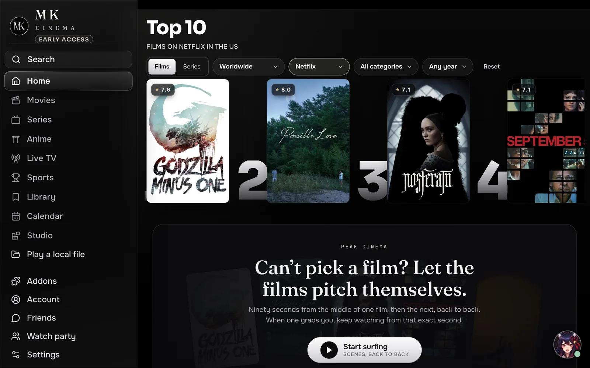
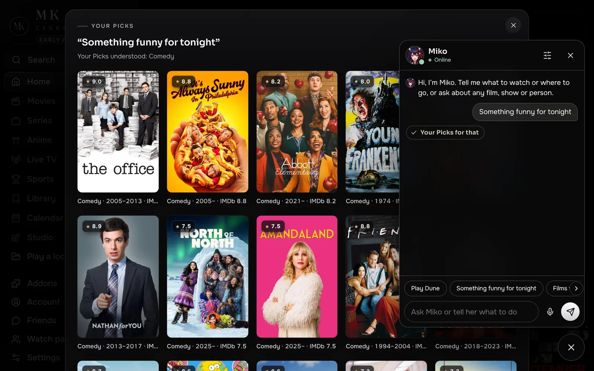
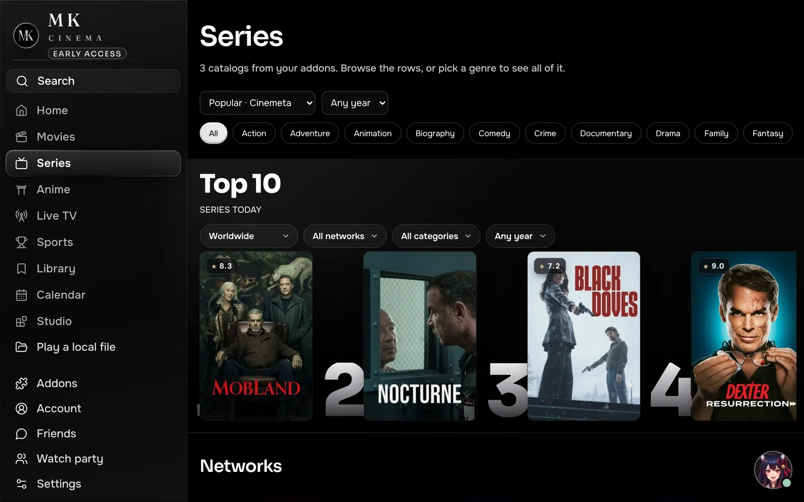
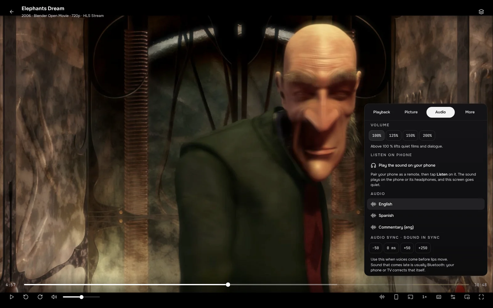
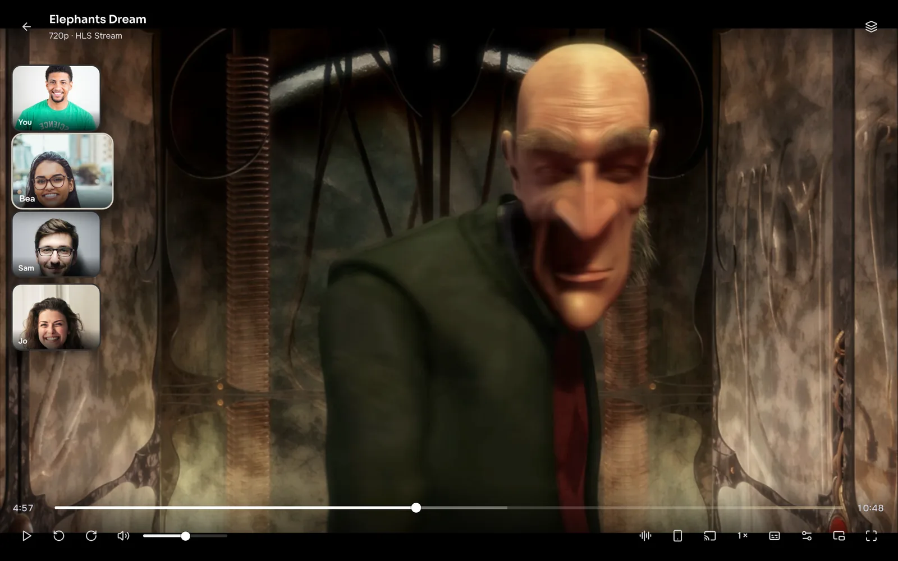
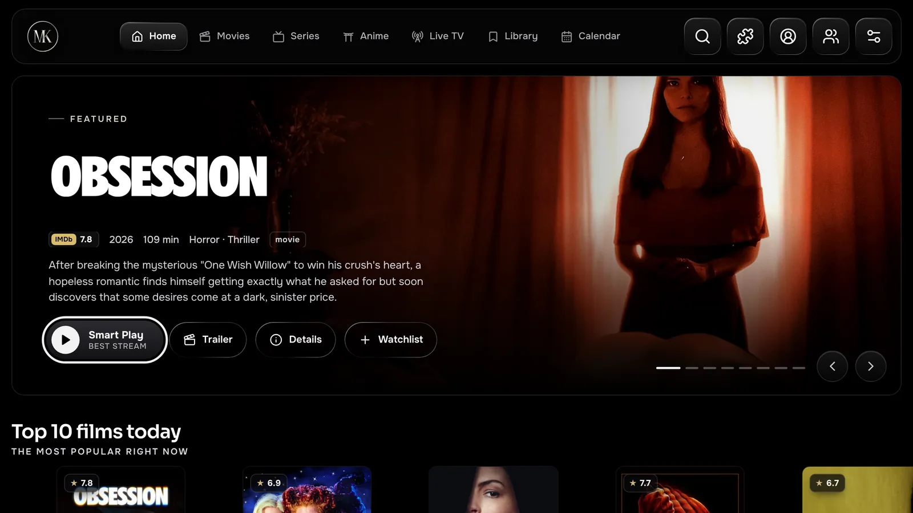
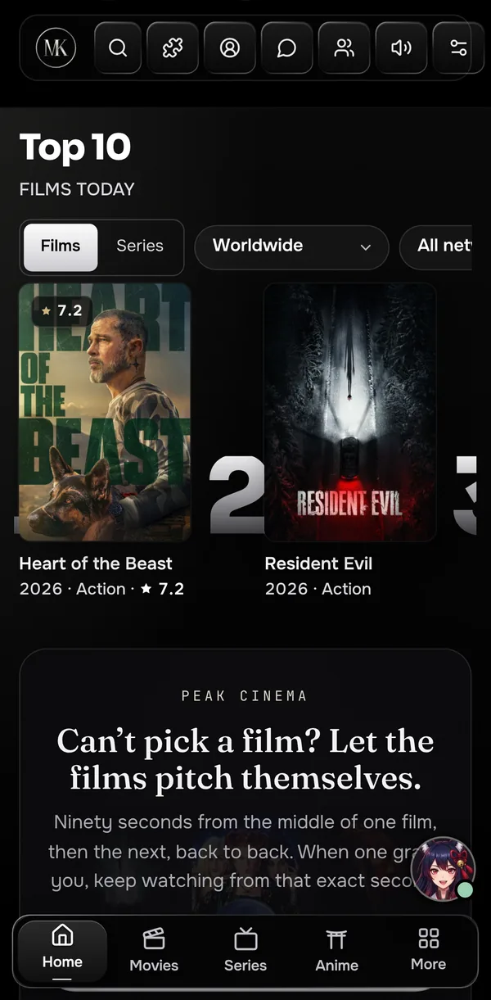
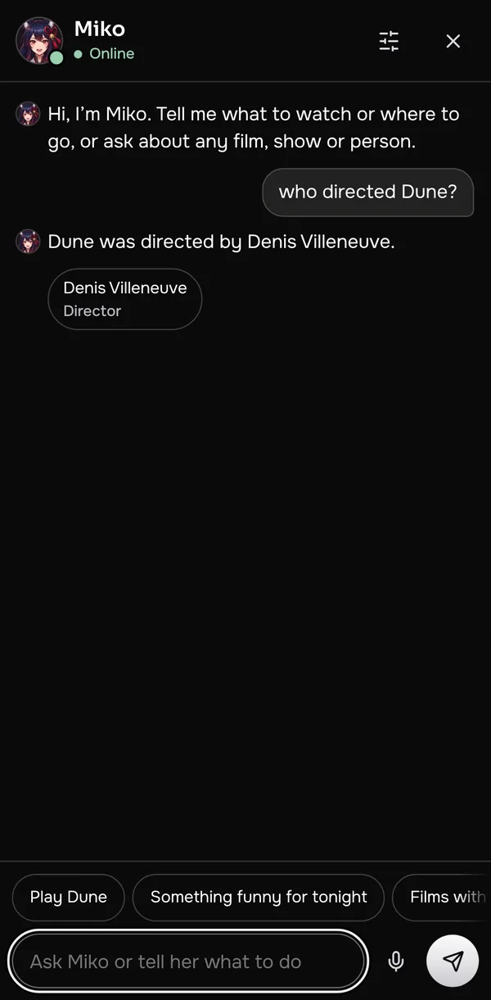
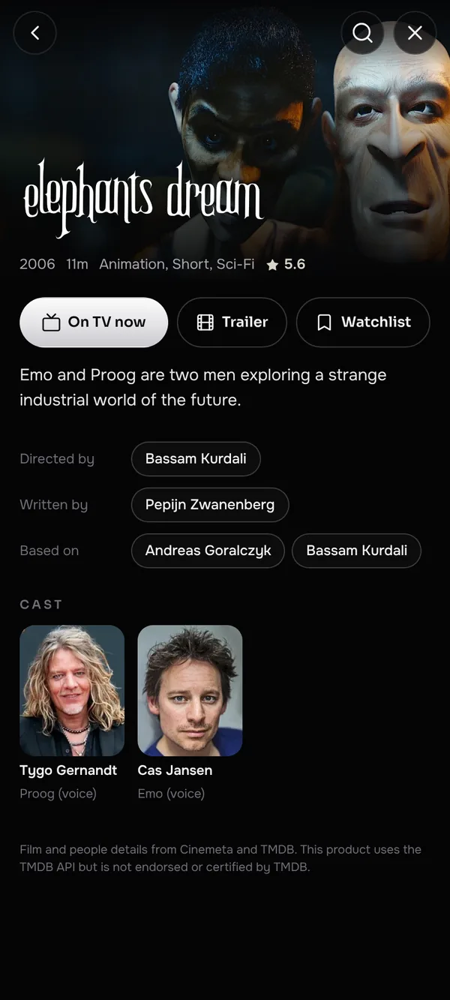

<p align="center">
  <a href="https://mkcinema.app"></a>
</p>

<h1 align="center">MKCinema</h1>

<p align="center">
  <b>Tomorrow's cinema. For the whole house.</b><br>
  A free home cinema app for the whole family, on every screen you own.
</p>

<p align="center">
  <a href="https://app.mkcinema.app"></a>
  <a href="https://github.com/itbelikethatbruh/MKCinema/releases/latest"></a>
  <a href="https://github.com/itbelikethatbruh/MKCinema/releases"></a>
  
  <a href="LICENSE"></a>
  <a href="https://ko-fi.com/mkcinema"></a>
</p>

<p align="center">
  <a href="https://app.mkcinema.app"><b>Open MKCinema</b></a> ·
  <a href="#get-mkcinema"><b>Download</b></a> ·
  <a href="https://mkcinema.app">Website</a> ·
  <a href="#everything-inside">Everything inside</a> ·
  <a href="docs/features.md">FAQ</a> ·
  <a href="CHANGELOG.md">What's new</a>
</p>

<p align="center"></p>

MKCinema brings everything you watch into one place and turns the evening into an event. It finds something everyone likes, plays it with a player made for films, gives every person in the house their own seat, and connects every screen you own, from the TV in the living room to the phone in your pocket. Friends on other sofas can join with voice and cameras. Grandparents can get help from across town.

You bring the sources: Stremio-compatible addons, your own Plex, Jellyfin or Emby server, live TV playlists, or the streaming services you already pay for. MKCinema is free forever, with no ads, no paywalls and no account needed.

> [!IMPORTANT]
> **New in 2.63:** **Friends.** Pick a username, add friends, see who's online and what they're watching, chat, send watch party invites, and call with voice or camera, never during a film. Xtream TV logins now bring live channels, catch-up, films and series. 2.62 brought a Top 10 you can filter by country, network, category and year, homes for Films and Series, and Miko on every screen. [See what's new](CHANGELOG.md).

## A powerhouse player, right in the browser

Most web players give up at the first MKV file and send you off to VLC. MKCinema doesn't. Its player engine runs inside the browser and handles what browsers can't on their own:

- **MKV, MP4 and TS files** play directly, repackaged on the fly with no server in between.
- **Dolby Digital, Dolby Digital Plus, DTS and TrueHD sound** is converted as it plays, 5.1 included, so you never get a silent film.
- **HEVC (H.265)** decodes in software on computers when the browser has no decoder, up to 1080p, and quietly picks a lighter copy if your machine struggles.
- **Every audio and subtitle track** inside the file, including styled anime subtitles and picture-based (PGS) Blu-ray subtitles.
- **iPhone and iPad** play MKV files in Safari, with nothing to install.

For almost everything you watch, you won't need another app. Handing off to VLC, mpv or Infuse is still one press away for the odd file the browser really can't decode, such as 4K HEVC on a phone.

## One house, every screen

<table>
<tr>
<td width="50%" valign="top">

### Watch
A player made for films. **Smart Play** checks the best copies first and starts one that really plays, and if it stalls the next one takes over at the same line. Intros, recaps and credits **skip themselves**, AI captions for films with no subtitles, X-Ray and cast pages, styled anime subtitles, sound modes, volume to 200 %, and HDR and Dolby Vision on Android TV.

</td>
<td width="50%" valign="top">

### Discover
A Home that's yours. **Your Picks** is worked out on your device. A **Top 10** for any country, network, category or year, homes for Films and Series, 142 **Universes** in order, **Peak Cinema** scenes by mood, an Anime tab, MK Channel, Live TV with a guide, sports and **Split Screen**.

</td>
</tr>
<tr>
<td width="50%" valign="top">

### Together
**Friends** to chat with, invite and call, and see what they're watching. **Watch parties** with chat, voice and cameras, even when everyone has a different version of the film. **Couch match** and **film night** pick the film on your phones. **Listen on phone** puts the sound in your headphones.

</td>
<td width="50%" valign="top">

### The whole family
A **seat** for everyone with their own watchlist, picks and stats. **Kids seats** by age rating with a grown-up PIN, shows per day, **Family Helper** from anywhere, **sensory-friendly mode**, and every seat in its own language.

</td>
</tr>
<tr>
<td width="50%" valign="top">

### Your phone, the remote
Scan the TV's code and your phone is a touchpad, keyboard and voice remote, with cast and details for whatever's on. Ask **Miko**, the assistant on every screen: "who's in this?" Use it as the party camera, or send the subtitles to your **smart glasses**.

</td>
<td width="50%" valign="top">

### Every screen
Web, Android, Android TV and Fire TV, Windows, Mac, Linux, and LG and Samsung TVs. Sign in once and your library, progress, addons and settings follow you. Twelve languages, five looks and a colour wheel.

</td>
</tr>
</table>

## See it

<table>
<tr>
<td width="50%" align="center"><br><sub>A Top 10 for any country, network, category or year</sub></td>
<td width="50%" align="center"><br><sub>Miko on every screen: "something funny for tonight"</sub></td>
</tr>
<tr>
<td width="50%" align="center"><br><sub>Films and Series each open with their own Top 10 and networks</sub></td>
<td width="50%" align="center"><br><sub>Film pages with Smart Play, Find a line and every source</sub></td>
</tr>
<tr>
<td width="50%" align="center"><br><sub>The player: audio languages, 200 % volume, Listen on phone</sub></td>
<td width="50%" align="center"><br><sub>Watch parties with synced playback, voice and cameras</sub></td>
</tr>
<tr>
<td width="50%" align="center"><br><sub>A seat for everyone in the house, with PINs and kids seats</sub></td>
<td width="50%" align="center"><br><sub>On a TV, built for the remote</sub></td>
</tr>
<tr>
<td width="50%" align="center"><br><sub>Split Screen: up to four streams, the sound follows your pick</sub></td>
<td width="50%" align="center"><br><sub>The Anime look</sub></td>
</tr>
</table>

<table>
<tr>
<td width="25%" align="center"><br><sub>Top 10 on your phone</sub></td>
<td width="25%" align="center"><br><sub>Ask Miko anything</sub></td>
<td width="25%" align="center"><br><sub>Phone remote</sub></td>
<td width="25%" align="center"><br><sub>Details on your phone</sub></td>
</tr>
</table>

<p align="center"><sub>All screenshots are of the real app. Player and Split Screen shots show <a href="https://studio.blender.org/films/">Blender open movies</a> (CC BY). Poster and backdrop art comes from the catalogs and belongs to its owners. Faces in the party shots are stock photos from Pexels.</sub></p>

## Things we haven't seen anywhere else

We've looked, and we haven't found these in other apps. Every one is live today.

- **Watch party on any version.** Friends can each use their own source, even a different release or frame rate. MKCinema lines everyone up by the dialogue.
- **Find a line.** Type a few words someone says and play from that exact moment.
- **Same line on any source.** Resume and automatic source switching land on the line you left, even on another version.
- **Share this moment.** A link that opens a friend's MKCinema at the same line, on whatever source they have.
- **Subtitles on your phone,** each person in their own language, in step with the TV.
- **Couch match.** Everyone swipes on their phone, and the first title you all like plays on the TV.
- **Listen on phone.** The film plays on the TV and the sound in your headphones, with no app to install.
- **Split Screen** for up to four streams, with the sound following the tile you pick.
- **Your addons, made better,** with no changes from the people who make them: ratings rows become real ratings, debrid notice clips are explained and skipped, and SDK addons get a proper settings form.

## Everything inside

<details open>
<summary><b>Watching</b></summary>

- **Smart Play** checks the best few copies first and starts one whose picture and sound really play on your device, following your quality and language rules. It passes over camera recordings, samples and waiting clips, and **automatic failover** switches if one stalls.
- **Every source side by side** with the same labels for quality, HDR, sound and size. Duplicates fold into one, and Source Check hides fakes, samples and wrong episodes.
- **The player:** Playback, Picture, Audio and More tabs; volume to 200 %; Clear voices and Night sound; audio delay; picture adjustments; sharp upscaling on the GPU; phone gestures; sleep timer that waits for a pause in the dialogue; A-B repeat; still frames; bookmarks; playback stats.
- **Intros, recaps and credits skip themselves** when the times are known, anime included, with a Watch button in case you wanted to see it. Or keep a Skip button, or turn it off.
- **AI captions** for films with no subtitles, written on your device a minute or two ahead, with foreign films translated into English.
- **X-Ray and cast pages.** Pause to see who's in the scene, then open anyone's photo, story and filmography.
- **Which cut is this?** and **Shape of the film**, a curve of how much is said across the film, drawn from the subtitles.
- **Subtitles:** styled anime subtitles (ASS/SSA), subtitles inside MKV files, one list from every source without repeats, automatic sync plus a drag strip, translation when none exist, Signs & Songs with dubs, second subtitles.
- **Learn mode.** Tap any word in the subtitles to translate it and keep a list of your words.
- **Sound from another source.** Keep one release's picture and play another's dub, kept in step.
- **Sensory-friendly mode** softens sudden bangs and dims flashing light as it happens.
- **Subtitles on smart glasses:** Even Realities G1 and G2 and Brilliant Labs Frame over Bluetooth, and Meta Ray-Ban Display through the Meta AI app.
- **Your audio language first** on multi-language files, everywhere the device lets MKCinema choose.
- **The in-browser engine** plays MKV, MP4 and TS, converts Dolby, DTS and TrueHD sound, shows PGS subtitles and decodes HEVC on computers, so an outside player is rarely needed.
- **Hand off to any player** your device supports, such as VLC, mpv, Infuse or MX Player, for the rare file that still needs one. Picture-in-picture, lock-screen controls, and Send to TV (Chromecast).
- **Spoiler Guard**, **Never miss a line** after a pause, and **Last time…** to remind you where you were.
- **Chapters** in Player › Options › More, **Shuffle a series**, and your **subtitle choice remembered for each title**, with forced subtitles for foreign-language scenes, an option to hide SDH, and an option to wait for your language at the start.
- **Your cloud.** Browse and play the films and episodes already in your debrid account, from Library or Settings › Debrid.

</details>

<details>
<summary><b>Discover</b></summary>

- **Top 10 for every taste:** worldwide or in your country, on one network, in one category, or from one year or decade, for films and for series.
- **Films and Series homes** open with their own Top 10 and networks, with a **Year menu** beside every catalog and genre.
- **Miko on every screen.** Say or type "play Dune", "films with Zendaya" or "something funny for tonight", and she finds it, opens it or plays it.
- **Home:** Continue watching, your watchlist, Top 10 films today, Networks, 142 Universes in order, Your Picks, Hidden gems, Award winners, Under 90 minutes, and rows from every addon, loading more as you scroll.
- **Arrange Home.** Hide, move or rename any row. Each seat keeps its own.
- **Your Picks** is worked out on your device. Ask in plain words, like "a cosy mystery for tonight".
- **More like this**, scores from other sites, awards and **Where to watch** in your region.
- **Your apps.** Pick the services you pay for, and their titles get a Watch on button. When your sources find nothing, **other ways to watch** are offered instead of an empty list.
- **Peak Cinema.** Surf 90-second scenes by mood, then keep watching from that second.
- **MK Channel.** Switch on and something is already playing: up next, your watchlist, films on the clock, a series marathon.
- **Anime tab** with trending, airing now and top rated, plus AniList and MyAnimeList sync.
- **Live TV & guide** from your own M3U playlist or Xtream login with an XMLTV guide. Xtream logins show your account, channels by category, catch-up, and the service's films and series, **sports**, and **Split Screen**.
- **Official trailers**, and **MDBList** rows with your own key.

</details>

<details>
<summary><b>Together</b></summary>

- **Friends.** Choose a username and the name friends see, add friends by username, and see who's online and, if they share it, what they're watching. Requests need their OK, and Remove, Block and Report are one tap away.
- **Messages and party invites** inside MKCinema. Nothing pops up over a film: the Friends button shows a count instead.
- **Calls that wait for the credits.** Voice or camera calls are off until you turn them on, and "When I'm not watching" never rings during a film.
- **Watch party.** Six-letter rooms with play, pause and seek in sync, chat, reactions and push-to-talk voice. The film dips while people talk, and the host can hand over.
- **Party cameras.** See each other while you watch. On a TV, your phone is the camera, with a face light for dark rooms.
- **Catch up to the room** when you join late, and **ask to pause** as a guest.
- **Film night.** Seats take turns picking, and the shortlist goes to a vote on your phones.
- **Watch-along.** Record your own commentary over a film as one file that lines itself up on anyone's copy.
- **Take it with you.** Leave the sofa and carry on on your phone at the same line, then send it back.
- **Your language on your phone.** Hear another source's dub on the phone while the TV keeps its sound for the room.

</details>

<details>
<summary><b>The whole family</b></summary>

- **Seats** for everyone, each with its own watchlist, progress, picks, stats, language, picture and optional PIN.
- **Kids seats by age rating**, a grown-up PIN to leave them, and **shows per day** that stop at the end of an episode, never mid-scene.
- **Family Helper.** The person who set MKCinema up for you can help from their phone, from anywhere: turn subtitles on, fix the sound or start a film. The screen shows when they're connected.
- **Your stats** for each seat: top titles, time watched, genres, streaks and who you watch with most. Save it as a picture.
- **Ticket stubs** for every film you finish, with the date, the seat and who you watched with.

</details>

<details>
<summary><b>Your phone</b></summary>

- **Phone remote.** Scan the TV's code for a touchpad or D-pad, keyboard and voice search. The TV asks before a new phone can take control.
- **Details on your phone.** Cast, crew, episodes and anyone's filmography while the film plays. Send a title, trailer or watchlist change to the TV.
- **Miko, the remote's assistant.** "Back 30 seconds", "who's in this", "play the next episode". Everyday asks are understood on the phone itself, free and with no account.
- **Listen on phone**, **subtitles on your phone**, **party voice** and **party camera**.
- **Manage addons from your phone** with a QR code from the TV.

</details>

<details>
<summary><b>Library and sync</b></summary>

- **Library** with watchlist, in progress, watched and your own lists, plus an **airing calendar** and **new-episode alerts** checked on your device.
- **Sync everywhere** with an optional email account: library, progress, addons, settings and Home layout. A change on your phone shows on your TV almost at once, and offline changes go up the moment you're back.
- **Trakt and Simkl** scrobbling, **AniList and MyAnimeList** progress, and **Import from Stremio** in one step.
- **Downloads** on phones, tablets, Windows and TVs, and a **backup code** that carries everything in one line.

</details>

<details>
<summary><b>Sources</b></summary>

- **Any Stremio-compatible addon** by link or from the built-in addon finder, in your order.
- **Debrid built in** with your own key from any debrid service. Ready files are marked and play straight away. Keys stay on your device or in your own account row.
- **Your own media servers.** Plex, Jellyfin and Emby titles appear as sources and as an On your server row.
- **Source rules** for resolution, size, HDR, audio language and blocked words, plus **slow internet mode** and **browser only mode**.
- **Addon Studio.** Design an addon visually, try it in MKCinema, and export a ready-to-run server.

</details>

<details>
<summary><b>Looks and languages</b></summary>

- **Five looks:** Noir (default), Midnight, Velvet, Sepia and Anime, plus a **colour wheel** that tints everything.
- **The Anime look** with manga frames, a comic edition and Kitsune, the mascot.
- **Nine fonts**, text size, top or side menu, and **Ambient Mode**, a screensaver of film art.
- **Plugins and themes** from a reviewed, signed gallery.
- **Twelve languages:** English, Español, Português (Brasil), Français, Deutsch, Italiano, हिन्दी, தமிழ், తెలుగు, বাংলা, മലയാളം and Gagana Samoa.

</details>

## Get MKCinema

| Platform | Get it | Notes |
|---|---|---|
| Web | [app.mkcinema.app](https://app.mkcinema.app) | Chrome, Edge, Firefox and Safari. Installable as an app. Every app below loads it, so all platforms update together |
| iPhone, iPad | [app.mkcinema.app](https://app.mkcinema.app) in Safari | Share › Add to Home Screen. Opens full screen, and most MKV files play right in the browser. iOS 17.1 or later |
| Android | [MKCinema.apk](https://github.com/itbelikethatbruh/MKCinema/releases/latest/download/MKCinema.apk) (1.11.0) | Phones and tablets, with its own player, picture-in-picture and downloads |
| Android TV, Google TV, Fire TV | [MKCinema-TV.apk](https://github.com/itbelikethatbruh/MKCinema/releases/latest/download/MKCinema-TV.apk) (1.11.0, same file) | Fire TV: type `tv.mkcinema.app` or code `6400996` into Downloader |
| Windows | [MKCinema.exe](https://github.com/itbelikethatbruh/MKCinema/releases/latest/download/MKCinema.exe) (1.4.0) | Not code-signed yet: More info › Run anyway |
| macOS | [ZIP](https://github.com/itbelikethatbruh/MKCinema/releases/latest/download/MKCinema-1.2.0-mac.zip) (1.2.0) | Not notarized yet |
| Linux | [DEB](https://github.com/itbelikethatbruh/MKCinema/releases/latest/download/mkcinema_1.1_amd64.deb) or [tar.gz](https://github.com/itbelikethatbruh/MKCinema/releases/latest/download/mkcinema-1.1-linux-x86_64.tar.gz) (1.1) | x86_64, WebKitGTK 4.1 |
| LG webOS | [IPK](https://github.com/itbelikethatbruh/MKCinema/releases/latest/download/com.mkcinema.app_1.1.0_all.ipk) (1.1.0) | Beta, needs Developer Mode |
| Samsung Tizen | [TizenBrew module](tizen/README.md) | Beta, 2023 models and later |

Every download has a SHA-256 checksum and a build provenance attestation on its release ([how to check](SECURITY.md)). Install notes for each platform are in [docs/install.md](docs/install.md).

## Free forever, private by default

**MKCinema will never charge for anything.** There is no paid tier, no ads and no feature behind a paywall. If you'd like to say thanks, you can [donate on Ko-fi](https://ko-fi.com/mkcinema); donations are optional and unlock nothing.

No account is needed. Your Picks and your stats are worked out on your device. The only measurement is an anonymous, cookie-free visit count, which you can switch off in Settings › Data. MKCinema never sees your addons, keys or what you watch. Read the [privacy policy](https://app.mkcinema.app/privacy.html) and [terms of use](https://app.mkcinema.app/terms.html).

MKCinema hosts no films, shows or channels. Catalogs come from Cinemeta, subtitles from OpenSubtitles, and the only built-in source is official trailers. Everything else comes from sources you add yourself, and you are responsible for using them lawfully where you live.

## About

MKCinema is an independent project, designed, built and maintained by one developer, **Dee Lavish**. There is no company behind it. Everything here was built for MKCinema: the player, the source engine, the apps for every platform, the phone remote and assistant, watch parties with voice and cameras, account sync, and the website.

## For developers

<details>
<summary><b>Addon developers</b></summary>

Addons work in MKCinema as they are. If you want more, one optional, data-only `mkcinema` field in your manifest adds row styles, poster badges, film-page panels, Library tabs, playback events and skip times. MKCinema draws everything with its own components, addon code never runs, and other apps simply ignore the field. Specs: [addon looks](docs/addon-looks.md) and [addon extras](docs/addon-extras.md).

</details>

<details>
<summary><b>Setup links</b></summary>

One link adds a whole addon setup on another screen or for a friend. MKCinema always asks before adding anything, setup links are blocked on the kids seat, and addons that hold someone's own key are never put in a link.

- `https://app.mkcinema.app/#setup=<base64url JSON>` where the JSON is `{"v":1,"name":"My setup","addons":["https://…/manifest.json"]}`
- `https://app.mkcinema.app/#setup-url=https://…/setup.json` to load the same JSON from a URL

At most 40 addons per link.

</details>

<details>
<summary><b>Architecture</b></summary>

```
  native apps ──load──► web app (app/index.html) ──HTTP──► addons, media servers
  (Android, TV, Windows,  UI, source engine, player ──────► debrid APIs (relay where CORS blocks)
   macOS, Linux, webOS)                              ──────► Supabase auth + per-user row (optional)
```

- **Web app** (`app/`): a single-page app served as static files from Cloudflare Pages. The native apps load the same hosted build, so every platform updates together.
- **Native apps:** Android (Java, WebView plus an ExoPlayer-based player), Windows (Go and WebView2), macOS (WKWebView through JavaScript for Automation) and Linux (C and WebKitGTK).
- **Sync:** optional email sign-in through Supabase Auth. Each user's data lives in one row protected by row-level security.
- **Companion server** (`app/mkcinema-server.js`, optional): a local trailer source, a CORS proxy for streams that need headers, and audio transcoding when ffmpeg is installed.

</details>

<details>
<summary><b>Build and repository layout</b></summary>

```sh
cd app
npm install
node mkcinema-server.js   # app at http://127.0.0.1:7000/
```

Releases minify a copy of `app/` with `node tools/minify-web.mjs <copy>`. The Web checks workflow smoke-tests the source and the minified copy in headless Chromium, checks every relative link and runs Lighthouse on the website. Native build steps are in [docs/install.md](docs/install.md#build-from-source).

| Path | Contents |
|---|---|
| [`app/`](app) | Web app, PWA files, companion server, Supabase schema and Edge Functions |
| [`android/`](android) | Android, Android TV and Fire TV app |
| [`windows/`](windows), [`mac/`](mac), [`linux/`](linux) | Desktop apps |
| [`webos/`](webos), [`tizen/`](tizen) | LG and Samsung TV packages |
| [`site/`](site), [`tv-site/`](tv-site) | Website and the Fire TV download page |
| [`plugins/`](plugins) | Reviewed community plugins and themes |
| [`docs/`](docs) | FAQ, install guide, [brand guide](docs/brand.md) and addon developer specs |
| [`tools/`](tools) | Release and build tooling |

</details>

## Contributing

Issues and pull requests are welcome. Read [CONTRIBUTING.md](CONTRIBUTING.md) first, and report security issues privately as described in [SECURITY.md](SECURITY.md). If MKCinema makes your movie nights better, a star helps other families find it.

## License

[GPL-3.0](LICENSE), with additional terms under section 7 in [NOTICE](NOTICE): forks must credit MKCinema and its author, mark themselves as modified, and use their own name and icon. Created by Dee Lavish.

MKCinema is an independent project and is not affiliated with or endorsed by Stremio, or by any company whose products it works with. Third-party names are used only to describe compatibility.
