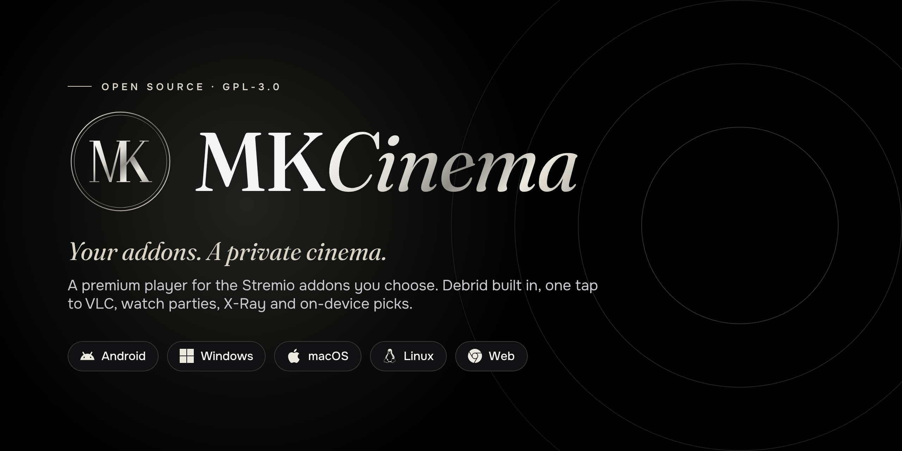
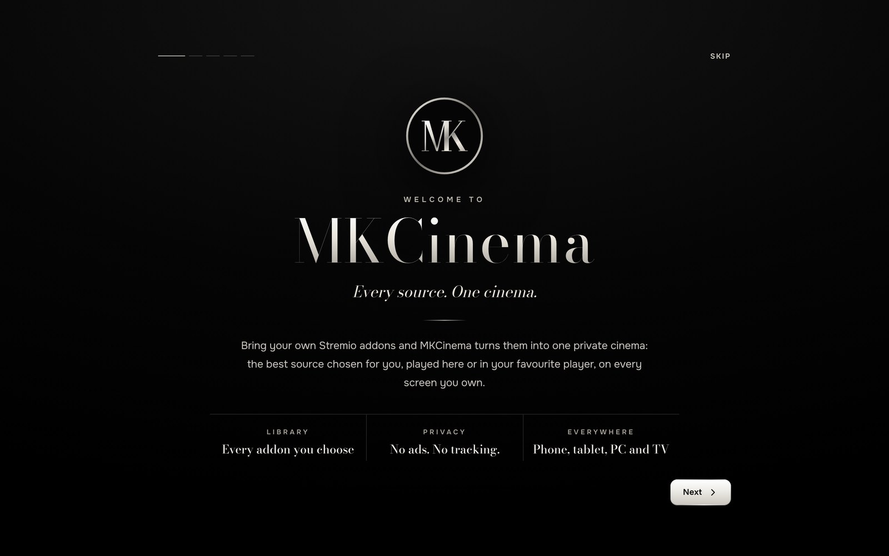
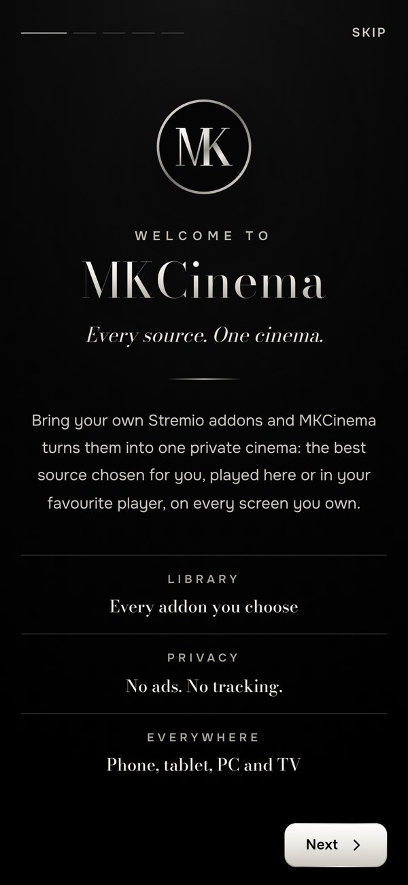
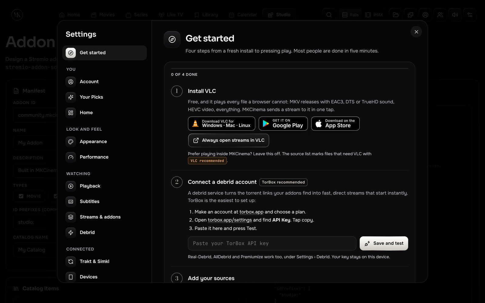
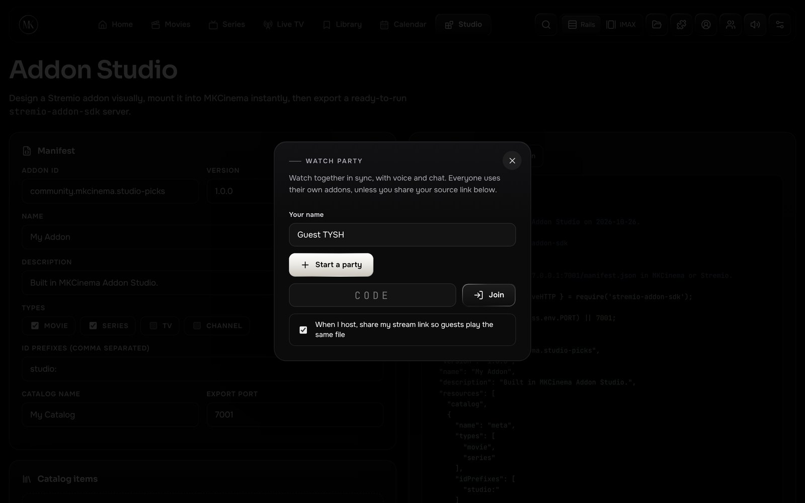
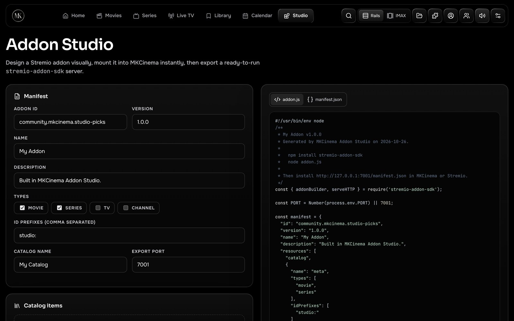
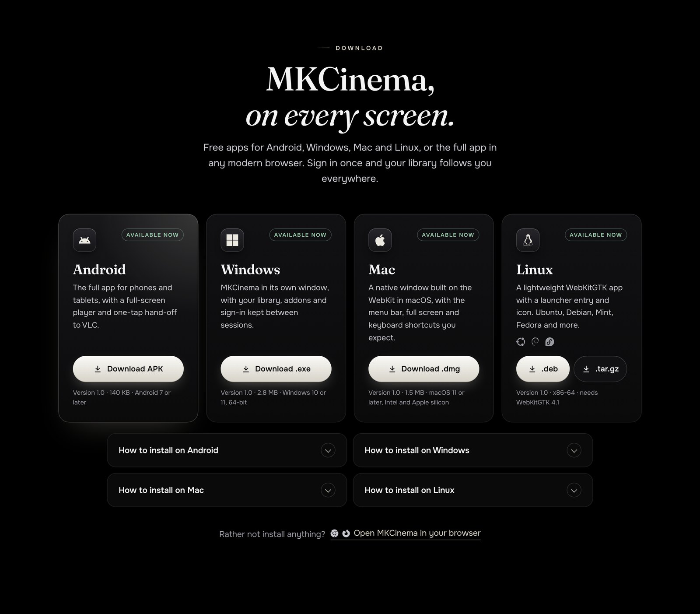
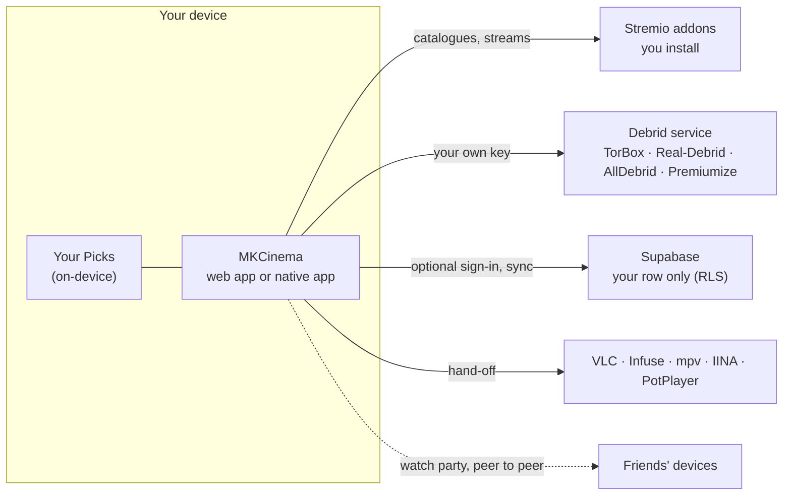

<p align="center">
  <a href="https://mkcinema-site.pages.dev"></a>
</p>

<p align="center">
  <a href="https://github.com/itbelikethatbruh/MKCinema/releases/latest"></a>
  <a href="LICENSE"></a>
  
  <a href="https://mkcinema-site.pages.dev/#support"></a>
</p>

<p align="center">
  <a href="https://mkcinema.pages.dev"><b>Open the app</b></a> &nbsp;·&nbsp;
  <a href="https://mkcinema-site.pages.dev"><b>Website</b></a> &nbsp;·&nbsp;
  <a href="#download"><b>Download</b></a> &nbsp;·&nbsp;
  <a href="#features"><b>Features</b></a> &nbsp;·&nbsp;
  <a href="#build-from-source"><b>Build</b></a> &nbsp;·&nbsp;
  <a href="CHANGELOG.md"><b>Changelog</b></a>
</p>

---

**MKCinema** is a free, open-source premium player for the Stremio addons you choose. It brings your catalogues, debrid account and subtitles together in one matte-black library, with a player built for phones, tablets and big screens.

MKCinema ships no titles, channels or streams of its own. Catalogues come from Cinemeta, subtitles from OpenSubtitles, and the only built-in source is official trailers. Everything else comes from addons that you install yourself.

<p align="center">
  
  &nbsp;
  
</p>

## Download

| Platform | Download | Requirements |
|---|---|---|
| **Android** | [MKCinema.apk](https://mkcinema-site.pages.dev/download/MKCinema.apk) | Android 7 or later |
| **Windows** | [MKCinema.exe](https://mkcinema-site.pages.dev/download/MKCinema.exe) | Windows 10 or 11, 64-bit |
| **macOS** | [MKCinema-1.0.dmg](https://mkcinema-site.pages.dev/download/MKCinema-1.0.dmg) | macOS 11 or later, Intel and Apple silicon |
| **Linux** | [.deb](https://mkcinema-site.pages.dev/download/mkcinema_1.0_amd64.deb) · [.tar.gz](https://mkcinema-site.pages.dev/download/mkcinema-1.0-linux-x86_64.tar.gz) | x86-64 with WebKitGTK 4.1 |
| **Web** | [mkcinema.pages.dev](https://mkcinema.pages.dev) | Chrome, Edge, Firefox or Safari |

Every app opens the same MKCinema in its own window, so it always runs the latest version. Sign in with email and your library, progress, addons and settings follow you between devices.

> [!NOTE]
> The Windows and Mac apps are not code-signed by Microsoft or Apple yet. On Windows, click **More info › Run anyway** the first time. On a Mac, open the app once, then go to **System Settings › Privacy & Security › Open Anyway**. Android asks you to allow installs from your browser. Only download MKCinema from this repository or [the website](https://mkcinema-site.pages.dev).

## Features

<table>
<tr>
<td width="50%" valign="top">

**Your addons, your rules.** Install any Stremio addon by link, reorder them, and see results from each one as soon as it answers.

**Debrid built in.** Paste your own TorBox, Real-Debrid, AllDebrid or Premiumize key and press Test. Cached results are marked ⚡ and play right away. TorBox is the easiest to start with.

**One tap to VLC.** Hand any stream to VLC, Infuse, MX Player, Just Player, mpv, IINA or PotPlayer. MKCinema only lists the players your device supports.

**Watch party.** Share a six-character room. Play, pause and seek stay in sync, with chat, reactions and push-to-talk, peer to peer.

**X-Ray.** Pause for a second to see the cast, actor bios, release facts and the picture and sound details.

**Your Picks.** A *For you* row built from your favourites and history. Ask in plain words, like "funny crime series". It runs entirely on your device.

</td>
<td width="50%" valign="top">

**Skip Intro and next episode.** Skip intros and credits, with a 10-second countdown to the next episode while its sources load.

**Automatic failover.** If a source shows no picture or stalls, MKCinema moves to the next one by itself.

**Night Mode audio.** Brings whispers and explosions closer together, plus Vocal Boost and Spatial Widen presets.

**Browser only mode.** Can't install a player? MKCinema lists only the sources your browser can play with picture and sound.

**Phone as a remote.** Scan a code and your phone becomes a trackpad with volume, skip, audio presets and subtitles.

**Sync and import.** Email sign-in syncs everything across devices. Scrobble to Trakt or Simkl, and import your library and addons from Stremio in one step.

</td>
</tr>
</table>

## Screenshots

<table>
<tr>
<td></td>
<td></td>
</tr>
<tr>
<td align="center"><sub>Get started: VLC and TorBox in four steps</sub></td>
<td align="center"><sub>Watch party with synced playback and voice</sub></td>
</tr>
<tr>
<td></td>
<td></td>
</tr>
<tr>
<td align="center"><sub>Addon Studio: design a Stremio addon visually</sub></td>
<td align="center"><sub>Apps for Android, Windows, Mac and Linux</sub></td>
</tr>
</table>

## How it works



- **Your keys stay yours.** Debrid keys live in your browser and, if you sign in, in your own Supabase row, which row-level security keeps readable only by you. You can turn sync off and keep them on one device.
- **No tracking.** No ads, no analytics, and Your Picks never sends your taste to an outside service.
- **Bring your own sources.** MKCinema only plays what your addons return. You are responsible for using them lawfully where you live.

## Repository

| Folder | What it is |
|---|---|
| [`app/`](app) | The web app (`index.html`), PWA files, the companion server (`mkcinema-server.js`), the Supabase schema (`supabase.sql`) and the debrid relay Edge Function. See [`app/README.md`](app/README.md). |
| [`site/`](site) | The website at [mkcinema-site.pages.dev](https://mkcinema-site.pages.dev). |
| [`android/`](android) | Android app: a full-screen WebView with intent hand-off to video players. |
| [`windows/`](windows) | Windows app: Go and Microsoft Edge WebView2. |
| [`mac/`](mac) | Mac app: WKWebView through JavaScript for Automation, packaged as a .dmg. |
| [`linux/`](linux) | Linux app: C and WebKitGTK 4.1, packaged as .deb and .tar.gz. |

## Build from source

<details>
<summary><b>Web app and companion server</b></summary>

```sh
cd app
npm install
node mkcinema-server.js
# App:   http://127.0.0.1:7000/
# Addon: http://127.0.0.1:7000/manifest.json
```

The server adds official trailers as a source, a CORS proxy for streams that need headers, and audio rescue (EAC3, AC3, DTS and TrueHD to AAC) when ffmpeg is installed. The app also runs as static files on any host, such as Cloudflare Pages.
</details>

<details>
<summary><b>Android</b></summary>

Needs the Android SDK (build-tools 35 and platform 35) and JDK 17 or later. Create your own signing key first:

```sh
cd android
mkdir -p keystore && openssl rand -base64 24 > keystore/password.txt
keytool -genkeypair -keystore keystore/mkcinema.jks -storepass "$(cat keystore/password.txt)" \
  -alias mkcinema -keyalg RSA -keysize 4096 -validity 10000 -dname "CN=MKCinema"
ANDROID_HOME=~/Android/Sdk sh build.sh   # writes build/MKCinema.apk
```

Change `package` in `AndroidManifest.xml` for your own fork so it doesn't clash with official releases.
</details>

<details>
<summary><b>Windows</b></summary>

Builds from Windows, Linux or macOS with Go 1.24 or later. See [`windows/BUILD.md`](windows/BUILD.md).

```sh
cd windows
go install github.com/akavel/rsrc@latest
rsrc -arch amd64 -ico mkcinema.ico -manifest app.manifest -o rsrc_windows_amd64.syso
GOOS=windows GOARCH=amd64 CGO_ENABLED=0 go build -trimpath -ldflags "-s -w -H windowsgui" -o MKCinema.exe .
```
</details>

<details>
<summary><b>macOS</b></summary>

The app is a standard `.app` bundle that runs `main.js` with the system's JavaScript for Automation, so it needs no compiler. To package it on Linux, install `hfsprogs` and build [mozilla/libdmg-hfsplus](https://github.com/mozilla/libdmg-hfsplus), then:

```sh
cd mac
DMGTOOLS=/path/to/libdmg-hfsplus/build sh package.sh   # writes build/MKCinema-1.0.dmg
```
</details>

<details>
<summary><b>Linux</b></summary>

```sh
sudo apt install gcc libwebkit2gtk-4.1-dev python3-pil
cd linux
sh package.sh   # writes build/mkcinema_1.0_amd64.deb and the .tar.gz
```
</details>

## FAQ

<details>
<summary><b>Does MKCinema provide movies or shows?</b></summary>

No. MKCinema hosts and links to no content. It plays what your own addons return, plus official trailers.
</details>

<details>
<summary><b>Which debrid service and player should I use?</b></summary>

If you're new, use **TorBox** and **VLC**. Settings › Get started walks you through both.
</details>

<details>
<summary><b>Do I need an account?</b></summary>

No. Everything works without one. Sign in with email only if you want sync between devices.
</details>

<details>
<summary><b>Is iPhone supported?</b></summary>

No. iPhone and iPad are not supported platforms.
</details>

<details>
<summary><b>Can I move from Stremio?</b></summary>

Yes. Settings › Account › Import from Stremio copies your library, progress and addons. Your Stremio password is used once and never stored.
</details>

## Contributing

Bug reports, ideas and pull requests are welcome. Read [CONTRIBUTING.md](CONTRIBUTING.md) first, and report security problems privately as described in [SECURITY.md](SECURITY.md).

## Support MKCinema

MKCinema is made by **Drake Christopher**, with no ads and no paid tier. If it has become your favourite way to watch, a donation keeps it growing.

<p><a href="https://www.paypal.com/qrcodes/p2pqrc/W7NTDVZTZVQMU"></a></p>

## License

MKCinema is free software under the [GNU General Public License v3.0](LICENSE). Local file playback ideas are adapted from [addyosmani/webvlc](https://github.com/addyosmani/webvlc) (MIT).

MKCinema is an independent project and is not affiliated with or endorsed by Stremio. Stremio, VLC, TorBox and other names and logos belong to their owners and are used only to describe compatibility.
