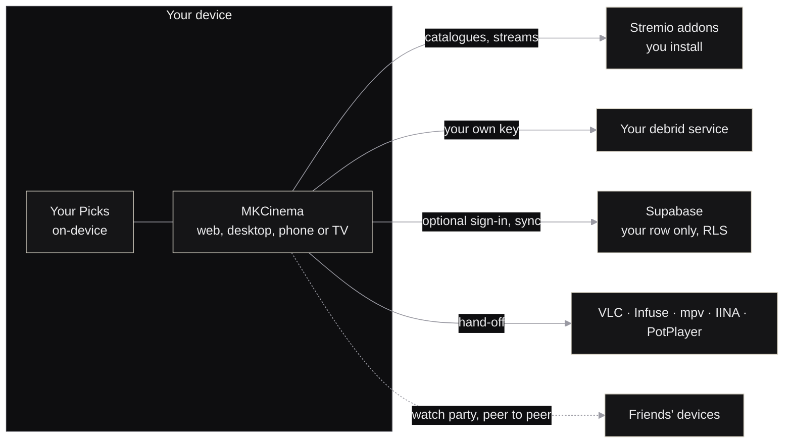

<a name="top"></a>
<p align="center">
  <a href="https://mkcinema-site.pages.dev"></a>
</p>

<p align="center">
  <a href="https://github.com/itbelikethatbruh/MKCinema/releases/latest"></a>
  <a href="LICENSE"></a>
  <a href="https://github.com/itbelikethatbruh/MKCinema/commits/main"></a>
  <a href="https://mkcinema.pages.dev"></a>
  <a href="#support"></a>
</p>

<p align="center">
  <a href="https://mkcinema.pages.dev"><b>Open the app</b></a> &nbsp;·&nbsp;
  <a href="https://mkcinema-site.pages.dev"><b>Website</b></a> &nbsp;·&nbsp;
  <a href="#download"><b>Download</b></a> &nbsp;·&nbsp;
  <a href="#features"><b>Features</b></a> &nbsp;·&nbsp;
  <a href="#3d"><b>3D</b></a> &nbsp;·&nbsp;
  <a href="#build"><b>Build</b></a> &nbsp;·&nbsp;
  <a href="CHANGELOG.md"><b>Changelog</b></a>
</p>

<br>

> **MKCinema** is a free, open-source premium player for the Stremio addons you choose. It brings your catalogues, debrid account and subtitles together in one matte-black library, with a player built for phones, tablets, desktops and TVs.
>
> It ships no titles, channels or streams of its own. Catalogues come from Cinemeta, subtitles from OpenSubtitles, and the only built-in source is official trailers. Everything else comes from addons you install yourself.

<a name="download"></a>
<p></p>

<p align="center">
  <a href="https://github.com/itbelikethatbruh/MKCinema/releases/download/v1.2/MKCinema.apk"></a>
  <a href="https://github.com/itbelikethatbruh/MKCinema/releases/download/v1.2/MKCinema-TV.apk"></a>
  <a href="https://github.com/itbelikethatbruh/MKCinema/releases/download/v1.2/com.mkcinema.app_1.1.0_all.ipk"></a>
  <a href="https://github.com/itbelikethatbruh/MKCinema/releases/download/v1.2/MKCinema.exe"></a>
  <a href="https://github.com/itbelikethatbruh/MKCinema/releases/download/v1.2/MKCinema-1.0.dmg"></a>
  <a href="https://github.com/itbelikethatbruh/MKCinema/releases/download/v1.2/mkcinema_1.0_amd64.deb"></a>
  <a href="https://mkcinema.pages.dev"></a>
</p>

<p align="center"><sub>
  Release <a href="https://github.com/itbelikethatbruh/MKCinema/releases/tag/v1.2">v1.2</a> &nbsp;·&nbsp;
  Linux also as <a href="https://github.com/itbelikethatbruh/MKCinema/releases/download/v1.2/mkcinema-1.0-linux-x86_64.tar.gz">.tar.gz</a> &nbsp;·&nbsp;
  Fire TV: type <code>mkctv.pages.dev</code> into the Downloader app
</sub></p>

Every app opens the same MKCinema in its own window, so it always runs the latest version. Sign in with email and your library, progress, addons and settings follow you between devices.

> [!NOTE]
> The Windows and Mac apps are not code-signed by Microsoft or Apple yet. On Windows, click **More info › Run anyway** the first time. On a Mac, open the app once, then go to **System Settings › Privacy & Security › Open Anyway**. Android asks you to allow installs from your browser; on a TV, allow the Downloader app instead. LG TVs only install store apps, so the webOS package needs Developer Mode. Samsung (Tizen) isn't supported yet because Samsung requires apps to be signed through its developer program. Only download MKCinema from this repository or [the website](https://mkcinema-site.pages.dev).

<a name="features"></a>
<p></p>

<table>
<tr>
<td width="33%" valign="top"><br><b>Your addons, your rules</b><br><sub>Install any Stremio addon by link, reorder them, and see results from each one the moment it answers.</sub></td>
<td width="33%" valign="top"><br><b>Debrid built in</b><br><sub>Bring your own key from the debrid service you already use and press Test. Cached results are marked ⚡ and play right away.</sub></td>
<td width="33%" valign="top"><br><b>One tap to VLC</b><br><sub>Hand any stream to VLC, Infuse, MX Player, Just Player, mpv, IINA or PotPlayer. Only players your device supports are listed.</sub></td>
</tr>
<tr>
<td width="33%" valign="top"><br><b>Watch party</b><br><sub>Share a six-character room. Play, pause and seek stay in sync, with chat, reactions and push-to-talk, peer to peer.</sub></td>
<td width="33%" valign="top"><br><b>X-Ray</b><br><sub>Pause for a second to see the cast, actor bios, release facts, and the picture and sound details.</sub></td>
<td width="33%" valign="top"><br><b>Your Picks</b><br><sub>A <i>For you</i> row from your favourites and history. Ask in plain words, like “funny crime series”. It runs entirely on your device.</sub></td>
</tr>
<tr>
<td width="33%" valign="top"><br><b>Skip Intro, next episode</b><br><sub>Skip intros and credits, with a 10-second countdown to the next episode while its sources load.</sub></td>
<td width="33%" valign="top"><br><b>Automatic failover</b><br><sub>If a source shows no picture or stalls, MKCinema moves to the next one by itself.</sub></td>
<td width="33%" valign="top"><br><b>Night Mode audio</b><br><sub>Brings whispers and explosions closer together, plus Vocal Boost and Spatial Widen presets.</sub></td>
</tr>
<tr>
<td width="33%" valign="top"><br><b>Browser only mode</b><br><sub>No player installed? MKCinema lists only the sources your browser can play with picture and sound.</sub></td>
<td width="33%" valign="top"><br><b>Phone as a remote</b><br><sub>Scan a code and your phone becomes a trackpad with volume, skip, audio presets and subtitles.</sub></td>
<td width="33%" valign="top"><br><b>Made for the big screen</b><br><sub>Android TV, Google TV, Fire TV and LG webOS, with a platinum focus ring, remembered rows and voice search.</sub></td>
</tr>
<tr>
<td width="33%" valign="top"><br><b>Subtitles that fit</b><br><sub>OpenSubtitles built in, your own files by drag and drop, and a sync strip you drag into place.</sub></td>
<td width="33%" valign="top"><br><b>Your keys stay yours</b><br><sub>Keys live on your device and, if you sign in, in your own row that only you can read.</sub></td>
<td width="33%" valign="top"><br><b>Move from Stremio</b><br><sub>Import your library, progress and addons in one step. Scrobble to Trakt or Simkl.</sub></td>
</tr>
</table>

<a name="screenshots"></a>
<p></p>

<p align="center"></p>

<table>
<tr>
<td width="40%" align="center"><br><sub>Your Picks, built on your device</sub></td>
<td width="40%" align="center"><br><sub>Watch party with synced playback and voice</sub></td>
<td width="20%" align="center" rowspan="2"><br><sub>Phones are first-class</sub></td>
</tr>
<tr>
<td align="center"><br><sub>The welcome tour</sub></td>
<td align="center"><br><sub>Addon Studio: design a Stremio addon visually</sub></td>
</tr>
</table>

<a name="3d"></a>
<p></p>

The MK monogram, as a real 3D model that GitHub renders right here. Drag to turn it, scroll to zoom. The file is [`docs/readme/mk-monogram.stl`](docs/readme/mk-monogram.stl), drawn from the same outline as the app icon by [`.github/readme/generate.py`](.github/readme/generate.py).

```stl
solid mkcinema
facet normal 0.00 0.00 1.00
outer loop
vertex -36.5 -28 9
vertex -34.1 -28 9
vertex -34.1 28 9
endloop
endfacet
facet normal 0.00 0.00 -1.00
outer loop
vertex -36.5 -28 0
vertex -34.1 28 0
vertex -34.1 -28 0
endloop
endfacet
facet normal 0.00 0.00 1.00
outer loop
vertex -36.5 -28 9
vertex -34.1 28 9
vertex -36.5 28 9
endloop
endfacet
facet normal 0.00 0.00 -1.00
outer loop
vertex -36.5 -28 0
vertex -36.5 28 0
vertex -34.1 28 0
endloop
endfacet
facet normal 0.00 -1.00 0.00
outer loop
vertex -36.5 -28 0
vertex -34.1 -28 0
vertex -34.1 -28 9
endloop
endfacet
facet normal 0.00 -1.00 0.00
outer loop
vertex -36.5 -28 0
vertex -34.1 -28 9
vertex -36.5 -28 9
endloop
endfacet
facet normal 1.00 0.00 0.00
outer loop
vertex -34.1 -28 0
vertex -34.1 28 0
vertex -34.1 28 9
endloop
endfacet
facet normal 1.00 0.00 0.00
outer loop
vertex -34.1 -28 0
vertex -34.1 28 9
vertex -34.1 -28 9
endloop
endfacet
facet normal 0.00 1.00 0.00
outer loop
vertex -34.1 28 0
vertex -36.5 28 0
vertex -36.5 28 9
endloop
endfacet
facet normal 0.00 1.00 0.00
outer loop
vertex -34.1 28 0
vertex -36.5 28 9
vertex -34.1 28 9
endloop
endfacet
facet normal -1.00 0.00 0.00
outer loop
vertex -36.5 28 0
vertex -36.5 -28 0
vertex -36.5 -28 9
endloop
endfacet
facet normal -1.00 0.00 0.00
outer loop
vertex -36.5 28 0
vertex -36.5 -28 9
vertex -36.5 28 9
endloop
endfacet
facet normal 0.00 0.00 1.00
outer loop
vertex -15.2 -28 9
vertex -12.2 -28 9
vertex -28 28 9
endloop
endfacet
facet normal 0.00 0.00 -1.00
outer loop
vertex -15.2 -28 0
vertex -28 28 0
vertex -12.2 -28 0
endloop
endfacet
facet normal 0.00 0.00 1.00
outer loop
vertex -15.2 -28 9
vertex -28 28 9
vertex -36.5 28 9
endloop
endfacet
facet normal 0.00 0.00 -1.00
outer loop
vertex -15.2 -28 0
vertex -36.5 28 0
vertex -28 28 0
endloop
endfacet
facet normal 0.00 -1.00 0.00
outer loop
vertex -15.2 -28 0
vertex -12.2 -28 0
vertex -12.2 -28 9
endloop
endfacet
facet normal 0.00 -1.00 0.00
outer loop
vertex -15.2 -28 0
vertex -12.2 -28 9
vertex -15.2 -28 9
endloop
endfacet
facet normal 0.96 0.27 0.00
outer loop
vertex -12.2 -28 0
vertex -28 28 0
vertex -28 28 9
endloop
endfacet
facet normal 0.96 0.27 0.00
outer loop
vertex -12.2 -28 0
vertex -28 28 9
vertex -12.2 -28 9
endloop
endfacet
facet normal 0.00 1.00 0.00
outer loop
vertex -28 28 0
vertex -36.5 28 0
vertex -36.5 28 9
endloop
endfacet
facet normal 0.00 1.00 0.00
outer loop
vertex -28 28 0
vertex -36.5 28 9
vertex -28 28 9
endloop
endfacet
facet normal -0.93 -0.36 0.00
outer loop
vertex -36.5 28 0
vertex -15.2 -28 0
vertex -15.2 -28 9
endloop
endfacet
facet normal -0.93 -0.36 0.00
outer loop
vertex -36.5 28 0
vertex -15.2 -28 9
vertex -36.5 28 9
endloop
endfacet
facet normal 0.00 0.00 1.00
outer loop
vertex -15.2 -28 9
vertex -12.2 -28 9
vertex 1.5 28 9
endloop
endfacet
facet normal 0.00 0.00 -1.00
outer loop
vertex -15.2 -28 0
vertex 1.5 28 0
vertex -12.2 -28 0
endloop
endfacet
facet normal 0.00 0.00 1.00
outer loop
vertex -15.2 -28 9
vertex 1.5 28 9
vertex 0.8 28 9
endloop
endfacet
facet normal 0.00 0.00 -1.00
outer loop
vertex -15.2 -28 0
vertex 0.8 28 0
vertex 1.5 28 0
endloop
endfacet
facet normal 0.00 -1.00 0.00
outer loop
vertex -15.2 -28 0
vertex -12.2 -28 0
vertex -12.2 -28 9
endloop
endfacet
facet normal 0.00 -1.00 0.00
outer loop
vertex -15.2 -28 0
vertex -12.2 -28 9
vertex -15.2 -28 9
endloop
endfacet
facet normal 0.97 -0.24 0.00
outer loop
vertex -12.2 -28 0
vertex 1.5 28 0
vertex 1.5 28 9
endloop
endfacet
facet normal 0.97 -0.24 0.00
outer loop
vertex -12.2 -28 0
vertex 1.5 28 9
vertex -12.2 -28 9
endloop
endfacet
facet normal 0.00 1.00 0.00
outer loop
vertex 1.5 28 0
vertex 0.8 28 0
vertex 0.8 28 9
endloop
endfacet
facet normal 0.00 1.00 0.00
outer loop
vertex 1.5 28 0
vertex 0.8 28 9
vertex 1.5 28 9
endloop
endfacet
facet normal -0.97 0.25 0.00
outer loop
vertex 0.8 28 0
vertex -15.2 -28 0
vertex -15.2 -28 9
endloop
endfacet
facet normal -0.97 0.25 0.00
outer loop
vertex 0.8 28 0
vertex -15.2 -28 9
vertex 0.8 28 9
endloop
endfacet
facet normal 0.00 0.00 1.00
outer loop
vertex 0.5 -28 9
vertex 8.1 -28 9
vertex 8.1 28 9
endloop
endfacet
facet normal 0.00 0.00 -1.00
outer loop
vertex 0.5 -28 0
vertex 8.1 28 0
vertex 8.1 -28 0
endloop
endfacet
facet normal 0.00 0.00 1.00
outer loop
vertex 0.5 -28 9
vertex 8.1 28 9
vertex 0.5 28 9
endloop
endfacet
facet normal 0.00 0.00 -1.00
outer loop
vertex 0.5 -28 0
vertex 0.5 28 0
vertex 8.1 28 0
endloop
endfacet
facet normal 0.00 -1.00 0.00
outer loop
vertex 0.5 -28 0
vertex 8.1 -28 0
vertex 8.1 -28 9
endloop
endfacet
facet normal 0.00 -1.00 0.00
outer loop
vertex 0.5 -28 0
vertex 8.1 -28 9
vertex 0.5 -28 9
endloop
endfacet
facet normal 1.00 0.00 0.00
outer loop
vertex 8.1 -28 0
vertex 8.1 28 0
vertex 8.1 28 9
endloop
endfacet
facet normal 1.00 0.00 0.00
outer loop
vertex 8.1 -28 0
vertex 8.1 28 9
vertex 8.1 -28 9
endloop
endfacet
facet normal 0.00 1.00 0.00
outer loop
vertex 8.1 28 0
vertex 0.5 28 0
vertex 0.5 28 9
endloop
endfacet
facet normal 0.00 1.00 0.00
outer loop
vertex 8.1 28 0
vertex 0.5 28 9
vertex 8.1 28 9
endloop
endfacet
facet normal -1.00 0.00 0.00
outer loop
vertex 0.5 28 0
vertex 0.5 -28 0
vertex 0.5 -28 9
endloop
endfacet
facet normal -1.00 0.00 0.00
outer loop
vertex 0.5 28 0
vertex 0.5 -28 9
vertex 0.5 28 9
endloop
endfacet
facet normal 0.00 0.00 1.00
outer loop
vertex 8.1 -1.5 9
vertex 8.1 -5.2 9
vertex 33.5 28 9
endloop
endfacet
facet normal 0.00 0.00 -1.00
outer loop
vertex 8.1 -1.5 0
vertex 33.5 28 0
vertex 8.1 -5.2 0
endloop
endfacet
facet normal 0.00 0.00 1.00
outer loop
vertex 8.1 -1.5 9
vertex 33.5 28 9
vertex 30.8 28 9
endloop
endfacet
facet normal 0.00 0.00 -1.00
outer loop
vertex 8.1 -1.5 0
vertex 30.8 28 0
vertex 33.5 28 0
endloop
endfacet
facet normal -1.00 0.00 0.00
outer loop
vertex 8.1 -1.5 0
vertex 8.1 -5.2 0
vertex 8.1 -5.2 9
endloop
endfacet
facet normal -1.00 0.00 0.00
outer loop
vertex 8.1 -1.5 0
vertex 8.1 -5.2 9
vertex 8.1 -1.5 9
endloop
endfacet
facet normal 0.79 -0.61 0.00
outer loop
vertex 8.1 -5.2 0
vertex 33.5 28 0
vertex 33.5 28 9
endloop
endfacet
facet normal 0.79 -0.61 0.00
outer loop
vertex 8.1 -5.2 0
vertex 33.5 28 9
vertex 8.1 -5.2 9
endloop
endfacet
facet normal 0.00 1.00 0.00
outer loop
vertex 33.5 28 0
vertex 30.8 28 0
vertex 30.8 28 9
endloop
endfacet
facet normal 0.00 1.00 0.00
outer loop
vertex 33.5 28 0
vertex 30.8 28 9
vertex 33.5 28 9
endloop
endfacet
facet normal -0.79 0.61 0.00
outer loop
vertex 30.8 28 0
vertex 8.1 -1.5 0
vertex 8.1 -1.5 9
endloop
endfacet
facet normal -0.79 0.61 0.00
outer loop
vertex 30.8 28 0
vertex 8.1 -1.5 9
vertex 30.8 28 9
endloop
endfacet
facet normal 0.00 0.00 1.00
outer loop
vertex 29.9 -28 9
vertex 39.1 -28 9
vertex 18.3 6.8 9
endloop
endfacet
facet normal 0.00 0.00 -1.00
outer loop
vertex 29.9 -28 0
vertex 18.3 6.8 0
vertex 39.1 -28 0
endloop
endfacet
facet normal 0.00 0.00 1.00
outer loop
vertex 29.9 -28 9
vertex 18.3 6.8 9
vertex 11.7 2.4 9
endloop
endfacet
facet normal 0.00 0.00 -1.00
outer loop
vertex 29.9 -28 0
vertex 11.7 2.4 0
vertex 18.3 6.8 0
endloop
endfacet
facet normal 0.00 -1.00 0.00
outer loop
vertex 29.9 -28 0
vertex 39.1 -28 0
vertex 39.1 -28 9
endloop
endfacet
facet normal 0.00 -1.00 0.00
outer loop
vertex 29.9 -28 0
vertex 39.1 -28 9
vertex 29.9 -28 9
endloop
endfacet
facet normal 0.86 0.51 0.00
outer loop
vertex 39.1 -28 0
vertex 18.3 6.8 0
vertex 18.3 6.8 9
endloop
endfacet
facet normal 0.86 0.51 0.00
outer loop
vertex 39.1 -28 0
vertex 18.3 6.8 9
vertex 39.1 -28 9
endloop
endfacet
facet normal -0.55 0.83 0.00
outer loop
vertex 18.3 6.8 0
vertex 11.7 2.4 0
vertex 11.7 2.4 9
endloop
endfacet
facet normal -0.55 0.83 0.00
outer loop
vertex 18.3 6.8 0
vertex 11.7 2.4 9
vertex 18.3 6.8 9
endloop
endfacet
facet normal -0.86 -0.51 0.00
outer loop
vertex 11.7 2.4 0
vertex 29.9 -28 0
vertex 29.9 -28 9
endloop
endfacet
facet normal -0.86 -0.51 0.00
outer loop
vertex 11.7 2.4 0
vertex 29.9 -28 9
vertex 11.7 2.4 9
endloop
endfacet
facet normal 0.00 0.00 1.00
outer loop
vertex -41.9 26.9 9
vertex -28 26.9 9
vertex -28 28 9
endloop
endfacet
facet normal 0.00 0.00 -1.00
outer loop
vertex -41.9 26.9 0
vertex -28 28 0
vertex -28 26.9 0
endloop
endfacet
facet normal 0.00 0.00 1.00
outer loop
vertex -41.9 26.9 9
vertex -28 28 9
vertex -41.9 28 9
endloop
endfacet
facet normal 0.00 0.00 -1.00
outer loop
vertex -41.9 26.9 0
vertex -41.9 28 0
vertex -28 28 0
endloop
endfacet
facet normal 0.00 -1.00 0.00
outer loop
vertex -41.9 26.9 0
vertex -28 26.9 0
vertex -28 26.9 9
endloop
endfacet
facet normal 0.00 -1.00 0.00
outer loop
vertex -41.9 26.9 0
vertex -28 26.9 9
vertex -41.9 26.9 9
endloop
endfacet
facet normal 1.00 0.00 0.00
outer loop
vertex -28 26.9 0
vertex -28 28 0
vertex -28 28 9
endloop
endfacet
facet normal 1.00 0.00 0.00
outer loop
vertex -28 26.9 0
vertex -28 28 9
vertex -28 26.9 9
endloop
endfacet
facet normal 0.00 1.00 0.00
outer loop
vertex -28 28 0
vertex -41.9 28 0
vertex -41.9 28 9
endloop
endfacet
facet normal 0.00 1.00 0.00
outer loop
vertex -28 28 0
vertex -41.9 28 9
vertex -28 28 9
endloop
endfacet
facet normal -1.00 0.00 0.00
outer loop
vertex -41.9 28 0
vertex -41.9 26.9 0
vertex -41.9 26.9 9
endloop
endfacet
facet normal -1.00 0.00 0.00
outer loop
vertex -41.9 28 0
vertex -41.9 26.9 9
vertex -41.9 28 9
endloop
endfacet
facet normal 0.00 0.00 1.00
outer loop
vertex -41.9 -28 9
vertex -28.7 -28 9
vertex -28.7 -26.9 9
endloop
endfacet
facet normal 0.00 0.00 -1.00
outer loop
vertex -41.9 -28 0
vertex -28.7 -26.9 0
vertex -28.7 -28 0
endloop
endfacet
facet normal 0.00 0.00 1.00
outer loop
vertex -41.9 -28 9
vertex -28.7 -26.9 9
vertex -41.9 -26.9 9
endloop
endfacet
facet normal 0.00 0.00 -1.00
outer loop
vertex -41.9 -28 0
vertex -41.9 -26.9 0
vertex -28.7 -26.9 0
endloop
endfacet
facet normal 0.00 -1.00 0.00
outer loop
vertex -41.9 -28 0
vertex -28.7 -28 0
vertex -28.7 -28 9
endloop
endfacet
facet normal 0.00 -1.00 0.00
outer loop
vertex -41.9 -28 0
vertex -28.7 -28 9
vertex -41.9 -28 9
endloop
endfacet
facet normal 1.00 0.00 0.00
outer loop
vertex -28.7 -28 0
vertex -28.7 -26.9 0
vertex -28.7 -26.9 9
endloop
endfacet
facet normal 1.00 0.00 0.00
outer loop
vertex -28.7 -28 0
vertex -28.7 -26.9 9
vertex -28.7 -28 9
endloop
endfacet
facet normal 0.00 1.00 0.00
outer loop
vertex -28.7 -26.9 0
vertex -41.9 -26.9 0
vertex -41.9 -26.9 9
endloop
endfacet
facet normal 0.00 1.00 0.00
outer loop
vertex -28.7 -26.9 0
vertex -41.9 -26.9 9
vertex -28.7 -26.9 9
endloop
endfacet
facet normal -1.00 0.00 0.00
outer loop
vertex -41.9 -26.9 0
vertex -41.9 -28 0
vertex -41.9 -28 9
endloop
endfacet
facet normal -1.00 0.00 0.00
outer loop
vertex -41.9 -26.9 0
vertex -41.9 -28 9
vertex -41.9 -26.9 9
endloop
endfacet
facet normal 0.00 0.00 1.00
outer loop
vertex -5.3 26.9 9
vertex 13.1 26.9 9
vertex 13.1 28 9
endloop
endfacet
facet normal 0.00 0.00 -1.00
outer loop
vertex -5.3 26.9 0
vertex 13.1 28 0
vertex 13.1 26.9 0
endloop
endfacet
facet normal 0.00 0.00 1.00
outer loop
vertex -5.3 26.9 9
vertex 13.1 28 9
vertex -5.3 28 9
endloop
endfacet
facet normal 0.00 0.00 -1.00
outer loop
vertex -5.3 26.9 0
vertex -5.3 28 0
vertex 13.1 28 0
endloop
endfacet
facet normal 0.00 -1.00 0.00
outer loop
vertex -5.3 26.9 0
vertex 13.1 26.9 0
vertex 13.1 26.9 9
endloop
endfacet
facet normal 0.00 -1.00 0.00
outer loop
vertex -5.3 26.9 0
vertex 13.1 26.9 9
vertex -5.3 26.9 9
endloop
endfacet
facet normal 1.00 0.00 0.00
outer loop
vertex 13.1 26.9 0
vertex 13.1 28 0
vertex 13.1 28 9
endloop
endfacet
facet normal 1.00 0.00 0.00
outer loop
vertex 13.1 26.9 0
vertex 13.1 28 9
vertex 13.1 26.9 9
endloop
endfacet
facet normal 0.00 1.00 0.00
outer loop
vertex 13.1 28 0
vertex -5.3 28 0
vertex -5.3 28 9
endloop
endfacet
facet normal 0.00 1.00 0.00
outer loop
vertex 13.1 28 0
vertex -5.3 28 9
vertex 13.1 28 9
endloop
endfacet
facet normal -1.00 0.00 0.00
outer loop
vertex -5.3 28 0
vertex -5.3 26.9 0
vertex -5.3 26.9 9
endloop
endfacet
facet normal -1.00 0.00 0.00
outer loop
vertex -5.3 28 0
vertex -5.3 26.9 9
vertex -5.3 28 9
endloop
endfacet
facet normal 0.00 0.00 1.00
outer loop
vertex -5.3 -28 9
vertex 13.1 -28 9
vertex 13.1 -26.9 9
endloop
endfacet
facet normal 0.00 0.00 -1.00
outer loop
vertex -5.3 -28 0
vertex 13.1 -26.9 0
vertex 13.1 -28 0
endloop
endfacet
facet normal 0.00 0.00 1.00
outer loop
vertex -5.3 -28 9
vertex 13.1 -26.9 9
vertex -5.3 -26.9 9
endloop
endfacet
facet normal 0.00 0.00 -1.00
outer loop
vertex -5.3 -28 0
vertex -5.3 -26.9 0
vertex 13.1 -26.9 0
endloop
endfacet
facet normal 0.00 -1.00 0.00
outer loop
vertex -5.3 -28 0
vertex 13.1 -28 0
vertex 13.1 -28 9
endloop
endfacet
facet normal 0.00 -1.00 0.00
outer loop
vertex -5.3 -28 0
vertex 13.1 -28 9
vertex -5.3 -28 9
endloop
endfacet
facet normal 1.00 0.00 0.00
outer loop
vertex 13.1 -28 0
vertex 13.1 -26.9 0
vertex 13.1 -26.9 9
endloop
endfacet
facet normal 1.00 0.00 0.00
outer loop
vertex 13.1 -28 0
vertex 13.1 -26.9 9
vertex 13.1 -28 9
endloop
endfacet
facet normal 0.00 1.00 0.00
outer loop
vertex 13.1 -26.9 0
vertex -5.3 -26.9 0
vertex -5.3 -26.9 9
endloop
endfacet
facet normal 0.00 1.00 0.00
outer loop
vertex 13.1 -26.9 0
vertex -5.3 -26.9 9
vertex 13.1 -26.9 9
endloop
endfacet
facet normal -1.00 0.00 0.00
outer loop
vertex -5.3 -26.9 0
vertex -5.3 -28 0
vertex -5.3 -28 9
endloop
endfacet
facet normal -1.00 0.00 0.00
outer loop
vertex -5.3 -26.9 0
vertex -5.3 -28 9
vertex -5.3 -26.9 9
endloop
endfacet
facet normal 0.00 0.00 1.00
outer loop
vertex 25.7 26.9 9
vertex 38.3 26.9 9
vertex 38.3 28 9
endloop
endfacet
facet normal 0.00 0.00 -1.00
outer loop
vertex 25.7 26.9 0
vertex 38.3 28 0
vertex 38.3 26.9 0
endloop
endfacet
facet normal 0.00 0.00 1.00
outer loop
vertex 25.7 26.9 9
vertex 38.3 28 9
vertex 25.7 28 9
endloop
endfacet
facet normal 0.00 0.00 -1.00
outer loop
vertex 25.7 26.9 0
vertex 25.7 28 0
vertex 38.3 28 0
endloop
endfacet
facet normal 0.00 -1.00 0.00
outer loop
vertex 25.7 26.9 0
vertex 38.3 26.9 0
vertex 38.3 26.9 9
endloop
endfacet
facet normal 0.00 -1.00 0.00
outer loop
vertex 25.7 26.9 0
vertex 38.3 26.9 9
vertex 25.7 26.9 9
endloop
endfacet
facet normal 1.00 0.00 0.00
outer loop
vertex 38.3 26.9 0
vertex 38.3 28 0
vertex 38.3 28 9
endloop
endfacet
facet normal 1.00 0.00 0.00
outer loop
vertex 38.3 26.9 0
vertex 38.3 28 9
vertex 38.3 26.9 9
endloop
endfacet
facet normal 0.00 1.00 0.00
outer loop
vertex 38.3 28 0
vertex 25.7 28 0
vertex 25.7 28 9
endloop
endfacet
facet normal 0.00 1.00 0.00
outer loop
vertex 38.3 28 0
vertex 25.7 28 9
vertex 38.3 28 9
endloop
endfacet
facet normal -1.00 0.00 0.00
outer loop
vertex 25.7 28 0
vertex 25.7 26.9 0
vertex 25.7 26.9 9
endloop
endfacet
facet normal -1.00 0.00 0.00
outer loop
vertex 25.7 28 0
vertex 25.7 26.9 9
vertex 25.7 28 9
endloop
endfacet
facet normal 0.00 0.00 1.00
outer loop
vertex 26.1 -28 9
vertex 42.7 -28 9
vertex 42.7 -26.9 9
endloop
endfacet
facet normal 0.00 0.00 -1.00
outer loop
vertex 26.1 -28 0
vertex 42.7 -26.9 0
vertex 42.7 -28 0
endloop
endfacet
facet normal 0.00 0.00 1.00
outer loop
vertex 26.1 -28 9
vertex 42.7 -26.9 9
vertex 26.1 -26.9 9
endloop
endfacet
facet normal 0.00 0.00 -1.00
outer loop
vertex 26.1 -28 0
vertex 26.1 -26.9 0
vertex 42.7 -26.9 0
endloop
endfacet
facet normal 0.00 -1.00 0.00
outer loop
vertex 26.1 -28 0
vertex 42.7 -28 0
vertex 42.7 -28 9
endloop
endfacet
facet normal 0.00 -1.00 0.00
outer loop
vertex 26.1 -28 0
vertex 42.7 -28 9
vertex 26.1 -28 9
endloop
endfacet
facet normal 1.00 0.00 0.00
outer loop
vertex 42.7 -28 0
vertex 42.7 -26.9 0
vertex 42.7 -26.9 9
endloop
endfacet
facet normal 1.00 0.00 0.00
outer loop
vertex 42.7 -28 0
vertex 42.7 -26.9 9
vertex 42.7 -28 9
endloop
endfacet
facet normal 0.00 1.00 0.00
outer loop
vertex 42.7 -26.9 0
vertex 26.1 -26.9 0
vertex 26.1 -26.9 9
endloop
endfacet
facet normal 0.00 1.00 0.00
outer loop
vertex 42.7 -26.9 0
vertex 26.1 -26.9 9
vertex 42.7 -26.9 9
endloop
endfacet
facet normal -1.00 0.00 0.00
outer loop
vertex 26.1 -26.9 0
vertex 26.1 -28 0
vertex 26.1 -28 9
endloop
endfacet
facet normal -1.00 0.00 0.00
outer loop
vertex 26.1 -26.9 0
vertex 26.1 -28 9
vertex 26.1 -26.9 9
endloop
endfacet
facet normal 0.00 0.00 1.00
outer loop
vertex 72 0 5
vertex 71.4 9.4 5
vertex 65.4 8.6 5
endloop
endfacet
facet normal 0.00 0.00 -1.00
outer loop
vertex 72 0 0
vertex 65.4 8.6 0
vertex 71.4 9.4 0
endloop
endfacet
facet normal 0.00 0.00 1.00
outer loop
vertex 72 0 5
vertex 65.4 8.6 5
vertex 66 0 5
endloop
endfacet
facet normal 0.00 0.00 -1.00
outer loop
vertex 72 0 0
vertex 66 0 0
vertex 65.4 8.6 0
endloop
endfacet
facet normal 1.00 0.07 0.00
outer loop
vertex 72 0 0
vertex 71.4 9.4 0
vertex 71.4 9.4 5
endloop
endfacet
facet normal 1.00 0.07 0.00
outer loop
vertex 72 0 0
vertex 71.4 9.4 5
vertex 72 0 5
endloop
endfacet
facet normal -0.13 0.99 0.00
outer loop
vertex 71.4 9.4 0
vertex 65.4 8.6 0
vertex 65.4 8.6 5
endloop
endfacet
facet normal -0.13 0.99 0.00
outer loop
vertex 71.4 9.4 0
vertex 65.4 8.6 5
vertex 71.4 9.4 5
endloop
endfacet
facet normal -1.00 -0.07 0.00
outer loop
vertex 65.4 8.6 0
vertex 66 0 0
vertex 66 0 5
endloop
endfacet
facet normal -1.00 -0.07 0.00
outer loop
vertex 65.4 8.6 0
vertex 66 0 5
vertex 65.4 8.6 5
endloop
endfacet
facet normal 0.00 -1.00 0.00
outer loop
vertex 66 0 0
vertex 72 0 0
vertex 72 0 5
endloop
endfacet
facet normal 0.00 -1.00 0.00
outer loop
vertex 66 0 0
vertex 72 0 5
vertex 66 0 5
endloop
endfacet
facet normal 0.00 0.00 1.00
outer loop
vertex 71.4 9.4 5
vertex 69.5 18.6 5
vertex 63.8 17.1 5
endloop
endfacet
facet normal 0.00 0.00 -1.00
outer loop
vertex 71.4 9.4 0
vertex 63.8 17.1 0
vertex 69.5 18.6 0
endloop
endfacet
facet normal 0.00 0.00 1.00
outer loop
vertex 71.4 9.4 5
vertex 63.8 17.1 5
vertex 65.4 8.6 5
endloop
endfacet
facet normal 0.00 0.00 -1.00
outer loop
vertex 71.4 9.4 0
vertex 65.4 8.6 0
vertex 63.8 17.1 0
endloop
endfacet
facet normal 0.98 0.20 0.00
outer loop
vertex 71.4 9.4 0
vertex 69.5 18.6 0
vertex 69.5 18.6 5
endloop
endfacet
facet normal 0.98 0.20 0.00
outer loop
vertex 71.4 9.4 0
vertex 69.5 18.6 5
vertex 71.4 9.4 5
endloop
endfacet
facet normal -0.26 0.97 0.00
outer loop
vertex 69.5 18.6 0
vertex 63.8 17.1 0
vertex 63.8 17.1 5
endloop
endfacet
facet normal -0.26 0.97 0.00
outer loop
vertex 69.5 18.6 0
vertex 63.8 17.1 5
vertex 69.5 18.6 5
endloop
endfacet
facet normal -0.98 -0.20 0.00
outer loop
vertex 63.8 17.1 0
vertex 65.4 8.6 0
vertex 65.4 8.6 5
endloop
endfacet
facet normal -0.98 -0.20 0.00
outer loop
vertex 63.8 17.1 0
vertex 65.4 8.6 5
vertex 63.8 17.1 5
endloop
endfacet
facet normal 0.13 -0.99 0.00
outer loop
vertex 65.4 8.6 0
vertex 71.4 9.4 0
vertex 71.4 9.4 5
endloop
endfacet
facet normal 0.13 -0.99 0.00
outer loop
vertex 65.4 8.6 0
vertex 71.4 9.4 5
vertex 65.4 8.6 5
endloop
endfacet
facet normal 0.00 0.00 1.00
outer loop
vertex 69.5 18.6 5
vertex 66.5 27.6 5
vertex 61 25.3 5
endloop
endfacet
facet normal 0.00 0.00 -1.00
outer loop
vertex 69.5 18.6 0
vertex 61 25.3 0
vertex 66.5 27.6 0
endloop
endfacet
facet normal 0.00 0.00 1.00
outer loop
vertex 69.5 18.6 5
vertex 61 25.3 5
vertex 63.8 17.1 5
endloop
endfacet
facet normal 0.00 0.00 -1.00
outer loop
vertex 69.5 18.6 0
vertex 63.8 17.1 0
vertex 61 25.3 0
endloop
endfacet
facet normal 0.95 0.32 0.00
outer loop
vertex 69.5 18.6 0
vertex 66.5 27.6 0
vertex 66.5 27.6 5
endloop
endfacet
facet normal 0.95 0.32 0.00
outer loop
vertex 69.5 18.6 0
vertex 66.5 27.6 5
vertex 69.5 18.6 5
endloop
endfacet
facet normal -0.38 0.92 0.00
outer loop
vertex 66.5 27.6 0
vertex 61 25.3 0
vertex 61 25.3 5
endloop
endfacet
facet normal -0.38 0.92 0.00
outer loop
vertex 66.5 27.6 0
vertex 61 25.3 5
vertex 66.5 27.6 5
endloop
endfacet
facet normal -0.95 -0.32 0.00
outer loop
vertex 61 25.3 0
vertex 63.8 17.1 0
vertex 63.8 17.1 5
endloop
endfacet
facet normal -0.95 -0.32 0.00
outer loop
vertex 61 25.3 0
vertex 63.8 17.1 5
vertex 61 25.3 5
endloop
endfacet
facet normal 0.26 -0.97 0.00
outer loop
vertex 63.8 17.1 0
vertex 69.5 18.6 0
vertex 69.5 18.6 5
endloop
endfacet
facet normal 0.26 -0.97 0.00
outer loop
vertex 63.8 17.1 0
vertex 69.5 18.6 5
vertex 63.8 17.1 5
endloop
endfacet
facet normal 0.00 0.00 1.00
outer loop
vertex 66.5 27.6 5
vertex 62.4 36 5
vertex 57.2 33 5
endloop
endfacet
facet normal 0.00 0.00 -1.00
outer loop
vertex 66.5 27.6 0
vertex 57.2 33 0
vertex 62.4 36 0
endloop
endfacet
facet normal 0.00 0.00 1.00
outer loop
vertex 66.5 27.6 5
vertex 57.2 33 5
vertex 61 25.3 5
endloop
endfacet
facet normal 0.00 0.00 -1.00
outer loop
vertex 66.5 27.6 0
vertex 61 25.3 0
vertex 57.2 33 0
endloop
endfacet
facet normal 0.90 0.44 0.00
outer loop
vertex 66.5 27.6 0
vertex 62.4 36 0
vertex 62.4 36 5
endloop
endfacet
facet normal 0.90 0.44 0.00
outer loop
vertex 66.5 27.6 0
vertex 62.4 36 5
vertex 66.5 27.6 5
endloop
endfacet
facet normal -0.50 0.87 0.00
outer loop
vertex 62.4 36 0
vertex 57.2 33 0
vertex 57.2 33 5
endloop
endfacet
facet normal -0.50 0.87 0.00
outer loop
vertex 62.4 36 0
vertex 57.2 33 5
vertex 62.4 36 5
endloop
endfacet
facet normal -0.90 -0.44 0.00
outer loop
vertex 57.2 33 0
vertex 61 25.3 0
vertex 61 25.3 5
endloop
endfacet
facet normal -0.90 -0.44 0.00
outer loop
vertex 57.2 33 0
vertex 61 25.3 5
vertex 57.2 33 5
endloop
endfacet
facet normal 0.38 -0.92 0.00
outer loop
vertex 61 25.3 0
vertex 66.5 27.6 0
vertex 66.5 27.6 5
endloop
endfacet
facet normal 0.38 -0.92 0.00
outer loop
vertex 61 25.3 0
vertex 66.5 27.6 5
vertex 61 25.3 5
endloop
endfacet
facet normal 0.00 0.00 1.00
outer loop
vertex 62.4 36 5
vertex 57.1 43.8 5
vertex 52.4 40.2 5
endloop
endfacet
facet normal 0.00 0.00 -1.00
outer loop
vertex 62.4 36 0
vertex 52.4 40.2 0
vertex 57.1 43.8 0
endloop
endfacet
facet normal 0.00 0.00 1.00
outer loop
vertex 62.4 36 5
vertex 52.4 40.2 5
vertex 57.2 33 5
endloop
endfacet
facet normal 0.00 0.00 -1.00
outer loop
vertex 62.4 36 0
vertex 57.2 33 0
vertex 52.4 40.2 0
endloop
endfacet
facet normal 0.83 0.56 0.00
outer loop
vertex 62.4 36 0
vertex 57.1 43.8 0
vertex 57.1 43.8 5
endloop
endfacet
facet normal 0.83 0.56 0.00
outer loop
vertex 62.4 36 0
vertex 57.1 43.8 5
vertex 62.4 36 5
endloop
endfacet
facet normal -0.61 0.79 0.00
outer loop
vertex 57.1 43.8 0
vertex 52.4 40.2 0
vertex 52.4 40.2 5
endloop
endfacet
facet normal -0.61 0.79 0.00
outer loop
vertex 57.1 43.8 0
vertex 52.4 40.2 5
vertex 57.1 43.8 5
endloop
endfacet
facet normal -0.83 -0.56 0.00
outer loop
vertex 52.4 40.2 0
vertex 57.2 33 0
vertex 57.2 33 5
endloop
endfacet
facet normal -0.83 -0.56 0.00
outer loop
vertex 52.4 40.2 0
vertex 57.2 33 5
vertex 52.4 40.2 5
endloop
endfacet
facet normal 0.50 -0.87 0.00
outer loop
vertex 57.2 33 0
vertex 62.4 36 0
vertex 62.4 36 5
endloop
endfacet
facet normal 0.50 -0.87 0.00
outer loop
vertex 57.2 33 0
vertex 62.4 36 5
vertex 57.2 33 5
endloop
endfacet
facet normal 0.00 0.00 1.00
outer loop
vertex 57.1 43.8 5
vertex 50.9 50.9 5
vertex 46.7 46.7 5
endloop
endfacet
facet normal 0.00 0.00 -1.00
outer loop
vertex 57.1 43.8 0
vertex 46.7 46.7 0
vertex 50.9 50.9 0
endloop
endfacet
facet normal 0.00 0.00 1.00
outer loop
vertex 57.1 43.8 5
vertex 46.7 46.7 5
vertex 52.4 40.2 5
endloop
endfacet
facet normal 0.00 0.00 -1.00
outer loop
vertex 57.1 43.8 0
vertex 52.4 40.2 0
vertex 46.7 46.7 0
endloop
endfacet
facet normal 0.75 0.66 0.00
outer loop
vertex 57.1 43.8 0
vertex 50.9 50.9 0
vertex 50.9 50.9 5
endloop
endfacet
facet normal 0.75 0.66 0.00
outer loop
vertex 57.1 43.8 0
vertex 50.9 50.9 5
vertex 57.1 43.8 5
endloop
endfacet
facet normal -0.71 0.71 0.00
outer loop
vertex 50.9 50.9 0
vertex 46.7 46.7 0
vertex 46.7 46.7 5
endloop
endfacet
facet normal -0.71 0.71 0.00
outer loop
vertex 50.9 50.9 0
vertex 46.7 46.7 5
vertex 50.9 50.9 5
endloop
endfacet
facet normal -0.75 -0.66 0.00
outer loop
vertex 46.7 46.7 0
vertex 52.4 40.2 0
vertex 52.4 40.2 5
endloop
endfacet
facet normal -0.75 -0.66 0.00
outer loop
vertex 46.7 46.7 0
vertex 52.4 40.2 5
vertex 46.7 46.7 5
endloop
endfacet
facet normal 0.61 -0.79 0.00
outer loop
vertex 52.4 40.2 0
vertex 57.1 43.8 0
vertex 57.1 43.8 5
endloop
endfacet
facet normal 0.61 -0.79 0.00
outer loop
vertex 52.4 40.2 0
vertex 57.1 43.8 5
vertex 52.4 40.2 5
endloop
endfacet
facet normal 0.00 0.00 1.00
outer loop
vertex 50.9 50.9 5
vertex 43.8 57.1 5
vertex 40.2 52.4 5
endloop
endfacet
facet normal 0.00 0.00 -1.00
outer loop
vertex 50.9 50.9 0
vertex 40.2 52.4 0
vertex 43.8 57.1 0
endloop
endfacet
facet normal 0.00 0.00 1.00
outer loop
vertex 50.9 50.9 5
vertex 40.2 52.4 5
vertex 46.7 46.7 5
endloop
endfacet
facet normal 0.00 0.00 -1.00
outer loop
vertex 50.9 50.9 0
vertex 46.7 46.7 0
vertex 40.2 52.4 0
endloop
endfacet
facet normal 0.66 0.75 0.00
outer loop
vertex 50.9 50.9 0
vertex 43.8 57.1 0
vertex 43.8 57.1 5
endloop
endfacet
facet normal 0.66 0.75 0.00
outer loop
vertex 50.9 50.9 0
vertex 43.8 57.1 5
vertex 50.9 50.9 5
endloop
endfacet
facet normal -0.79 0.61 0.00
outer loop
vertex 43.8 57.1 0
vertex 40.2 52.4 0
vertex 40.2 52.4 5
endloop
endfacet
facet normal -0.79 0.61 0.00
outer loop
vertex 43.8 57.1 0
vertex 40.2 52.4 5
vertex 43.8 57.1 5
endloop
endfacet
facet normal -0.66 -0.75 0.00
outer loop
vertex 40.2 52.4 0
vertex 46.7 46.7 0
vertex 46.7 46.7 5
endloop
endfacet
facet normal -0.66 -0.75 0.00
outer loop
vertex 40.2 52.4 0
vertex 46.7 46.7 5
vertex 40.2 52.4 5
endloop
endfacet
facet normal 0.71 -0.71 0.00
outer loop
vertex 46.7 46.7 0
vertex 50.9 50.9 0
vertex 50.9 50.9 5
endloop
endfacet
facet normal 0.71 -0.71 0.00
outer loop
vertex 46.7 46.7 0
vertex 50.9 50.9 5
vertex 46.7 46.7 5
endloop
endfacet
facet normal 0.00 0.00 1.00
outer loop
vertex 43.8 57.1 5
vertex 36 62.4 5
vertex 33 57.2 5
endloop
endfacet
facet normal 0.00 0.00 -1.00
outer loop
vertex 43.8 57.1 0
vertex 33 57.2 0
vertex 36 62.4 0
endloop
endfacet
facet normal 0.00 0.00 1.00
outer loop
vertex 43.8 57.1 5
vertex 33 57.2 5
vertex 40.2 52.4 5
endloop
endfacet
facet normal 0.00 0.00 -1.00
outer loop
vertex 43.8 57.1 0
vertex 40.2 52.4 0
vertex 33 57.2 0
endloop
endfacet
facet normal 0.56 0.83 0.00
outer loop
vertex 43.8 57.1 0
vertex 36 62.4 0
vertex 36 62.4 5
endloop
endfacet
facet normal 0.56 0.83 0.00
outer loop
vertex 43.8 57.1 0
vertex 36 62.4 5
vertex 43.8 57.1 5
endloop
endfacet
facet normal -0.87 0.50 0.00
outer loop
vertex 36 62.4 0
vertex 33 57.2 0
vertex 33 57.2 5
endloop
endfacet
facet normal -0.87 0.50 0.00
outer loop
vertex 36 62.4 0
vertex 33 57.2 5
vertex 36 62.4 5
endloop
endfacet
facet normal -0.56 -0.83 0.00
outer loop
vertex 33 57.2 0
vertex 40.2 52.4 0
vertex 40.2 52.4 5
endloop
endfacet
facet normal -0.56 -0.83 0.00
outer loop
vertex 33 57.2 0
vertex 40.2 52.4 5
vertex 33 57.2 5
endloop
endfacet
facet normal 0.79 -0.61 0.00
outer loop
vertex 40.2 52.4 0
vertex 43.8 57.1 0
vertex 43.8 57.1 5
endloop
endfacet
facet normal 0.79 -0.61 0.00
outer loop
vertex 40.2 52.4 0
vertex 43.8 57.1 5
vertex 40.2 52.4 5
endloop
endfacet
facet normal 0.00 0.00 1.00
outer loop
vertex 36 62.4 5
vertex 27.6 66.5 5
vertex 25.3 61 5
endloop
endfacet
facet normal 0.00 0.00 -1.00
outer loop
vertex 36 62.4 0
vertex 25.3 61 0
vertex 27.6 66.5 0
endloop
endfacet
facet normal 0.00 0.00 1.00
outer loop
vertex 36 62.4 5
vertex 25.3 61 5
vertex 33 57.2 5
endloop
endfacet
facet normal 0.00 0.00 -1.00
outer loop
vertex 36 62.4 0
vertex 33 57.2 0
vertex 25.3 61 0
endloop
endfacet
facet normal 0.44 0.90 0.00
outer loop
vertex 36 62.4 0
vertex 27.6 66.5 0
vertex 27.6 66.5 5
endloop
endfacet
facet normal 0.44 0.90 0.00
outer loop
vertex 36 62.4 0
vertex 27.6 66.5 5
vertex 36 62.4 5
endloop
endfacet
facet normal -0.92 0.38 0.00
outer loop
vertex 27.6 66.5 0
vertex 25.3 61 0
vertex 25.3 61 5
endloop
endfacet
facet normal -0.92 0.38 0.00
outer loop
vertex 27.6 66.5 0
vertex 25.3 61 5
vertex 27.6 66.5 5
endloop
endfacet
facet normal -0.44 -0.90 0.00
outer loop
vertex 25.3 61 0
vertex 33 57.2 0
vertex 33 57.2 5
endloop
endfacet
facet normal -0.44 -0.90 0.00
outer loop
vertex 25.3 61 0
vertex 33 57.2 5
vertex 25.3 61 5
endloop
endfacet
facet normal 0.87 -0.50 0.00
outer loop
vertex 33 57.2 0
vertex 36 62.4 0
vertex 36 62.4 5
endloop
endfacet
facet normal 0.87 -0.50 0.00
outer loop
vertex 33 57.2 0
vertex 36 62.4 5
vertex 33 57.2 5
endloop
endfacet
facet normal 0.00 0.00 1.00
outer loop
vertex 27.6 66.5 5
vertex 18.6 69.5 5
vertex 17.1 63.8 5
endloop
endfacet
facet normal 0.00 0.00 -1.00
outer loop
vertex 27.6 66.5 0
vertex 17.1 63.8 0
vertex 18.6 69.5 0
endloop
endfacet
facet normal 0.00 0.00 1.00
outer loop
vertex 27.6 66.5 5
vertex 17.1 63.8 5
vertex 25.3 61 5
endloop
endfacet
facet normal 0.00 0.00 -1.00
outer loop
vertex 27.6 66.5 0
vertex 25.3 61 0
vertex 17.1 63.8 0
endloop
endfacet
facet normal 0.32 0.95 0.00
outer loop
vertex 27.6 66.5 0
vertex 18.6 69.5 0
vertex 18.6 69.5 5
endloop
endfacet
facet normal 0.32 0.95 0.00
outer loop
vertex 27.6 66.5 0
vertex 18.6 69.5 5
vertex 27.6 66.5 5
endloop
endfacet
facet normal -0.97 0.26 0.00
outer loop
vertex 18.6 69.5 0
vertex 17.1 63.8 0
vertex 17.1 63.8 5
endloop
endfacet
facet normal -0.97 0.26 0.00
outer loop
vertex 18.6 69.5 0
vertex 17.1 63.8 5
vertex 18.6 69.5 5
endloop
endfacet
facet normal -0.32 -0.95 0.00
outer loop
vertex 17.1 63.8 0
vertex 25.3 61 0
vertex 25.3 61 5
endloop
endfacet
facet normal -0.32 -0.95 0.00
outer loop
vertex 17.1 63.8 0
vertex 25.3 61 5
vertex 17.1 63.8 5
endloop
endfacet
facet normal 0.92 -0.38 0.00
outer loop
vertex 25.3 61 0
vertex 27.6 66.5 0
vertex 27.6 66.5 5
endloop
endfacet
facet normal 0.92 -0.38 0.00
outer loop
vertex 25.3 61 0
vertex 27.6 66.5 5
vertex 25.3 61 5
endloop
endfacet
facet normal 0.00 0.00 1.00
outer loop
vertex 18.6 69.5 5
vertex 9.4 71.4 5
vertex 8.6 65.4 5
endloop
endfacet
facet normal 0.00 0.00 -1.00
outer loop
vertex 18.6 69.5 0
vertex 8.6 65.4 0
vertex 9.4 71.4 0
endloop
endfacet
facet normal 0.00 0.00 1.00
outer loop
vertex 18.6 69.5 5
vertex 8.6 65.4 5
vertex 17.1 63.8 5
endloop
endfacet
facet normal 0.00 0.00 -1.00
outer loop
vertex 18.6 69.5 0
vertex 17.1 63.8 0
vertex 8.6 65.4 0
endloop
endfacet
facet normal 0.20 0.98 0.00
outer loop
vertex 18.6 69.5 0
vertex 9.4 71.4 0
vertex 9.4 71.4 5
endloop
endfacet
facet normal 0.20 0.98 0.00
outer loop
vertex 18.6 69.5 0
vertex 9.4 71.4 5
vertex 18.6 69.5 5
endloop
endfacet
facet normal -0.99 0.13 0.00
outer loop
vertex 9.4 71.4 0
vertex 8.6 65.4 0
vertex 8.6 65.4 5
endloop
endfacet
facet normal -0.99 0.13 0.00
outer loop
vertex 9.4 71.4 0
vertex 8.6 65.4 5
vertex 9.4 71.4 5
endloop
endfacet
facet normal -0.20 -0.98 0.00
outer loop
vertex 8.6 65.4 0
vertex 17.1 63.8 0
vertex 17.1 63.8 5
endloop
endfacet
facet normal -0.20 -0.98 0.00
outer loop
vertex 8.6 65.4 0
vertex 17.1 63.8 5
vertex 8.6 65.4 5
endloop
endfacet
facet normal 0.97 -0.26 0.00
outer loop
vertex 17.1 63.8 0
vertex 18.6 69.5 0
vertex 18.6 69.5 5
endloop
endfacet
facet normal 0.97 -0.26 0.00
outer loop
vertex 17.1 63.8 0
vertex 18.6 69.5 5
vertex 17.1 63.8 5
endloop
endfacet
facet normal 0.00 0.00 1.00
outer loop
vertex 9.4 71.4 5
vertex 0 72 5
vertex 0 66 5
endloop
endfacet
facet normal 0.00 0.00 -1.00
outer loop
vertex 9.4 71.4 0
vertex 0 66 0
vertex 0 72 0
endloop
endfacet
facet normal 0.00 0.00 1.00
outer loop
vertex 9.4 71.4 5
vertex 0 66 5
vertex 8.6 65.4 5
endloop
endfacet
facet normal 0.00 0.00 -1.00
outer loop
vertex 9.4 71.4 0
vertex 8.6 65.4 0
vertex 0 66 0
endloop
endfacet
facet normal 0.07 1.00 0.00
outer loop
vertex 9.4 71.4 0
vertex 0 72 0
vertex 0 72 5
endloop
endfacet
facet normal 0.07 1.00 0.00
outer loop
vertex 9.4 71.4 0
vertex 0 72 5
vertex 9.4 71.4 5
endloop
endfacet
facet normal -1.00 0.00 0.00
outer loop
vertex 0 72 0
vertex 0 66 0
vertex 0 66 5
endloop
endfacet
facet normal -1.00 0.00 0.00
outer loop
vertex 0 72 0
vertex 0 66 5
vertex 0 72 5
endloop
endfacet
facet normal -0.07 -1.00 0.00
outer loop
vertex 0 66 0
vertex 8.6 65.4 0
vertex 8.6 65.4 5
endloop
endfacet
facet normal -0.07 -1.00 0.00
outer loop
vertex 0 66 0
vertex 8.6 65.4 5
vertex 0 66 5
endloop
endfacet
facet normal 0.99 -0.13 0.00
outer loop
vertex 8.6 65.4 0
vertex 9.4 71.4 0
vertex 9.4 71.4 5
endloop
endfacet
facet normal 0.99 -0.13 0.00
outer loop
vertex 8.6 65.4 0
vertex 9.4 71.4 5
vertex 8.6 65.4 5
endloop
endfacet
facet normal 0.00 0.00 1.00
outer loop
vertex 0 72 5
vertex -9.4 71.4 5
vertex -8.6 65.4 5
endloop
endfacet
facet normal 0.00 0.00 -1.00
outer loop
vertex 0 72 0
vertex -8.6 65.4 0
vertex -9.4 71.4 0
endloop
endfacet
facet normal 0.00 0.00 1.00
outer loop
vertex 0 72 5
vertex -8.6 65.4 5
vertex 0 66 5
endloop
endfacet
facet normal 0.00 0.00 -1.00
outer loop
vertex 0 72 0
vertex 0 66 0
vertex -8.6 65.4 0
endloop
endfacet
facet normal -0.07 1.00 0.00
outer loop
vertex 0 72 0
vertex -9.4 71.4 0
vertex -9.4 71.4 5
endloop
endfacet
facet normal -0.07 1.00 0.00
outer loop
vertex 0 72 0
vertex -9.4 71.4 5
vertex 0 72 5
endloop
endfacet
facet normal -0.99 -0.13 0.00
outer loop
vertex -9.4 71.4 0
vertex -8.6 65.4 0
vertex -8.6 65.4 5
endloop
endfacet
facet normal -0.99 -0.13 0.00
outer loop
vertex -9.4 71.4 0
vertex -8.6 65.4 5
vertex -9.4 71.4 5
endloop
endfacet
facet normal 0.07 -1.00 0.00
outer loop
vertex -8.6 65.4 0
vertex 0 66 0
vertex 0 66 5
endloop
endfacet
facet normal 0.07 -1.00 0.00
outer loop
vertex -8.6 65.4 0
vertex 0 66 5
vertex -8.6 65.4 5
endloop
endfacet
facet normal 1.00 0.00 0.00
outer loop
vertex 0 66 0
vertex 0 72 0
vertex 0 72 5
endloop
endfacet
facet normal 1.00 0.00 0.00
outer loop
vertex 0 66 0
vertex 0 72 5
vertex 0 66 5
endloop
endfacet
facet normal 0.00 0.00 1.00
outer loop
vertex -9.4 71.4 5
vertex -18.6 69.5 5
vertex -17.1 63.8 5
endloop
endfacet
facet normal 0.00 0.00 -1.00
outer loop
vertex -9.4 71.4 0
vertex -17.1 63.8 0
vertex -18.6 69.5 0
endloop
endfacet
facet normal 0.00 0.00 1.00
outer loop
vertex -9.4 71.4 5
vertex -17.1 63.8 5
vertex -8.6 65.4 5
endloop
endfacet
facet normal 0.00 0.00 -1.00
outer loop
vertex -9.4 71.4 0
vertex -8.6 65.4 0
vertex -17.1 63.8 0
endloop
endfacet
facet normal -0.20 0.98 0.00
outer loop
vertex -9.4 71.4 0
vertex -18.6 69.5 0
vertex -18.6 69.5 5
endloop
endfacet
facet normal -0.20 0.98 0.00
outer loop
vertex -9.4 71.4 0
vertex -18.6 69.5 5
vertex -9.4 71.4 5
endloop
endfacet
facet normal -0.97 -0.26 0.00
outer loop
vertex -18.6 69.5 0
vertex -17.1 63.8 0
vertex -17.1 63.8 5
endloop
endfacet
facet normal -0.97 -0.26 0.00
outer loop
vertex -18.6 69.5 0
vertex -17.1 63.8 5
vertex -18.6 69.5 5
endloop
endfacet
facet normal 0.20 -0.98 0.00
outer loop
vertex -17.1 63.8 0
vertex -8.6 65.4 0
vertex -8.6 65.4 5
endloop
endfacet
facet normal 0.20 -0.98 0.00
outer loop
vertex -17.1 63.8 0
vertex -8.6 65.4 5
vertex -17.1 63.8 5
endloop
endfacet
facet normal 0.99 0.13 0.00
outer loop
vertex -8.6 65.4 0
vertex -9.4 71.4 0
vertex -9.4 71.4 5
endloop
endfacet
facet normal 0.99 0.13 0.00
outer loop
vertex -8.6 65.4 0
vertex -9.4 71.4 5
vertex -8.6 65.4 5
endloop
endfacet
facet normal 0.00 0.00 1.00
outer loop
vertex -18.6 69.5 5
vertex -27.6 66.5 5
vertex -25.3 61 5
endloop
endfacet
facet normal 0.00 0.00 -1.00
outer loop
vertex -18.6 69.5 0
vertex -25.3 61 0
vertex -27.6 66.5 0
endloop
endfacet
facet normal 0.00 0.00 1.00
outer loop
vertex -18.6 69.5 5
vertex -25.3 61 5
vertex -17.1 63.8 5
endloop
endfacet
facet normal 0.00 0.00 -1.00
outer loop
vertex -18.6 69.5 0
vertex -17.1 63.8 0
vertex -25.3 61 0
endloop
endfacet
facet normal -0.32 0.95 0.00
outer loop
vertex -18.6 69.5 0
vertex -27.6 66.5 0
vertex -27.6 66.5 5
endloop
endfacet
facet normal -0.32 0.95 0.00
outer loop
vertex -18.6 69.5 0
vertex -27.6 66.5 5
vertex -18.6 69.5 5
endloop
endfacet
facet normal -0.92 -0.38 0.00
outer loop
vertex -27.6 66.5 0
vertex -25.3 61 0
vertex -25.3 61 5
endloop
endfacet
facet normal -0.92 -0.38 0.00
outer loop
vertex -27.6 66.5 0
vertex -25.3 61 5
vertex -27.6 66.5 5
endloop
endfacet
facet normal 0.32 -0.95 0.00
outer loop
vertex -25.3 61 0
vertex -17.1 63.8 0
vertex -17.1 63.8 5
endloop
endfacet
facet normal 0.32 -0.95 0.00
outer loop
vertex -25.3 61 0
vertex -17.1 63.8 5
vertex -25.3 61 5
endloop
endfacet
facet normal 0.97 0.26 0.00
outer loop
vertex -17.1 63.8 0
vertex -18.6 69.5 0
vertex -18.6 69.5 5
endloop
endfacet
facet normal 0.97 0.26 0.00
outer loop
vertex -17.1 63.8 0
vertex -18.6 69.5 5
vertex -17.1 63.8 5
endloop
endfacet
facet normal 0.00 0.00 1.00
outer loop
vertex -27.6 66.5 5
vertex -36 62.4 5
vertex -33 57.2 5
endloop
endfacet
facet normal 0.00 0.00 -1.00
outer loop
vertex -27.6 66.5 0
vertex -33 57.2 0
vertex -36 62.4 0
endloop
endfacet
facet normal 0.00 0.00 1.00
outer loop
vertex -27.6 66.5 5
vertex -33 57.2 5
vertex -25.3 61 5
endloop
endfacet
facet normal 0.00 0.00 -1.00
outer loop
vertex -27.6 66.5 0
vertex -25.3 61 0
vertex -33 57.2 0
endloop
endfacet
facet normal -0.44 0.90 0.00
outer loop
vertex -27.6 66.5 0
vertex -36 62.4 0
vertex -36 62.4 5
endloop
endfacet
facet normal -0.44 0.90 0.00
outer loop
vertex -27.6 66.5 0
vertex -36 62.4 5
vertex -27.6 66.5 5
endloop
endfacet
facet normal -0.87 -0.50 0.00
outer loop
vertex -36 62.4 0
vertex -33 57.2 0
vertex -33 57.2 5
endloop
endfacet
facet normal -0.87 -0.50 0.00
outer loop
vertex -36 62.4 0
vertex -33 57.2 5
vertex -36 62.4 5
endloop
endfacet
facet normal 0.44 -0.90 0.00
outer loop
vertex -33 57.2 0
vertex -25.3 61 0
vertex -25.3 61 5
endloop
endfacet
facet normal 0.44 -0.90 0.00
outer loop
vertex -33 57.2 0
vertex -25.3 61 5
vertex -33 57.2 5
endloop
endfacet
facet normal 0.92 0.38 0.00
outer loop
vertex -25.3 61 0
vertex -27.6 66.5 0
vertex -27.6 66.5 5
endloop
endfacet
facet normal 0.92 0.38 0.00
outer loop
vertex -25.3 61 0
vertex -27.6 66.5 5
vertex -25.3 61 5
endloop
endfacet
facet normal 0.00 0.00 1.00
outer loop
vertex -36 62.4 5
vertex -43.8 57.1 5
vertex -40.2 52.4 5
endloop
endfacet
facet normal 0.00 0.00 -1.00
outer loop
vertex -36 62.4 0
vertex -40.2 52.4 0
vertex -43.8 57.1 0
endloop
endfacet
facet normal 0.00 0.00 1.00
outer loop
vertex -36 62.4 5
vertex -40.2 52.4 5
vertex -33 57.2 5
endloop
endfacet
facet normal 0.00 0.00 -1.00
outer loop
vertex -36 62.4 0
vertex -33 57.2 0
vertex -40.2 52.4 0
endloop
endfacet
facet normal -0.56 0.83 0.00
outer loop
vertex -36 62.4 0
vertex -43.8 57.1 0
vertex -43.8 57.1 5
endloop
endfacet
facet normal -0.56 0.83 0.00
outer loop
vertex -36 62.4 0
vertex -43.8 57.1 5
vertex -36 62.4 5
endloop
endfacet
facet normal -0.79 -0.61 0.00
outer loop
vertex -43.8 57.1 0
vertex -40.2 52.4 0
vertex -40.2 52.4 5
endloop
endfacet
facet normal -0.79 -0.61 0.00
outer loop
vertex -43.8 57.1 0
vertex -40.2 52.4 5
vertex -43.8 57.1 5
endloop
endfacet
facet normal 0.56 -0.83 0.00
outer loop
vertex -40.2 52.4 0
vertex -33 57.2 0
vertex -33 57.2 5
endloop
endfacet
facet normal 0.56 -0.83 0.00
outer loop
vertex -40.2 52.4 0
vertex -33 57.2 5
vertex -40.2 52.4 5
endloop
endfacet
facet normal 0.87 0.50 0.00
outer loop
vertex -33 57.2 0
vertex -36 62.4 0
vertex -36 62.4 5
endloop
endfacet
facet normal 0.87 0.50 0.00
outer loop
vertex -33 57.2 0
vertex -36 62.4 5
vertex -33 57.2 5
endloop
endfacet
facet normal 0.00 0.00 1.00
outer loop
vertex -43.8 57.1 5
vertex -50.9 50.9 5
vertex -46.7 46.7 5
endloop
endfacet
facet normal 0.00 0.00 -1.00
outer loop
vertex -43.8 57.1 0
vertex -46.7 46.7 0
vertex -50.9 50.9 0
endloop
endfacet
facet normal 0.00 0.00 1.00
outer loop
vertex -43.8 57.1 5
vertex -46.7 46.7 5
vertex -40.2 52.4 5
endloop
endfacet
facet normal 0.00 0.00 -1.00
outer loop
vertex -43.8 57.1 0
vertex -40.2 52.4 0
vertex -46.7 46.7 0
endloop
endfacet
facet normal -0.66 0.75 0.00
outer loop
vertex -43.8 57.1 0
vertex -50.9 50.9 0
vertex -50.9 50.9 5
endloop
endfacet
facet normal -0.66 0.75 0.00
outer loop
vertex -43.8 57.1 0
vertex -50.9 50.9 5
vertex -43.8 57.1 5
endloop
endfacet
facet normal -0.71 -0.71 0.00
outer loop
vertex -50.9 50.9 0
vertex -46.7 46.7 0
vertex -46.7 46.7 5
endloop
endfacet
facet normal -0.71 -0.71 0.00
outer loop
vertex -50.9 50.9 0
vertex -46.7 46.7 5
vertex -50.9 50.9 5
endloop
endfacet
facet normal 0.66 -0.75 0.00
outer loop
vertex -46.7 46.7 0
vertex -40.2 52.4 0
vertex -40.2 52.4 5
endloop
endfacet
facet normal 0.66 -0.75 0.00
outer loop
vertex -46.7 46.7 0
vertex -40.2 52.4 5
vertex -46.7 46.7 5
endloop
endfacet
facet normal 0.79 0.61 0.00
outer loop
vertex -40.2 52.4 0
vertex -43.8 57.1 0
vertex -43.8 57.1 5
endloop
endfacet
facet normal 0.79 0.61 0.00
outer loop
vertex -40.2 52.4 0
vertex -43.8 57.1 5
vertex -40.2 52.4 5
endloop
endfacet
facet normal 0.00 0.00 1.00
outer loop
vertex -50.9 50.9 5
vertex -57.1 43.8 5
vertex -52.4 40.2 5
endloop
endfacet
facet normal 0.00 0.00 -1.00
outer loop
vertex -50.9 50.9 0
vertex -52.4 40.2 0
vertex -57.1 43.8 0
endloop
endfacet
facet normal 0.00 0.00 1.00
outer loop
vertex -50.9 50.9 5
vertex -52.4 40.2 5
vertex -46.7 46.7 5
endloop
endfacet
facet normal 0.00 0.00 -1.00
outer loop
vertex -50.9 50.9 0
vertex -46.7 46.7 0
vertex -52.4 40.2 0
endloop
endfacet
facet normal -0.75 0.66 0.00
outer loop
vertex -50.9 50.9 0
vertex -57.1 43.8 0
vertex -57.1 43.8 5
endloop
endfacet
facet normal -0.75 0.66 0.00
outer loop
vertex -50.9 50.9 0
vertex -57.1 43.8 5
vertex -50.9 50.9 5
endloop
endfacet
facet normal -0.61 -0.79 0.00
outer loop
vertex -57.1 43.8 0
vertex -52.4 40.2 0
vertex -52.4 40.2 5
endloop
endfacet
facet normal -0.61 -0.79 0.00
outer loop
vertex -57.1 43.8 0
vertex -52.4 40.2 5
vertex -57.1 43.8 5
endloop
endfacet
facet normal 0.75 -0.66 0.00
outer loop
vertex -52.4 40.2 0
vertex -46.7 46.7 0
vertex -46.7 46.7 5
endloop
endfacet
facet normal 0.75 -0.66 0.00
outer loop
vertex -52.4 40.2 0
vertex -46.7 46.7 5
vertex -52.4 40.2 5
endloop
endfacet
facet normal 0.71 0.71 0.00
outer loop
vertex -46.7 46.7 0
vertex -50.9 50.9 0
vertex -50.9 50.9 5
endloop
endfacet
facet normal 0.71 0.71 0.00
outer loop
vertex -46.7 46.7 0
vertex -50.9 50.9 5
vertex -46.7 46.7 5
endloop
endfacet
facet normal 0.00 0.00 1.00
outer loop
vertex -57.1 43.8 5
vertex -62.4 36 5
vertex -57.2 33 5
endloop
endfacet
facet normal 0.00 0.00 -1.00
outer loop
vertex -57.1 43.8 0
vertex -57.2 33 0
vertex -62.4 36 0
endloop
endfacet
facet normal 0.00 0.00 1.00
outer loop
vertex -57.1 43.8 5
vertex -57.2 33 5
vertex -52.4 40.2 5
endloop
endfacet
facet normal 0.00 0.00 -1.00
outer loop
vertex -57.1 43.8 0
vertex -52.4 40.2 0
vertex -57.2 33 0
endloop
endfacet
facet normal -0.83 0.56 0.00
outer loop
vertex -57.1 43.8 0
vertex -62.4 36 0
vertex -62.4 36 5
endloop
endfacet
facet normal -0.83 0.56 0.00
outer loop
vertex -57.1 43.8 0
vertex -62.4 36 5
vertex -57.1 43.8 5
endloop
endfacet
facet normal -0.50 -0.87 0.00
outer loop
vertex -62.4 36 0
vertex -57.2 33 0
vertex -57.2 33 5
endloop
endfacet
facet normal -0.50 -0.87 0.00
outer loop
vertex -62.4 36 0
vertex -57.2 33 5
vertex -62.4 36 5
endloop
endfacet
facet normal 0.83 -0.56 0.00
outer loop
vertex -57.2 33 0
vertex -52.4 40.2 0
vertex -52.4 40.2 5
endloop
endfacet
facet normal 0.83 -0.56 0.00
outer loop
vertex -57.2 33 0
vertex -52.4 40.2 5
vertex -57.2 33 5
endloop
endfacet
facet normal 0.61 0.79 0.00
outer loop
vertex -52.4 40.2 0
vertex -57.1 43.8 0
vertex -57.1 43.8 5
endloop
endfacet
facet normal 0.61 0.79 0.00
outer loop
vertex -52.4 40.2 0
vertex -57.1 43.8 5
vertex -52.4 40.2 5
endloop
endfacet
facet normal 0.00 0.00 1.00
outer loop
vertex -62.4 36 5
vertex -66.5 27.6 5
vertex -61 25.3 5
endloop
endfacet
facet normal 0.00 0.00 -1.00
outer loop
vertex -62.4 36 0
vertex -61 25.3 0
vertex -66.5 27.6 0
endloop
endfacet
facet normal 0.00 0.00 1.00
outer loop
vertex -62.4 36 5
vertex -61 25.3 5
vertex -57.2 33 5
endloop
endfacet
facet normal 0.00 0.00 -1.00
outer loop
vertex -62.4 36 0
vertex -57.2 33 0
vertex -61 25.3 0
endloop
endfacet
facet normal -0.90 0.44 0.00
outer loop
vertex -62.4 36 0
vertex -66.5 27.6 0
vertex -66.5 27.6 5
endloop
endfacet
facet normal -0.90 0.44 0.00
outer loop
vertex -62.4 36 0
vertex -66.5 27.6 5
vertex -62.4 36 5
endloop
endfacet
facet normal -0.38 -0.92 0.00
outer loop
vertex -66.5 27.6 0
vertex -61 25.3 0
vertex -61 25.3 5
endloop
endfacet
facet normal -0.38 -0.92 0.00
outer loop
vertex -66.5 27.6 0
vertex -61 25.3 5
vertex -66.5 27.6 5
endloop
endfacet
facet normal 0.90 -0.44 0.00
outer loop
vertex -61 25.3 0
vertex -57.2 33 0
vertex -57.2 33 5
endloop
endfacet
facet normal 0.90 -0.44 0.00
outer loop
vertex -61 25.3 0
vertex -57.2 33 5
vertex -61 25.3 5
endloop
endfacet
facet normal 0.50 0.87 0.00
outer loop
vertex -57.2 33 0
vertex -62.4 36 0
vertex -62.4 36 5
endloop
endfacet
facet normal 0.50 0.87 0.00
outer loop
vertex -57.2 33 0
vertex -62.4 36 5
vertex -57.2 33 5
endloop
endfacet
facet normal 0.00 0.00 1.00
outer loop
vertex -66.5 27.6 5
vertex -69.5 18.6 5
vertex -63.8 17.1 5
endloop
endfacet
facet normal 0.00 0.00 -1.00
outer loop
vertex -66.5 27.6 0
vertex -63.8 17.1 0
vertex -69.5 18.6 0
endloop
endfacet
facet normal 0.00 0.00 1.00
outer loop
vertex -66.5 27.6 5
vertex -63.8 17.1 5
vertex -61 25.3 5
endloop
endfacet
facet normal 0.00 0.00 -1.00
outer loop
vertex -66.5 27.6 0
vertex -61 25.3 0
vertex -63.8 17.1 0
endloop
endfacet
facet normal -0.95 0.32 0.00
outer loop
vertex -66.5 27.6 0
vertex -69.5 18.6 0
vertex -69.5 18.6 5
endloop
endfacet
facet normal -0.95 0.32 0.00
outer loop
vertex -66.5 27.6 0
vertex -69.5 18.6 5
vertex -66.5 27.6 5
endloop
endfacet
facet normal -0.26 -0.97 0.00
outer loop
vertex -69.5 18.6 0
vertex -63.8 17.1 0
vertex -63.8 17.1 5
endloop
endfacet
facet normal -0.26 -0.97 0.00
outer loop
vertex -69.5 18.6 0
vertex -63.8 17.1 5
vertex -69.5 18.6 5
endloop
endfacet
facet normal 0.95 -0.32 0.00
outer loop
vertex -63.8 17.1 0
vertex -61 25.3 0
vertex -61 25.3 5
endloop
endfacet
facet normal 0.95 -0.32 0.00
outer loop
vertex -63.8 17.1 0
vertex -61 25.3 5
vertex -63.8 17.1 5
endloop
endfacet
facet normal 0.38 0.92 0.00
outer loop
vertex -61 25.3 0
vertex -66.5 27.6 0
vertex -66.5 27.6 5
endloop
endfacet
facet normal 0.38 0.92 0.00
outer loop
vertex -61 25.3 0
vertex -66.5 27.6 5
vertex -61 25.3 5
endloop
endfacet
facet normal 0.00 0.00 1.00
outer loop
vertex -69.5 18.6 5
vertex -71.4 9.4 5
vertex -65.4 8.6 5
endloop
endfacet
facet normal 0.00 0.00 -1.00
outer loop
vertex -69.5 18.6 0
vertex -65.4 8.6 0
vertex -71.4 9.4 0
endloop
endfacet
facet normal 0.00 0.00 1.00
outer loop
vertex -69.5 18.6 5
vertex -65.4 8.6 5
vertex -63.8 17.1 5
endloop
endfacet
facet normal 0.00 0.00 -1.00
outer loop
vertex -69.5 18.6 0
vertex -63.8 17.1 0
vertex -65.4 8.6 0
endloop
endfacet
facet normal -0.98 0.20 0.00
outer loop
vertex -69.5 18.6 0
vertex -71.4 9.4 0
vertex -71.4 9.4 5
endloop
endfacet
facet normal -0.98 0.20 0.00
outer loop
vertex -69.5 18.6 0
vertex -71.4 9.4 5
vertex -69.5 18.6 5
endloop
endfacet
facet normal -0.13 -0.99 0.00
outer loop
vertex -71.4 9.4 0
vertex -65.4 8.6 0
vertex -65.4 8.6 5
endloop
endfacet
facet normal -0.13 -0.99 0.00
outer loop
vertex -71.4 9.4 0
vertex -65.4 8.6 5
vertex -71.4 9.4 5
endloop
endfacet
facet normal 0.98 -0.20 0.00
outer loop
vertex -65.4 8.6 0
vertex -63.8 17.1 0
vertex -63.8 17.1 5
endloop
endfacet
facet normal 0.98 -0.20 0.00
outer loop
vertex -65.4 8.6 0
vertex -63.8 17.1 5
vertex -65.4 8.6 5
endloop
endfacet
facet normal 0.26 0.97 0.00
outer loop
vertex -63.8 17.1 0
vertex -69.5 18.6 0
vertex -69.5 18.6 5
endloop
endfacet
facet normal 0.26 0.97 0.00
outer loop
vertex -63.8 17.1 0
vertex -69.5 18.6 5
vertex -63.8 17.1 5
endloop
endfacet
facet normal 0.00 0.00 1.00
outer loop
vertex -71.4 9.4 5
vertex -72 0 5
vertex -66 0 5
endloop
endfacet
facet normal 0.00 0.00 -1.00
outer loop
vertex -71.4 9.4 0
vertex -66 0 0
vertex -72 0 0
endloop
endfacet
facet normal 0.00 0.00 1.00
outer loop
vertex -71.4 9.4 5
vertex -66 0 5
vertex -65.4 8.6 5
endloop
endfacet
facet normal 0.00 0.00 -1.00
outer loop
vertex -71.4 9.4 0
vertex -65.4 8.6 0
vertex -66 0 0
endloop
endfacet
facet normal -1.00 0.07 0.00
outer loop
vertex -71.4 9.4 0
vertex -72 0 0
vertex -72 0 5
endloop
endfacet
facet normal -1.00 0.07 0.00
outer loop
vertex -71.4 9.4 0
vertex -72 0 5
vertex -71.4 9.4 5
endloop
endfacet
facet normal 0.00 -1.00 0.00
outer loop
vertex -72 0 0
vertex -66 0 0
vertex -66 0 5
endloop
endfacet
facet normal 0.00 -1.00 0.00
outer loop
vertex -72 0 0
vertex -66 0 5
vertex -72 0 5
endloop
endfacet
facet normal 1.00 -0.07 0.00
outer loop
vertex -66 0 0
vertex -65.4 8.6 0
vertex -65.4 8.6 5
endloop
endfacet
facet normal 1.00 -0.07 0.00
outer loop
vertex -66 0 0
vertex -65.4 8.6 5
vertex -66 0 5
endloop
endfacet
facet normal 0.13 0.99 0.00
outer loop
vertex -65.4 8.6 0
vertex -71.4 9.4 0
vertex -71.4 9.4 5
endloop
endfacet
facet normal 0.13 0.99 0.00
outer loop
vertex -65.4 8.6 0
vertex -71.4 9.4 5
vertex -65.4 8.6 5
endloop
endfacet
facet normal 0.00 0.00 1.00
outer loop
vertex -72 0 5
vertex -71.4 -9.4 5
vertex -65.4 -8.6 5
endloop
endfacet
facet normal 0.00 0.00 -1.00
outer loop
vertex -72 0 0
vertex -65.4 -8.6 0
vertex -71.4 -9.4 0
endloop
endfacet
facet normal 0.00 0.00 1.00
outer loop
vertex -72 0 5
vertex -65.4 -8.6 5
vertex -66 0 5
endloop
endfacet
facet normal 0.00 0.00 -1.00
outer loop
vertex -72 0 0
vertex -66 0 0
vertex -65.4 -8.6 0
endloop
endfacet
facet normal -1.00 -0.07 0.00
outer loop
vertex -72 0 0
vertex -71.4 -9.4 0
vertex -71.4 -9.4 5
endloop
endfacet
facet normal -1.00 -0.07 0.00
outer loop
vertex -72 0 0
vertex -71.4 -9.4 5
vertex -72 0 5
endloop
endfacet
facet normal 0.13 -0.99 0.00
outer loop
vertex -71.4 -9.4 0
vertex -65.4 -8.6 0
vertex -65.4 -8.6 5
endloop
endfacet
facet normal 0.13 -0.99 0.00
outer loop
vertex -71.4 -9.4 0
vertex -65.4 -8.6 5
vertex -71.4 -9.4 5
endloop
endfacet
facet normal 1.00 0.07 0.00
outer loop
vertex -65.4 -8.6 0
vertex -66 0 0
vertex -66 0 5
endloop
endfacet
facet normal 1.00 0.07 0.00
outer loop
vertex -65.4 -8.6 0
vertex -66 0 5
vertex -65.4 -8.6 5
endloop
endfacet
facet normal 0.00 1.00 0.00
outer loop
vertex -66 0 0
vertex -72 0 0
vertex -72 0 5
endloop
endfacet
facet normal 0.00 1.00 0.00
outer loop
vertex -66 0 0
vertex -72 0 5
vertex -66 0 5
endloop
endfacet
facet normal 0.00 0.00 1.00
outer loop
vertex -71.4 -9.4 5
vertex -69.5 -18.6 5
vertex -63.8 -17.1 5
endloop
endfacet
facet normal 0.00 0.00 -1.00
outer loop
vertex -71.4 -9.4 0
vertex -63.8 -17.1 0
vertex -69.5 -18.6 0
endloop
endfacet
facet normal 0.00 0.00 1.00
outer loop
vertex -71.4 -9.4 5
vertex -63.8 -17.1 5
vertex -65.4 -8.6 5
endloop
endfacet
facet normal 0.00 0.00 -1.00
outer loop
vertex -71.4 -9.4 0
vertex -65.4 -8.6 0
vertex -63.8 -17.1 0
endloop
endfacet
facet normal -0.98 -0.20 0.00
outer loop
vertex -71.4 -9.4 0
vertex -69.5 -18.6 0
vertex -69.5 -18.6 5
endloop
endfacet
facet normal -0.98 -0.20 0.00
outer loop
vertex -71.4 -9.4 0
vertex -69.5 -18.6 5
vertex -71.4 -9.4 5
endloop
endfacet
facet normal 0.26 -0.97 0.00
outer loop
vertex -69.5 -18.6 0
vertex -63.8 -17.1 0
vertex -63.8 -17.1 5
endloop
endfacet
facet normal 0.26 -0.97 0.00
outer loop
vertex -69.5 -18.6 0
vertex -63.8 -17.1 5
vertex -69.5 -18.6 5
endloop
endfacet
facet normal 0.98 0.20 0.00
outer loop
vertex -63.8 -17.1 0
vertex -65.4 -8.6 0
vertex -65.4 -8.6 5
endloop
endfacet
facet normal 0.98 0.20 0.00
outer loop
vertex -63.8 -17.1 0
vertex -65.4 -8.6 5
vertex -63.8 -17.1 5
endloop
endfacet
facet normal -0.13 0.99 0.00
outer loop
vertex -65.4 -8.6 0
vertex -71.4 -9.4 0
vertex -71.4 -9.4 5
endloop
endfacet
facet normal -0.13 0.99 0.00
outer loop
vertex -65.4 -8.6 0
vertex -71.4 -9.4 5
vertex -65.4 -8.6 5
endloop
endfacet
facet normal 0.00 0.00 1.00
outer loop
vertex -69.5 -18.6 5
vertex -66.5 -27.6 5
vertex -61 -25.3 5
endloop
endfacet
facet normal 0.00 0.00 -1.00
outer loop
vertex -69.5 -18.6 0
vertex -61 -25.3 0
vertex -66.5 -27.6 0
endloop
endfacet
facet normal 0.00 0.00 1.00
outer loop
vertex -69.5 -18.6 5
vertex -61 -25.3 5
vertex -63.8 -17.1 5
endloop
endfacet
facet normal 0.00 0.00 -1.00
outer loop
vertex -69.5 -18.6 0
vertex -63.8 -17.1 0
vertex -61 -25.3 0
endloop
endfacet
facet normal -0.95 -0.32 0.00
outer loop
vertex -69.5 -18.6 0
vertex -66.5 -27.6 0
vertex -66.5 -27.6 5
endloop
endfacet
facet normal -0.95 -0.32 0.00
outer loop
vertex -69.5 -18.6 0
vertex -66.5 -27.6 5
vertex -69.5 -18.6 5
endloop
endfacet
facet normal 0.38 -0.92 0.00
outer loop
vertex -66.5 -27.6 0
vertex -61 -25.3 0
vertex -61 -25.3 5
endloop
endfacet
facet normal 0.38 -0.92 0.00
outer loop
vertex -66.5 -27.6 0
vertex -61 -25.3 5
vertex -66.5 -27.6 5
endloop
endfacet
facet normal 0.95 0.32 0.00
outer loop
vertex -61 -25.3 0
vertex -63.8 -17.1 0
vertex -63.8 -17.1 5
endloop
endfacet
facet normal 0.95 0.32 0.00
outer loop
vertex -61 -25.3 0
vertex -63.8 -17.1 5
vertex -61 -25.3 5
endloop
endfacet
facet normal -0.26 0.97 0.00
outer loop
vertex -63.8 -17.1 0
vertex -69.5 -18.6 0
vertex -69.5 -18.6 5
endloop
endfacet
facet normal -0.26 0.97 0.00
outer loop
vertex -63.8 -17.1 0
vertex -69.5 -18.6 5
vertex -63.8 -17.1 5
endloop
endfacet
facet normal 0.00 0.00 1.00
outer loop
vertex -66.5 -27.6 5
vertex -62.4 -36 5
vertex -57.2 -33 5
endloop
endfacet
facet normal 0.00 0.00 -1.00
outer loop
vertex -66.5 -27.6 0
vertex -57.2 -33 0
vertex -62.4 -36 0
endloop
endfacet
facet normal 0.00 0.00 1.00
outer loop
vertex -66.5 -27.6 5
vertex -57.2 -33 5
vertex -61 -25.3 5
endloop
endfacet
facet normal 0.00 0.00 -1.00
outer loop
vertex -66.5 -27.6 0
vertex -61 -25.3 0
vertex -57.2 -33 0
endloop
endfacet
facet normal -0.90 -0.44 0.00
outer loop
vertex -66.5 -27.6 0
vertex -62.4 -36 0
vertex -62.4 -36 5
endloop
endfacet
facet normal -0.90 -0.44 0.00
outer loop
vertex -66.5 -27.6 0
vertex -62.4 -36 5
vertex -66.5 -27.6 5
endloop
endfacet
facet normal 0.50 -0.87 0.00
outer loop
vertex -62.4 -36 0
vertex -57.2 -33 0
vertex -57.2 -33 5
endloop
endfacet
facet normal 0.50 -0.87 0.00
outer loop
vertex -62.4 -36 0
vertex -57.2 -33 5
vertex -62.4 -36 5
endloop
endfacet
facet normal 0.90 0.44 0.00
outer loop
vertex -57.2 -33 0
vertex -61 -25.3 0
vertex -61 -25.3 5
endloop
endfacet
facet normal 0.90 0.44 0.00
outer loop
vertex -57.2 -33 0
vertex -61 -25.3 5
vertex -57.2 -33 5
endloop
endfacet
facet normal -0.38 0.92 0.00
outer loop
vertex -61 -25.3 0
vertex -66.5 -27.6 0
vertex -66.5 -27.6 5
endloop
endfacet
facet normal -0.38 0.92 0.00
outer loop
vertex -61 -25.3 0
vertex -66.5 -27.6 5
vertex -61 -25.3 5
endloop
endfacet
facet normal 0.00 0.00 1.00
outer loop
vertex -62.4 -36 5
vertex -57.1 -43.8 5
vertex -52.4 -40.2 5
endloop
endfacet
facet normal 0.00 0.00 -1.00
outer loop
vertex -62.4 -36 0
vertex -52.4 -40.2 0
vertex -57.1 -43.8 0
endloop
endfacet
facet normal 0.00 0.00 1.00
outer loop
vertex -62.4 -36 5
vertex -52.4 -40.2 5
vertex -57.2 -33 5
endloop
endfacet
facet normal 0.00 0.00 -1.00
outer loop
vertex -62.4 -36 0
vertex -57.2 -33 0
vertex -52.4 -40.2 0
endloop
endfacet
facet normal -0.83 -0.56 0.00
outer loop
vertex -62.4 -36 0
vertex -57.1 -43.8 0
vertex -57.1 -43.8 5
endloop
endfacet
facet normal -0.83 -0.56 0.00
outer loop
vertex -62.4 -36 0
vertex -57.1 -43.8 5
vertex -62.4 -36 5
endloop
endfacet
facet normal 0.61 -0.79 0.00
outer loop
vertex -57.1 -43.8 0
vertex -52.4 -40.2 0
vertex -52.4 -40.2 5
endloop
endfacet
facet normal 0.61 -0.79 0.00
outer loop
vertex -57.1 -43.8 0
vertex -52.4 -40.2 5
vertex -57.1 -43.8 5
endloop
endfacet
facet normal 0.83 0.56 0.00
outer loop
vertex -52.4 -40.2 0
vertex -57.2 -33 0
vertex -57.2 -33 5
endloop
endfacet
facet normal 0.83 0.56 0.00
outer loop
vertex -52.4 -40.2 0
vertex -57.2 -33 5
vertex -52.4 -40.2 5
endloop
endfacet
facet normal -0.50 0.87 0.00
outer loop
vertex -57.2 -33 0
vertex -62.4 -36 0
vertex -62.4 -36 5
endloop
endfacet
facet normal -0.50 0.87 0.00
outer loop
vertex -57.2 -33 0
vertex -62.4 -36 5
vertex -57.2 -33 5
endloop
endfacet
facet normal 0.00 0.00 1.00
outer loop
vertex -57.1 -43.8 5
vertex -50.9 -50.9 5
vertex -46.7 -46.7 5
endloop
endfacet
facet normal 0.00 0.00 -1.00
outer loop
vertex -57.1 -43.8 0
vertex -46.7 -46.7 0
vertex -50.9 -50.9 0
endloop
endfacet
facet normal 0.00 0.00 1.00
outer loop
vertex -57.1 -43.8 5
vertex -46.7 -46.7 5
vertex -52.4 -40.2 5
endloop
endfacet
facet normal 0.00 0.00 -1.00
outer loop
vertex -57.1 -43.8 0
vertex -52.4 -40.2 0
vertex -46.7 -46.7 0
endloop
endfacet
facet normal -0.75 -0.66 0.00
outer loop
vertex -57.1 -43.8 0
vertex -50.9 -50.9 0
vertex -50.9 -50.9 5
endloop
endfacet
facet normal -0.75 -0.66 0.00
outer loop
vertex -57.1 -43.8 0
vertex -50.9 -50.9 5
vertex -57.1 -43.8 5
endloop
endfacet
facet normal 0.71 -0.71 0.00
outer loop
vertex -50.9 -50.9 0
vertex -46.7 -46.7 0
vertex -46.7 -46.7 5
endloop
endfacet
facet normal 0.71 -0.71 0.00
outer loop
vertex -50.9 -50.9 0
vertex -46.7 -46.7 5
vertex -50.9 -50.9 5
endloop
endfacet
facet normal 0.75 0.66 0.00
outer loop
vertex -46.7 -46.7 0
vertex -52.4 -40.2 0
vertex -52.4 -40.2 5
endloop
endfacet
facet normal 0.75 0.66 0.00
outer loop
vertex -46.7 -46.7 0
vertex -52.4 -40.2 5
vertex -46.7 -46.7 5
endloop
endfacet
facet normal -0.61 0.79 0.00
outer loop
vertex -52.4 -40.2 0
vertex -57.1 -43.8 0
vertex -57.1 -43.8 5
endloop
endfacet
facet normal -0.61 0.79 0.00
outer loop
vertex -52.4 -40.2 0
vertex -57.1 -43.8 5
vertex -52.4 -40.2 5
endloop
endfacet
facet normal 0.00 0.00 1.00
outer loop
vertex -50.9 -50.9 5
vertex -43.8 -57.1 5
vertex -40.2 -52.4 5
endloop
endfacet
facet normal 0.00 0.00 -1.00
outer loop
vertex -50.9 -50.9 0
vertex -40.2 -52.4 0
vertex -43.8 -57.1 0
endloop
endfacet
facet normal 0.00 0.00 1.00
outer loop
vertex -50.9 -50.9 5
vertex -40.2 -52.4 5
vertex -46.7 -46.7 5
endloop
endfacet
facet normal 0.00 0.00 -1.00
outer loop
vertex -50.9 -50.9 0
vertex -46.7 -46.7 0
vertex -40.2 -52.4 0
endloop
endfacet
facet normal -0.66 -0.75 0.00
outer loop
vertex -50.9 -50.9 0
vertex -43.8 -57.1 0
vertex -43.8 -57.1 5
endloop
endfacet
facet normal -0.66 -0.75 0.00
outer loop
vertex -50.9 -50.9 0
vertex -43.8 -57.1 5
vertex -50.9 -50.9 5
endloop
endfacet
facet normal 0.79 -0.61 0.00
outer loop
vertex -43.8 -57.1 0
vertex -40.2 -52.4 0
vertex -40.2 -52.4 5
endloop
endfacet
facet normal 0.79 -0.61 0.00
outer loop
vertex -43.8 -57.1 0
vertex -40.2 -52.4 5
vertex -43.8 -57.1 5
endloop
endfacet
facet normal 0.66 0.75 0.00
outer loop
vertex -40.2 -52.4 0
vertex -46.7 -46.7 0
vertex -46.7 -46.7 5
endloop
endfacet
facet normal 0.66 0.75 0.00
outer loop
vertex -40.2 -52.4 0
vertex -46.7 -46.7 5
vertex -40.2 -52.4 5
endloop
endfacet
facet normal -0.71 0.71 0.00
outer loop
vertex -46.7 -46.7 0
vertex -50.9 -50.9 0
vertex -50.9 -50.9 5
endloop
endfacet
facet normal -0.71 0.71 0.00
outer loop
vertex -46.7 -46.7 0
vertex -50.9 -50.9 5
vertex -46.7 -46.7 5
endloop
endfacet
facet normal 0.00 0.00 1.00
outer loop
vertex -43.8 -57.1 5
vertex -36 -62.4 5
vertex -33 -57.2 5
endloop
endfacet
facet normal 0.00 0.00 -1.00
outer loop
vertex -43.8 -57.1 0
vertex -33 -57.2 0
vertex -36 -62.4 0
endloop
endfacet
facet normal 0.00 0.00 1.00
outer loop
vertex -43.8 -57.1 5
vertex -33 -57.2 5
vertex -40.2 -52.4 5
endloop
endfacet
facet normal 0.00 0.00 -1.00
outer loop
vertex -43.8 -57.1 0
vertex -40.2 -52.4 0
vertex -33 -57.2 0
endloop
endfacet
facet normal -0.56 -0.83 0.00
outer loop
vertex -43.8 -57.1 0
vertex -36 -62.4 0
vertex -36 -62.4 5
endloop
endfacet
facet normal -0.56 -0.83 0.00
outer loop
vertex -43.8 -57.1 0
vertex -36 -62.4 5
vertex -43.8 -57.1 5
endloop
endfacet
facet normal 0.87 -0.50 0.00
outer loop
vertex -36 -62.4 0
vertex -33 -57.2 0
vertex -33 -57.2 5
endloop
endfacet
facet normal 0.87 -0.50 0.00
outer loop
vertex -36 -62.4 0
vertex -33 -57.2 5
vertex -36 -62.4 5
endloop
endfacet
facet normal 0.56 0.83 0.00
outer loop
vertex -33 -57.2 0
vertex -40.2 -52.4 0
vertex -40.2 -52.4 5
endloop
endfacet
facet normal 0.56 0.83 0.00
outer loop
vertex -33 -57.2 0
vertex -40.2 -52.4 5
vertex -33 -57.2 5
endloop
endfacet
facet normal -0.79 0.61 0.00
outer loop
vertex -40.2 -52.4 0
vertex -43.8 -57.1 0
vertex -43.8 -57.1 5
endloop
endfacet
facet normal -0.79 0.61 0.00
outer loop
vertex -40.2 -52.4 0
vertex -43.8 -57.1 5
vertex -40.2 -52.4 5
endloop
endfacet
facet normal 0.00 0.00 1.00
outer loop
vertex -36 -62.4 5
vertex -27.6 -66.5 5
vertex -25.3 -61 5
endloop
endfacet
facet normal 0.00 0.00 -1.00
outer loop
vertex -36 -62.4 0
vertex -25.3 -61 0
vertex -27.6 -66.5 0
endloop
endfacet
facet normal 0.00 0.00 1.00
outer loop
vertex -36 -62.4 5
vertex -25.3 -61 5
vertex -33 -57.2 5
endloop
endfacet
facet normal 0.00 0.00 -1.00
outer loop
vertex -36 -62.4 0
vertex -33 -57.2 0
vertex -25.3 -61 0
endloop
endfacet
facet normal -0.44 -0.90 0.00
outer loop
vertex -36 -62.4 0
vertex -27.6 -66.5 0
vertex -27.6 -66.5 5
endloop
endfacet
facet normal -0.44 -0.90 0.00
outer loop
vertex -36 -62.4 0
vertex -27.6 -66.5 5
vertex -36 -62.4 5
endloop
endfacet
facet normal 0.92 -0.38 0.00
outer loop
vertex -27.6 -66.5 0
vertex -25.3 -61 0
vertex -25.3 -61 5
endloop
endfacet
facet normal 0.92 -0.38 0.00
outer loop
vertex -27.6 -66.5 0
vertex -25.3 -61 5
vertex -27.6 -66.5 5
endloop
endfacet
facet normal 0.44 0.90 0.00
outer loop
vertex -25.3 -61 0
vertex -33 -57.2 0
vertex -33 -57.2 5
endloop
endfacet
facet normal 0.44 0.90 0.00
outer loop
vertex -25.3 -61 0
vertex -33 -57.2 5
vertex -25.3 -61 5
endloop
endfacet
facet normal -0.87 0.50 0.00
outer loop
vertex -33 -57.2 0
vertex -36 -62.4 0
vertex -36 -62.4 5
endloop
endfacet
facet normal -0.87 0.50 0.00
outer loop
vertex -33 -57.2 0
vertex -36 -62.4 5
vertex -33 -57.2 5
endloop
endfacet
facet normal 0.00 0.00 1.00
outer loop
vertex -27.6 -66.5 5
vertex -18.6 -69.5 5
vertex -17.1 -63.8 5
endloop
endfacet
facet normal 0.00 0.00 -1.00
outer loop
vertex -27.6 -66.5 0
vertex -17.1 -63.8 0
vertex -18.6 -69.5 0
endloop
endfacet
facet normal 0.00 0.00 1.00
outer loop
vertex -27.6 -66.5 5
vertex -17.1 -63.8 5
vertex -25.3 -61 5
endloop
endfacet
facet normal 0.00 0.00 -1.00
outer loop
vertex -27.6 -66.5 0
vertex -25.3 -61 0
vertex -17.1 -63.8 0
endloop
endfacet
facet normal -0.32 -0.95 0.00
outer loop
vertex -27.6 -66.5 0
vertex -18.6 -69.5 0
vertex -18.6 -69.5 5
endloop
endfacet
facet normal -0.32 -0.95 0.00
outer loop
vertex -27.6 -66.5 0
vertex -18.6 -69.5 5
vertex -27.6 -66.5 5
endloop
endfacet
facet normal 0.97 -0.26 0.00
outer loop
vertex -18.6 -69.5 0
vertex -17.1 -63.8 0
vertex -17.1 -63.8 5
endloop
endfacet
facet normal 0.97 -0.26 0.00
outer loop
vertex -18.6 -69.5 0
vertex -17.1 -63.8 5
vertex -18.6 -69.5 5
endloop
endfacet
facet normal 0.32 0.95 0.00
outer loop
vertex -17.1 -63.8 0
vertex -25.3 -61 0
vertex -25.3 -61 5
endloop
endfacet
facet normal 0.32 0.95 0.00
outer loop
vertex -17.1 -63.8 0
vertex -25.3 -61 5
vertex -17.1 -63.8 5
endloop
endfacet
facet normal -0.92 0.38 0.00
outer loop
vertex -25.3 -61 0
vertex -27.6 -66.5 0
vertex -27.6 -66.5 5
endloop
endfacet
facet normal -0.92 0.38 0.00
outer loop
vertex -25.3 -61 0
vertex -27.6 -66.5 5
vertex -25.3 -61 5
endloop
endfacet
facet normal 0.00 0.00 1.00
outer loop
vertex -18.6 -69.5 5
vertex -9.4 -71.4 5
vertex -8.6 -65.4 5
endloop
endfacet
facet normal 0.00 0.00 -1.00
outer loop
vertex -18.6 -69.5 0
vertex -8.6 -65.4 0
vertex -9.4 -71.4 0
endloop
endfacet
facet normal 0.00 0.00 1.00
outer loop
vertex -18.6 -69.5 5
vertex -8.6 -65.4 5
vertex -17.1 -63.8 5
endloop
endfacet
facet normal 0.00 0.00 -1.00
outer loop
vertex -18.6 -69.5 0
vertex -17.1 -63.8 0
vertex -8.6 -65.4 0
endloop
endfacet
facet normal -0.20 -0.98 0.00
outer loop
vertex -18.6 -69.5 0
vertex -9.4 -71.4 0
vertex -9.4 -71.4 5
endloop
endfacet
facet normal -0.20 -0.98 0.00
outer loop
vertex -18.6 -69.5 0
vertex -9.4 -71.4 5
vertex -18.6 -69.5 5
endloop
endfacet
facet normal 0.99 -0.13 0.00
outer loop
vertex -9.4 -71.4 0
vertex -8.6 -65.4 0
vertex -8.6 -65.4 5
endloop
endfacet
facet normal 0.99 -0.13 0.00
outer loop
vertex -9.4 -71.4 0
vertex -8.6 -65.4 5
vertex -9.4 -71.4 5
endloop
endfacet
facet normal 0.20 0.98 0.00
outer loop
vertex -8.6 -65.4 0
vertex -17.1 -63.8 0
vertex -17.1 -63.8 5
endloop
endfacet
facet normal 0.20 0.98 0.00
outer loop
vertex -8.6 -65.4 0
vertex -17.1 -63.8 5
vertex -8.6 -65.4 5
endloop
endfacet
facet normal -0.97 0.26 0.00
outer loop
vertex -17.1 -63.8 0
vertex -18.6 -69.5 0
vertex -18.6 -69.5 5
endloop
endfacet
facet normal -0.97 0.26 0.00
outer loop
vertex -17.1 -63.8 0
vertex -18.6 -69.5 5
vertex -17.1 -63.8 5
endloop
endfacet
facet normal 0.00 0.00 1.00
outer loop
vertex -9.4 -71.4 5
vertex 0 -72 5
vertex 0 -66 5
endloop
endfacet
facet normal 0.00 0.00 -1.00
outer loop
vertex -9.4 -71.4 0
vertex 0 -66 0
vertex 0 -72 0
endloop
endfacet
facet normal 0.00 0.00 1.00
outer loop
vertex -9.4 -71.4 5
vertex 0 -66 5
vertex -8.6 -65.4 5
endloop
endfacet
facet normal 0.00 0.00 -1.00
outer loop
vertex -9.4 -71.4 0
vertex -8.6 -65.4 0
vertex 0 -66 0
endloop
endfacet
facet normal -0.07 -1.00 0.00
outer loop
vertex -9.4 -71.4 0
vertex 0 -72 0
vertex 0 -72 5
endloop
endfacet
facet normal -0.07 -1.00 0.00
outer loop
vertex -9.4 -71.4 0
vertex 0 -72 5
vertex -9.4 -71.4 5
endloop
endfacet
facet normal 1.00 0.00 0.00
outer loop
vertex 0 -72 0
vertex 0 -66 0
vertex 0 -66 5
endloop
endfacet
facet normal 1.00 0.00 0.00
outer loop
vertex 0 -72 0
vertex 0 -66 5
vertex 0 -72 5
endloop
endfacet
facet normal 0.07 1.00 0.00
outer loop
vertex 0 -66 0
vertex -8.6 -65.4 0
vertex -8.6 -65.4 5
endloop
endfacet
facet normal 0.07 1.00 0.00
outer loop
vertex 0 -66 0
vertex -8.6 -65.4 5
vertex 0 -66 5
endloop
endfacet
facet normal -0.99 0.13 0.00
outer loop
vertex -8.6 -65.4 0
vertex -9.4 -71.4 0
vertex -9.4 -71.4 5
endloop
endfacet
facet normal -0.99 0.13 0.00
outer loop
vertex -8.6 -65.4 0
vertex -9.4 -71.4 5
vertex -8.6 -65.4 5
endloop
endfacet
facet normal 0.00 0.00 1.00
outer loop
vertex 0 -72 5
vertex 9.4 -71.4 5
vertex 8.6 -65.4 5
endloop
endfacet
facet normal 0.00 0.00 -1.00
outer loop
vertex 0 -72 0
vertex 8.6 -65.4 0
vertex 9.4 -71.4 0
endloop
endfacet
facet normal 0.00 0.00 1.00
outer loop
vertex 0 -72 5
vertex 8.6 -65.4 5
vertex 0 -66 5
endloop
endfacet
facet normal 0.00 0.00 -1.00
outer loop
vertex 0 -72 0
vertex 0 -66 0
vertex 8.6 -65.4 0
endloop
endfacet
facet normal 0.07 -1.00 0.00
outer loop
vertex 0 -72 0
vertex 9.4 -71.4 0
vertex 9.4 -71.4 5
endloop
endfacet
facet normal 0.07 -1.00 0.00
outer loop
vertex 0 -72 0
vertex 9.4 -71.4 5
vertex 0 -72 5
endloop
endfacet
facet normal 0.99 0.13 0.00
outer loop
vertex 9.4 -71.4 0
vertex 8.6 -65.4 0
vertex 8.6 -65.4 5
endloop
endfacet
facet normal 0.99 0.13 0.00
outer loop
vertex 9.4 -71.4 0
vertex 8.6 -65.4 5
vertex 9.4 -71.4 5
endloop
endfacet
facet normal -0.07 1.00 0.00
outer loop
vertex 8.6 -65.4 0
vertex 0 -66 0
vertex 0 -66 5
endloop
endfacet
facet normal -0.07 1.00 0.00
outer loop
vertex 8.6 -65.4 0
vertex 0 -66 5
vertex 8.6 -65.4 5
endloop
endfacet
facet normal -1.00 0.00 0.00
outer loop
vertex 0 -66 0
vertex 0 -72 0
vertex 0 -72 5
endloop
endfacet
facet normal -1.00 0.00 0.00
outer loop
vertex 0 -66 0
vertex 0 -72 5
vertex 0 -66 5
endloop
endfacet
facet normal 0.00 0.00 1.00
outer loop
vertex 9.4 -71.4 5
vertex 18.6 -69.5 5
vertex 17.1 -63.8 5
endloop
endfacet
facet normal 0.00 0.00 -1.00
outer loop
vertex 9.4 -71.4 0
vertex 17.1 -63.8 0
vertex 18.6 -69.5 0
endloop
endfacet
facet normal 0.00 0.00 1.00
outer loop
vertex 9.4 -71.4 5
vertex 17.1 -63.8 5
vertex 8.6 -65.4 5
endloop
endfacet
facet normal 0.00 0.00 -1.00
outer loop
vertex 9.4 -71.4 0
vertex 8.6 -65.4 0
vertex 17.1 -63.8 0
endloop
endfacet
facet normal 0.20 -0.98 0.00
outer loop
vertex 9.4 -71.4 0
vertex 18.6 -69.5 0
vertex 18.6 -69.5 5
endloop
endfacet
facet normal 0.20 -0.98 0.00
outer loop
vertex 9.4 -71.4 0
vertex 18.6 -69.5 5
vertex 9.4 -71.4 5
endloop
endfacet
facet normal 0.97 0.26 0.00
outer loop
vertex 18.6 -69.5 0
vertex 17.1 -63.8 0
vertex 17.1 -63.8 5
endloop
endfacet
facet normal 0.97 0.26 0.00
outer loop
vertex 18.6 -69.5 0
vertex 17.1 -63.8 5
vertex 18.6 -69.5 5
endloop
endfacet
facet normal -0.20 0.98 0.00
outer loop
vertex 17.1 -63.8 0
vertex 8.6 -65.4 0
vertex 8.6 -65.4 5
endloop
endfacet
facet normal -0.20 0.98 0.00
outer loop
vertex 17.1 -63.8 0
vertex 8.6 -65.4 5
vertex 17.1 -63.8 5
endloop
endfacet
facet normal -0.99 -0.13 0.00
outer loop
vertex 8.6 -65.4 0
vertex 9.4 -71.4 0
vertex 9.4 -71.4 5
endloop
endfacet
facet normal -0.99 -0.13 0.00
outer loop
vertex 8.6 -65.4 0
vertex 9.4 -71.4 5
vertex 8.6 -65.4 5
endloop
endfacet
facet normal 0.00 0.00 1.00
outer loop
vertex 18.6 -69.5 5
vertex 27.6 -66.5 5
vertex 25.3 -61 5
endloop
endfacet
facet normal 0.00 0.00 -1.00
outer loop
vertex 18.6 -69.5 0
vertex 25.3 -61 0
vertex 27.6 -66.5 0
endloop
endfacet
facet normal 0.00 0.00 1.00
outer loop
vertex 18.6 -69.5 5
vertex 25.3 -61 5
vertex 17.1 -63.8 5
endloop
endfacet
facet normal 0.00 0.00 -1.00
outer loop
vertex 18.6 -69.5 0
vertex 17.1 -63.8 0
vertex 25.3 -61 0
endloop
endfacet
facet normal 0.32 -0.95 0.00
outer loop
vertex 18.6 -69.5 0
vertex 27.6 -66.5 0
vertex 27.6 -66.5 5
endloop
endfacet
facet normal 0.32 -0.95 0.00
outer loop
vertex 18.6 -69.5 0
vertex 27.6 -66.5 5
vertex 18.6 -69.5 5
endloop
endfacet
facet normal 0.92 0.38 0.00
outer loop
vertex 27.6 -66.5 0
vertex 25.3 -61 0
vertex 25.3 -61 5
endloop
endfacet
facet normal 0.92 0.38 0.00
outer loop
vertex 27.6 -66.5 0
vertex 25.3 -61 5
vertex 27.6 -66.5 5
endloop
endfacet
facet normal -0.32 0.95 0.00
outer loop
vertex 25.3 -61 0
vertex 17.1 -63.8 0
vertex 17.1 -63.8 5
endloop
endfacet
facet normal -0.32 0.95 0.00
outer loop
vertex 25.3 -61 0
vertex 17.1 -63.8 5
vertex 25.3 -61 5
endloop
endfacet
facet normal -0.97 -0.26 0.00
outer loop
vertex 17.1 -63.8 0
vertex 18.6 -69.5 0
vertex 18.6 -69.5 5
endloop
endfacet
facet normal -0.97 -0.26 0.00
outer loop
vertex 17.1 -63.8 0
vertex 18.6 -69.5 5
vertex 17.1 -63.8 5
endloop
endfacet
facet normal 0.00 0.00 1.00
outer loop
vertex 27.6 -66.5 5
vertex 36 -62.4 5
vertex 33 -57.2 5
endloop
endfacet
facet normal 0.00 0.00 -1.00
outer loop
vertex 27.6 -66.5 0
vertex 33 -57.2 0
vertex 36 -62.4 0
endloop
endfacet
facet normal 0.00 0.00 1.00
outer loop
vertex 27.6 -66.5 5
vertex 33 -57.2 5
vertex 25.3 -61 5
endloop
endfacet
facet normal 0.00 0.00 -1.00
outer loop
vertex 27.6 -66.5 0
vertex 25.3 -61 0
vertex 33 -57.2 0
endloop
endfacet
facet normal 0.44 -0.90 0.00
outer loop
vertex 27.6 -66.5 0
vertex 36 -62.4 0
vertex 36 -62.4 5
endloop
endfacet
facet normal 0.44 -0.90 0.00
outer loop
vertex 27.6 -66.5 0
vertex 36 -62.4 5
vertex 27.6 -66.5 5
endloop
endfacet
facet normal 0.87 0.50 0.00
outer loop
vertex 36 -62.4 0
vertex 33 -57.2 0
vertex 33 -57.2 5
endloop
endfacet
facet normal 0.87 0.50 0.00
outer loop
vertex 36 -62.4 0
vertex 33 -57.2 5
vertex 36 -62.4 5
endloop
endfacet
facet normal -0.44 0.90 0.00
outer loop
vertex 33 -57.2 0
vertex 25.3 -61 0
vertex 25.3 -61 5
endloop
endfacet
facet normal -0.44 0.90 0.00
outer loop
vertex 33 -57.2 0
vertex 25.3 -61 5
vertex 33 -57.2 5
endloop
endfacet
facet normal -0.92 -0.38 0.00
outer loop
vertex 25.3 -61 0
vertex 27.6 -66.5 0
vertex 27.6 -66.5 5
endloop
endfacet
facet normal -0.92 -0.38 0.00
outer loop
vertex 25.3 -61 0
vertex 27.6 -66.5 5
vertex 25.3 -61 5
endloop
endfacet
facet normal 0.00 0.00 1.00
outer loop
vertex 36 -62.4 5
vertex 43.8 -57.1 5
vertex 40.2 -52.4 5
endloop
endfacet
facet normal 0.00 0.00 -1.00
outer loop
vertex 36 -62.4 0
vertex 40.2 -52.4 0
vertex 43.8 -57.1 0
endloop
endfacet
facet normal 0.00 0.00 1.00
outer loop
vertex 36 -62.4 5
vertex 40.2 -52.4 5
vertex 33 -57.2 5
endloop
endfacet
facet normal 0.00 0.00 -1.00
outer loop
vertex 36 -62.4 0
vertex 33 -57.2 0
vertex 40.2 -52.4 0
endloop
endfacet
facet normal 0.56 -0.83 0.00
outer loop
vertex 36 -62.4 0
vertex 43.8 -57.1 0
vertex 43.8 -57.1 5
endloop
endfacet
facet normal 0.56 -0.83 0.00
outer loop
vertex 36 -62.4 0
vertex 43.8 -57.1 5
vertex 36 -62.4 5
endloop
endfacet
facet normal 0.79 0.61 0.00
outer loop
vertex 43.8 -57.1 0
vertex 40.2 -52.4 0
vertex 40.2 -52.4 5
endloop
endfacet
facet normal 0.79 0.61 0.00
outer loop
vertex 43.8 -57.1 0
vertex 40.2 -52.4 5
vertex 43.8 -57.1 5
endloop
endfacet
facet normal -0.56 0.83 0.00
outer loop
vertex 40.2 -52.4 0
vertex 33 -57.2 0
vertex 33 -57.2 5
endloop
endfacet
facet normal -0.56 0.83 0.00
outer loop
vertex 40.2 -52.4 0
vertex 33 -57.2 5
vertex 40.2 -52.4 5
endloop
endfacet
facet normal -0.87 -0.50 0.00
outer loop
vertex 33 -57.2 0
vertex 36 -62.4 0
vertex 36 -62.4 5
endloop
endfacet
facet normal -0.87 -0.50 0.00
outer loop
vertex 33 -57.2 0
vertex 36 -62.4 5
vertex 33 -57.2 5
endloop
endfacet
facet normal 0.00 0.00 1.00
outer loop
vertex 43.8 -57.1 5
vertex 50.9 -50.9 5
vertex 46.7 -46.7 5
endloop
endfacet
facet normal 0.00 0.00 -1.00
outer loop
vertex 43.8 -57.1 0
vertex 46.7 -46.7 0
vertex 50.9 -50.9 0
endloop
endfacet
facet normal 0.00 0.00 1.00
outer loop
vertex 43.8 -57.1 5
vertex 46.7 -46.7 5
vertex 40.2 -52.4 5
endloop
endfacet
facet normal 0.00 0.00 -1.00
outer loop
vertex 43.8 -57.1 0
vertex 40.2 -52.4 0
vertex 46.7 -46.7 0
endloop
endfacet
facet normal 0.66 -0.75 0.00
outer loop
vertex 43.8 -57.1 0
vertex 50.9 -50.9 0
vertex 50.9 -50.9 5
endloop
endfacet
facet normal 0.66 -0.75 0.00
outer loop
vertex 43.8 -57.1 0
vertex 50.9 -50.9 5
vertex 43.8 -57.1 5
endloop
endfacet
facet normal 0.71 0.71 0.00
outer loop
vertex 50.9 -50.9 0
vertex 46.7 -46.7 0
vertex 46.7 -46.7 5
endloop
endfacet
facet normal 0.71 0.71 0.00
outer loop
vertex 50.9 -50.9 0
vertex 46.7 -46.7 5
vertex 50.9 -50.9 5
endloop
endfacet
facet normal -0.66 0.75 0.00
outer loop
vertex 46.7 -46.7 0
vertex 40.2 -52.4 0
vertex 40.2 -52.4 5
endloop
endfacet
facet normal -0.66 0.75 0.00
outer loop
vertex 46.7 -46.7 0
vertex 40.2 -52.4 5
vertex 46.7 -46.7 5
endloop
endfacet
facet normal -0.79 -0.61 0.00
outer loop
vertex 40.2 -52.4 0
vertex 43.8 -57.1 0
vertex 43.8 -57.1 5
endloop
endfacet
facet normal -0.79 -0.61 0.00
outer loop
vertex 40.2 -52.4 0
vertex 43.8 -57.1 5
vertex 40.2 -52.4 5
endloop
endfacet
facet normal 0.00 0.00 1.00
outer loop
vertex 50.9 -50.9 5
vertex 57.1 -43.8 5
vertex 52.4 -40.2 5
endloop
endfacet
facet normal 0.00 0.00 -1.00
outer loop
vertex 50.9 -50.9 0
vertex 52.4 -40.2 0
vertex 57.1 -43.8 0
endloop
endfacet
facet normal 0.00 0.00 1.00
outer loop
vertex 50.9 -50.9 5
vertex 52.4 -40.2 5
vertex 46.7 -46.7 5
endloop
endfacet
facet normal 0.00 0.00 -1.00
outer loop
vertex 50.9 -50.9 0
vertex 46.7 -46.7 0
vertex 52.4 -40.2 0
endloop
endfacet
facet normal 0.75 -0.66 0.00
outer loop
vertex 50.9 -50.9 0
vertex 57.1 -43.8 0
vertex 57.1 -43.8 5
endloop
endfacet
facet normal 0.75 -0.66 0.00
outer loop
vertex 50.9 -50.9 0
vertex 57.1 -43.8 5
vertex 50.9 -50.9 5
endloop
endfacet
facet normal 0.61 0.79 0.00
outer loop
vertex 57.1 -43.8 0
vertex 52.4 -40.2 0
vertex 52.4 -40.2 5
endloop
endfacet
facet normal 0.61 0.79 0.00
outer loop
vertex 57.1 -43.8 0
vertex 52.4 -40.2 5
vertex 57.1 -43.8 5
endloop
endfacet
facet normal -0.75 0.66 0.00
outer loop
vertex 52.4 -40.2 0
vertex 46.7 -46.7 0
vertex 46.7 -46.7 5
endloop
endfacet
facet normal -0.75 0.66 0.00
outer loop
vertex 52.4 -40.2 0
vertex 46.7 -46.7 5
vertex 52.4 -40.2 5
endloop
endfacet
facet normal -0.71 -0.71 0.00
outer loop
vertex 46.7 -46.7 0
vertex 50.9 -50.9 0
vertex 50.9 -50.9 5
endloop
endfacet
facet normal -0.71 -0.71 0.00
outer loop
vertex 46.7 -46.7 0
vertex 50.9 -50.9 5
vertex 46.7 -46.7 5
endloop
endfacet
facet normal 0.00 0.00 1.00
outer loop
vertex 57.1 -43.8 5
vertex 62.4 -36 5
vertex 57.2 -33 5
endloop
endfacet
facet normal 0.00 0.00 -1.00
outer loop
vertex 57.1 -43.8 0
vertex 57.2 -33 0
vertex 62.4 -36 0
endloop
endfacet
facet normal 0.00 0.00 1.00
outer loop
vertex 57.1 -43.8 5
vertex 57.2 -33 5
vertex 52.4 -40.2 5
endloop
endfacet
facet normal 0.00 0.00 -1.00
outer loop
vertex 57.1 -43.8 0
vertex 52.4 -40.2 0
vertex 57.2 -33 0
endloop
endfacet
facet normal 0.83 -0.56 0.00
outer loop
vertex 57.1 -43.8 0
vertex 62.4 -36 0
vertex 62.4 -36 5
endloop
endfacet
facet normal 0.83 -0.56 0.00
outer loop
vertex 57.1 -43.8 0
vertex 62.4 -36 5
vertex 57.1 -43.8 5
endloop
endfacet
facet normal 0.50 0.87 0.00
outer loop
vertex 62.4 -36 0
vertex 57.2 -33 0
vertex 57.2 -33 5
endloop
endfacet
facet normal 0.50 0.87 0.00
outer loop
vertex 62.4 -36 0
vertex 57.2 -33 5
vertex 62.4 -36 5
endloop
endfacet
facet normal -0.83 0.56 0.00
outer loop
vertex 57.2 -33 0
vertex 52.4 -40.2 0
vertex 52.4 -40.2 5
endloop
endfacet
facet normal -0.83 0.56 0.00
outer loop
vertex 57.2 -33 0
vertex 52.4 -40.2 5
vertex 57.2 -33 5
endloop
endfacet
facet normal -0.61 -0.79 0.00
outer loop
vertex 52.4 -40.2 0
vertex 57.1 -43.8 0
vertex 57.1 -43.8 5
endloop
endfacet
facet normal -0.61 -0.79 0.00
outer loop
vertex 52.4 -40.2 0
vertex 57.1 -43.8 5
vertex 52.4 -40.2 5
endloop
endfacet
facet normal 0.00 0.00 1.00
outer loop
vertex 62.4 -36 5
vertex 66.5 -27.6 5
vertex 61 -25.3 5
endloop
endfacet
facet normal 0.00 0.00 -1.00
outer loop
vertex 62.4 -36 0
vertex 61 -25.3 0
vertex 66.5 -27.6 0
endloop
endfacet
facet normal 0.00 0.00 1.00
outer loop
vertex 62.4 -36 5
vertex 61 -25.3 5
vertex 57.2 -33 5
endloop
endfacet
facet normal 0.00 0.00 -1.00
outer loop
vertex 62.4 -36 0
vertex 57.2 -33 0
vertex 61 -25.3 0
endloop
endfacet
facet normal 0.90 -0.44 0.00
outer loop
vertex 62.4 -36 0
vertex 66.5 -27.6 0
vertex 66.5 -27.6 5
endloop
endfacet
facet normal 0.90 -0.44 0.00
outer loop
vertex 62.4 -36 0
vertex 66.5 -27.6 5
vertex 62.4 -36 5
endloop
endfacet
facet normal 0.38 0.92 0.00
outer loop
vertex 66.5 -27.6 0
vertex 61 -25.3 0
vertex 61 -25.3 5
endloop
endfacet
facet normal 0.38 0.92 0.00
outer loop
vertex 66.5 -27.6 0
vertex 61 -25.3 5
vertex 66.5 -27.6 5
endloop
endfacet
facet normal -0.90 0.44 0.00
outer loop
vertex 61 -25.3 0
vertex 57.2 -33 0
vertex 57.2 -33 5
endloop
endfacet
facet normal -0.90 0.44 0.00
outer loop
vertex 61 -25.3 0
vertex 57.2 -33 5
vertex 61 -25.3 5
endloop
endfacet
facet normal -0.50 -0.87 0.00
outer loop
vertex 57.2 -33 0
vertex 62.4 -36 0
vertex 62.4 -36 5
endloop
endfacet
facet normal -0.50 -0.87 0.00
outer loop
vertex 57.2 -33 0
vertex 62.4 -36 5
vertex 57.2 -33 5
endloop
endfacet
facet normal 0.00 0.00 1.00
outer loop
vertex 66.5 -27.6 5
vertex 69.5 -18.6 5
vertex 63.8 -17.1 5
endloop
endfacet
facet normal 0.00 0.00 -1.00
outer loop
vertex 66.5 -27.6 0
vertex 63.8 -17.1 0
vertex 69.5 -18.6 0
endloop
endfacet
facet normal 0.00 0.00 1.00
outer loop
vertex 66.5 -27.6 5
vertex 63.8 -17.1 5
vertex 61 -25.3 5
endloop
endfacet
facet normal 0.00 0.00 -1.00
outer loop
vertex 66.5 -27.6 0
vertex 61 -25.3 0
vertex 63.8 -17.1 0
endloop
endfacet
facet normal 0.95 -0.32 0.00
outer loop
vertex 66.5 -27.6 0
vertex 69.5 -18.6 0
vertex 69.5 -18.6 5
endloop
endfacet
facet normal 0.95 -0.32 0.00
outer loop
vertex 66.5 -27.6 0
vertex 69.5 -18.6 5
vertex 66.5 -27.6 5
endloop
endfacet
facet normal 0.26 0.97 0.00
outer loop
vertex 69.5 -18.6 0
vertex 63.8 -17.1 0
vertex 63.8 -17.1 5
endloop
endfacet
facet normal 0.26 0.97 0.00
outer loop
vertex 69.5 -18.6 0
vertex 63.8 -17.1 5
vertex 69.5 -18.6 5
endloop
endfacet
facet normal -0.95 0.32 0.00
outer loop
vertex 63.8 -17.1 0
vertex 61 -25.3 0
vertex 61 -25.3 5
endloop
endfacet
facet normal -0.95 0.32 0.00
outer loop
vertex 63.8 -17.1 0
vertex 61 -25.3 5
vertex 63.8 -17.1 5
endloop
endfacet
facet normal -0.38 -0.92 0.00
outer loop
vertex 61 -25.3 0
vertex 66.5 -27.6 0
vertex 66.5 -27.6 5
endloop
endfacet
facet normal -0.38 -0.92 0.00
outer loop
vertex 61 -25.3 0
vertex 66.5 -27.6 5
vertex 61 -25.3 5
endloop
endfacet
facet normal 0.00 0.00 1.00
outer loop
vertex 69.5 -18.6 5
vertex 71.4 -9.4 5
vertex 65.4 -8.6 5
endloop
endfacet
facet normal 0.00 0.00 -1.00
outer loop
vertex 69.5 -18.6 0
vertex 65.4 -8.6 0
vertex 71.4 -9.4 0
endloop
endfacet
facet normal 0.00 0.00 1.00
outer loop
vertex 69.5 -18.6 5
vertex 65.4 -8.6 5
vertex 63.8 -17.1 5
endloop
endfacet
facet normal 0.00 0.00 -1.00
outer loop
vertex 69.5 -18.6 0
vertex 63.8 -17.1 0
vertex 65.4 -8.6 0
endloop
endfacet
facet normal 0.98 -0.20 0.00
outer loop
vertex 69.5 -18.6 0
vertex 71.4 -9.4 0
vertex 71.4 -9.4 5
endloop
endfacet
facet normal 0.98 -0.20 0.00
outer loop
vertex 69.5 -18.6 0
vertex 71.4 -9.4 5
vertex 69.5 -18.6 5
endloop
endfacet
facet normal 0.13 0.99 0.00
outer loop
vertex 71.4 -9.4 0
vertex 65.4 -8.6 0
vertex 65.4 -8.6 5
endloop
endfacet
facet normal 0.13 0.99 0.00
outer loop
vertex 71.4 -9.4 0
vertex 65.4 -8.6 5
vertex 71.4 -9.4 5
endloop
endfacet
facet normal -0.98 0.20 0.00
outer loop
vertex 65.4 -8.6 0
vertex 63.8 -17.1 0
vertex 63.8 -17.1 5
endloop
endfacet
facet normal -0.98 0.20 0.00
outer loop
vertex 65.4 -8.6 0
vertex 63.8 -17.1 5
vertex 65.4 -8.6 5
endloop
endfacet
facet normal -0.26 -0.97 0.00
outer loop
vertex 63.8 -17.1 0
vertex 69.5 -18.6 0
vertex 69.5 -18.6 5
endloop
endfacet
facet normal -0.26 -0.97 0.00
outer loop
vertex 63.8 -17.1 0
vertex 69.5 -18.6 5
vertex 63.8 -17.1 5
endloop
endfacet
facet normal 0.00 0.00 1.00
outer loop
vertex 71.4 -9.4 5
vertex 72 0 5
vertex 66 0 5
endloop
endfacet
facet normal 0.00 0.00 -1.00
outer loop
vertex 71.4 -9.4 0
vertex 66 0 0
vertex 72 0 0
endloop
endfacet
facet normal 0.00 0.00 1.00
outer loop
vertex 71.4 -9.4 5
vertex 66 0 5
vertex 65.4 -8.6 5
endloop
endfacet
facet normal 0.00 0.00 -1.00
outer loop
vertex 71.4 -9.4 0
vertex 65.4 -8.6 0
vertex 66 0 0
endloop
endfacet
facet normal 1.00 -0.07 0.00
outer loop
vertex 71.4 -9.4 0
vertex 72 0 0
vertex 72 0 5
endloop
endfacet
facet normal 1.00 -0.07 0.00
outer loop
vertex 71.4 -9.4 0
vertex 72 0 5
vertex 71.4 -9.4 5
endloop
endfacet
facet normal 0.00 1.00 0.00
outer loop
vertex 72 0 0
vertex 66 0 0
vertex 66 0 5
endloop
endfacet
facet normal 0.00 1.00 0.00
outer loop
vertex 72 0 0
vertex 66 0 5
vertex 72 0 5
endloop
endfacet
facet normal -1.00 0.07 0.00
outer loop
vertex 66 0 0
vertex 65.4 -8.6 0
vertex 65.4 -8.6 5
endloop
endfacet
facet normal -1.00 0.07 0.00
outer loop
vertex 66 0 0
vertex 65.4 -8.6 5
vertex 66 0 5
endloop
endfacet
facet normal -0.13 -0.99 0.00
outer loop
vertex 65.4 -8.6 0
vertex 71.4 -9.4 0
vertex 71.4 -9.4 5
endloop
endfacet
facet normal -0.13 -0.99 0.00
outer loop
vertex 65.4 -8.6 0
vertex 71.4 -9.4 5
vertex 65.4 -8.6 5
endloop
endfacet
endsolid mkcinema
```

<a name="how"></a>
<p></p>



- **Your keys stay yours.** Debrid keys live in your browser and, if you sign in, in your own Supabase row, which row-level security keeps readable only by you. You can turn sync off and keep them on one device.
- **No tracking.** No ads, no analytics, and Your Picks never sends your taste to an outside service.
- **Bring your own sources.** MKCinema only plays what your addons return. You are responsible for using them lawfully where you live.

### Repository

| Folder | What it is |
|---|---|
| [`app/`](app) | The web app (`index.html`), PWA files, the companion server (`mkcinema-server.js`), the Supabase schema (`supabase.sql`) and the debrid relay Edge Function. See [`app/README.md`](app/README.md). |
| [`site/`](site) | The website at [mkcinema-site.pages.dev](https://mkcinema-site.pages.dev). |
| [`android/`](android) | Android, Android TV, Google TV and Fire TV app: a full-screen WebView with intent hand-off to video players, a TV launcher banner and remote control support. `MKCinema.apk` and `MKCinema-TV.apk` are the same file. |
| [`webos/`](webos) | LG webOS app (beta): a hosted web app package. See [`webos/README.md`](webos/README.md). |
| [`windows/`](windows) | Windows app: Go and Microsoft Edge WebView2. |
| [`mac/`](mac) | Mac app: WKWebView through JavaScript for Automation, packaged as a .dmg. |
| [`linux/`](linux) | Linux app: C and WebKitGTK 4.1, packaged as .deb and .tar.gz. |

<a name="build"></a>
<p></p>

<details>
<summary><b>Web app and companion server</b></summary>

```sh
cd app
npm install
node mkcinema-server.js
# App:   http://127.0.0.1:7000/
# Addon: http://127.0.0.1:7000/manifest.json
```

The server adds official trailers as a source, a CORS proxy for streams that need headers, and audio rescue (EAC3, AC3, DTS and TrueHD to AAC) when ffmpeg is installed. The app also runs as static files on any host, such as Cloudflare Pages.
</details>

<details>
<summary><b>Android</b></summary>

Needs the Android SDK (build-tools 35 and platform 35) and JDK 17 or later. Create your own signing key first:

```sh
cd android
mkdir -p keystore && openssl rand -base64 24 > keystore/password.txt
keytool -genkeypair -keystore keystore/mkcinema.jks -storepass "$(cat keystore/password.txt)" \
  -alias mkcinema -keyalg RSA -keysize 4096 -validity 10000 -dname "CN=MKCinema"
ANDROID_HOME=~/Android/Sdk sh build.sh   # writes build/MKCinema.apk
```

Change `package` in `AndroidManifest.xml` for your own fork so it doesn't clash with official releases.
</details>

<details>
<summary><b>LG webOS</b></summary>

```sh
npx @webos-tools/cli ares-package webos -o build   # writes build/com.mkcinema.app_1.1.0_all.ipk
```

Install it on a TV in Developer Mode with `ares-install`. See [`webos/README.md`](webos/README.md).
</details>

<details>
<summary><b>Windows</b></summary>

Builds from Windows, Linux or macOS with Go 1.24 or later. See [`windows/BUILD.md`](windows/BUILD.md).

```sh
cd windows
go install github.com/akavel/rsrc@latest
rsrc -arch amd64 -ico mkcinema.ico -manifest app.manifest -o rsrc_windows_amd64.syso
GOOS=windows GOARCH=amd64 CGO_ENABLED=0 go build -trimpath -ldflags "-s -w -H windowsgui" -o MKCinema.exe .
```
</details>

<details>
<summary><b>macOS</b></summary>

The app is a standard `.app` bundle that runs `main.js` with the system's JavaScript for Automation, so it needs no compiler. To package it on Linux, install `hfsprogs` and build [mozilla/libdmg-hfsplus](https://github.com/mozilla/libdmg-hfsplus), then:

```sh
cd mac
DMGTOOLS=/path/to/libdmg-hfsplus/build sh package.sh   # writes build/MKCinema-1.0.dmg
```
</details>

<details>
<summary><b>Linux</b></summary>

```sh
sudo apt install gcc libwebkit2gtk-4.1-dev python3-pil
cd linux
sh package.sh   # writes build/mkcinema_1.0_amd64.deb and the .tar.gz
```
</details>

<a name="faq"></a>
<p></p>

<details>
<summary><b>Does MKCinema provide movies or shows?</b></summary>

No. MKCinema hosts and links to no content. It plays what your own addons return, plus official trailers.
</details>

<details>
<summary><b>Which debrid service and player should I use?</b></summary>

Use the debrid service you already have, or compare a few and pick the one that suits you. MKCinema works with all the common ones. For a player, **VLC** is the easy choice: it's free and plays almost any file. Settings › Get started walks you through both.
</details>

<details>
<summary><b>Do I need an account?</b></summary>

No. Everything works without one. Sign in with email only if you want sync between devices.
</details>

<details>
<summary><b>Is iPhone supported?</b></summary>

No. iPhone and iPad are not supported platforms.
</details>

<details>
<summary><b>Can I move from Stremio?</b></summary>

Yes. Settings › Account › Import from Stremio copies your library, progress and addons. Your Stremio password is used once and never stored.
</details>

<a name="support"></a>
<p></p>

<p align="center"></p>

MKCinema is made by **Drake Christopher**, with no ads and no paid tier. If it has become your favourite way to watch, you can help in three ways:

- **Star the repo.** It's free and helps other people find MKCinema.
- **Share it** with a friend who still juggles five apps to watch one film.
- **Donate** to keep it growing.

<p align="center"><a href="https://www.paypal.com/qrcodes/p2pqrc/W7NTDVZTZVQMU"></a></p>

### Contributing

Bug reports, ideas and pull requests are welcome. Read [CONTRIBUTING.md](CONTRIBUTING.md) first, and report security problems privately as described in [SECURITY.md](SECURITY.md).

### License

MKCinema is free software under the [GNU General Public License v3.0](LICENSE). Local file playback ideas are adapted from [addyosmani/webvlc](https://github.com/addyosmani/webvlc) (MIT). The README artwork is drawn by [`.github/readme/generate.py`](.github/readme/generate.py) with Fraunces and Space Grotesk (SIL Open Font License) and brand marks from [Simple Icons](https://simpleicons.org) (CC0).

MKCinema is an independent project and is not affiliated with or endorsed by Stremio. Stremio, VLC and other names and logos belong to their owners and are used only to describe compatibility.

<p align="center"><a href="#top"></a></p>
