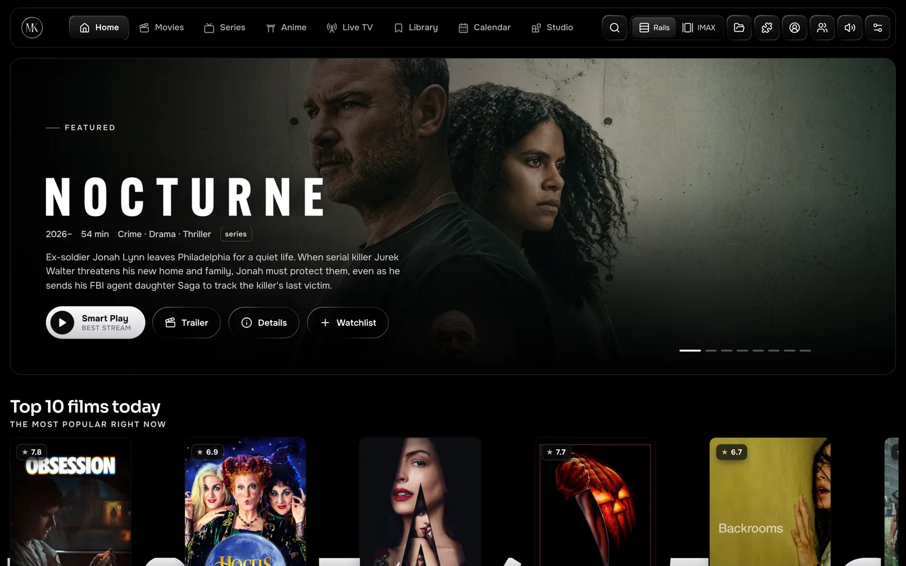
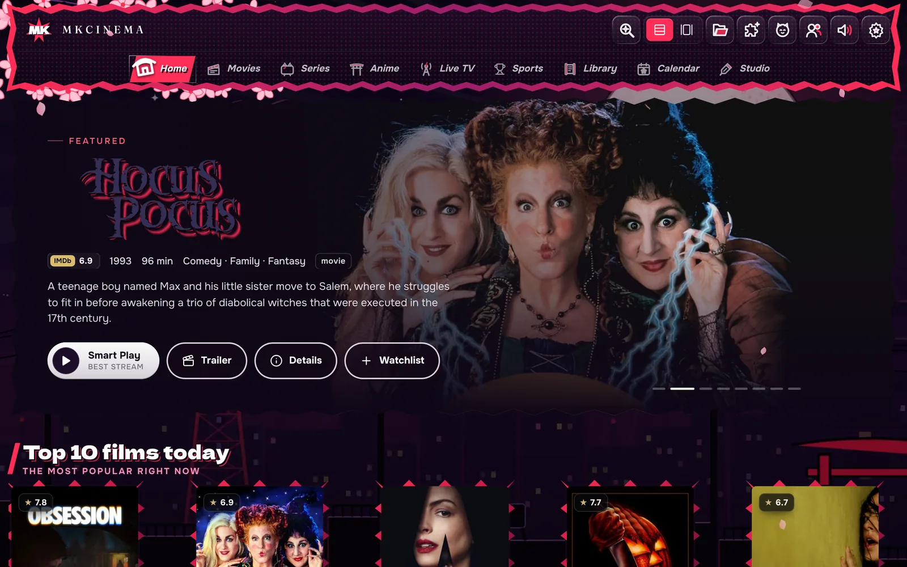
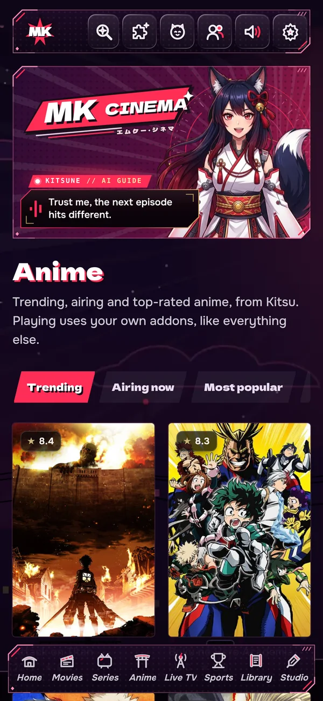
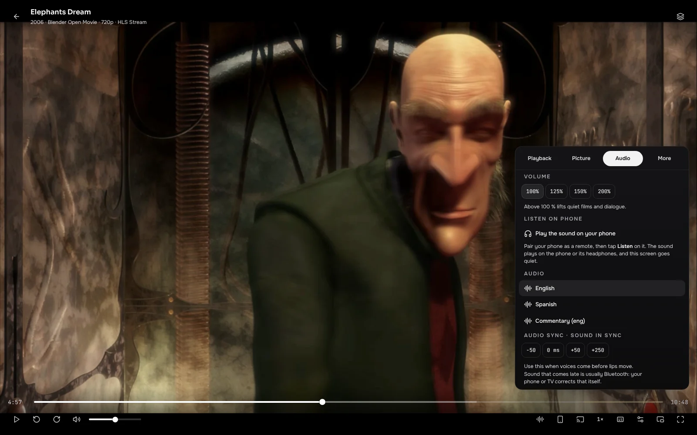
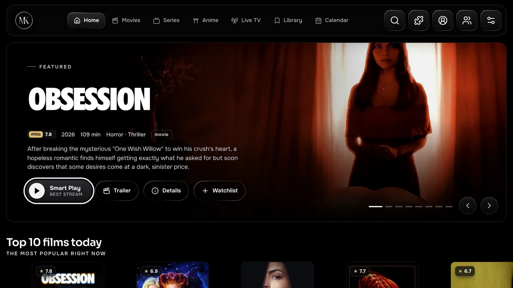
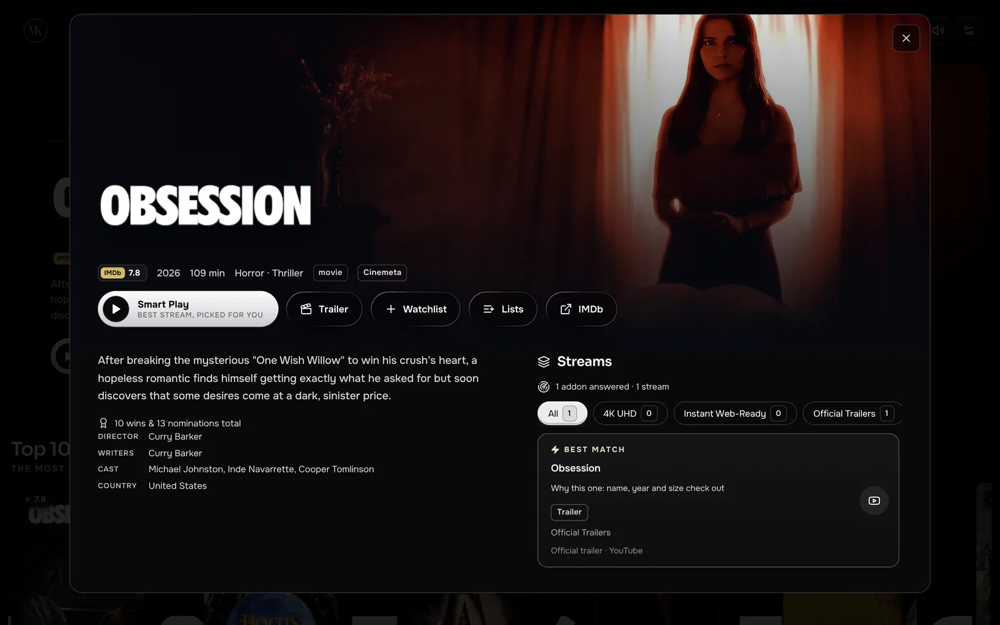
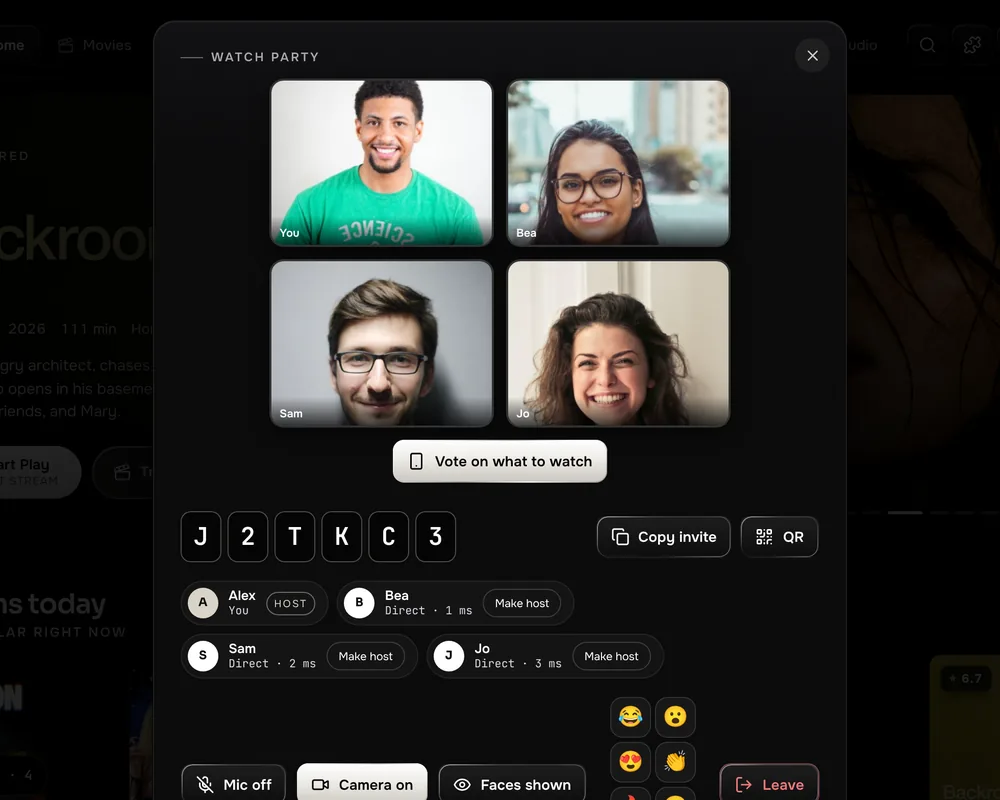
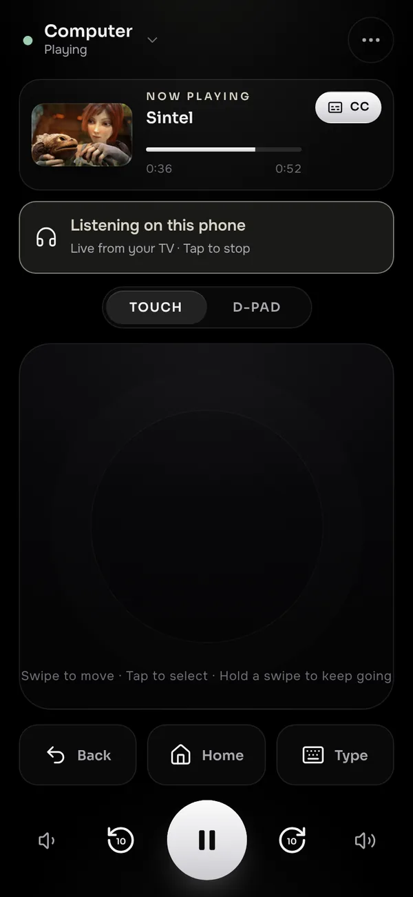
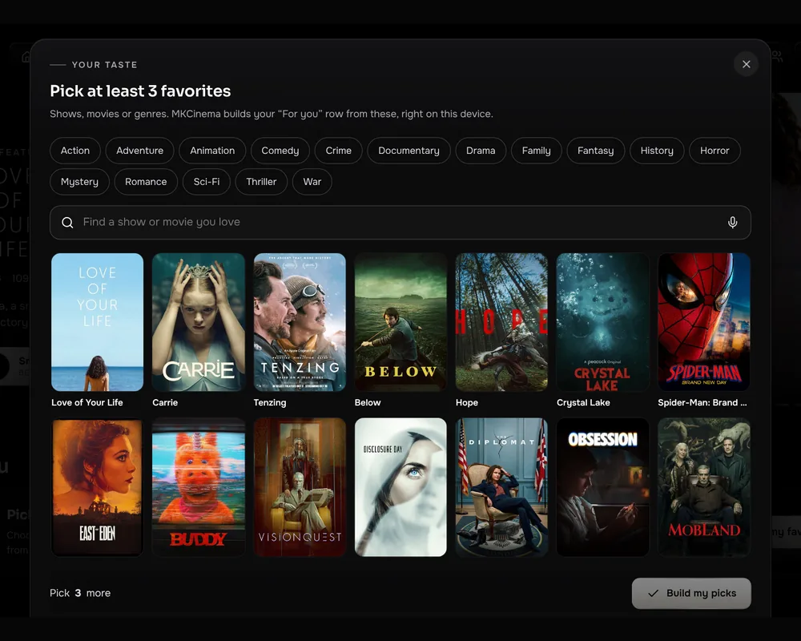
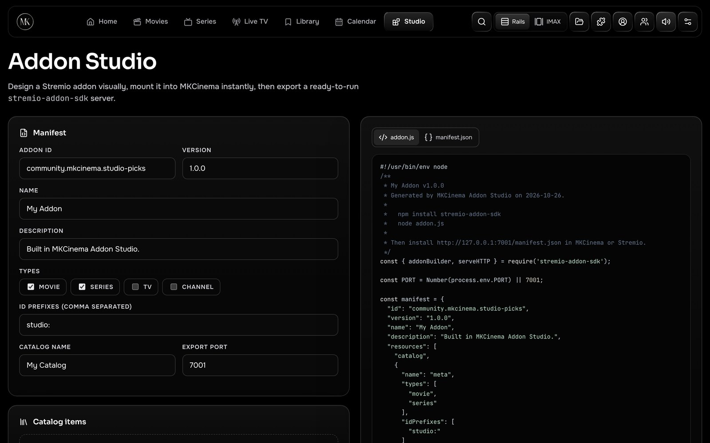

# Screenshots, privacy and questions

Back to the [README](../README.md). The full list of what MKCinema does is in the README under [Everything inside](../README.md#everything-inside), the one feature list for the repository.

## Free forever

**MKCinema will never charge for anything.** There is no paid plan, no premium tier and no feature behind a paywall, and there never will be. Everything that ships today stays free, and everything added later is free too. No ads, ever.

Donations on Ko-fi are optional and only say thank you: they never unlock a feature, a seat, a look or anything else. The code is open under GPL-3.0, so the free version can never be taken away. Addons and debrid services are run by other people and may cost money; that is their choice, not ours.

Coming from Stremio? **Settings › Account › Import from Stremio** (also in the welcome tour) copies your addons, library, Continue watching and watched episodes in one step. Your password goes only to Stremio and is never saved.

## Screenshots

<table>
<tr>
<td width="40%" align="center"> The Anime tab: trending, airing now, most popular, top rated</td>
<td width="40%" align="center"> Home in the Anime look, with sakura</td>
<td width="20%" align="center" rowspan="2"> Phones are first-class</td>
</tr>
<tr>
<td align="center"> The Audio tab: 200 % volume, Listen on phone and a film’s audio languages</td>
<td align="center"> On a TV: big type, a focus ring and remembered rows</td>
</tr>
</table>

<table>
<tr>
<td width="40%" align="center"> Every pick says why</td>
<td width="40%" align="center"> Watch party with synced playback and voice</td>
<td width="20%" align="center" rowspan="2"> Listen on phone</td>
</tr>
<tr>
<td align="center"> Your Picks, built on your device</td>
<td align="center"> Addon Studio: design a Stremio addon visually</td>
</tr>
</table>

The player shots show <a href="https://studio.blender.org/films/">Blender open movies</a> (CC BY). Poster and backdrop art comes from the catalogues and belongs to its owners.

## Privacy

- **Your keys stay yours.** Debrid keys live in your browser and, if you sign in, in your own Supabase row, which row-level security keeps readable only by you. You can turn sync off and keep them on one device.
- **No tracking.** No ads, no cookies and no profiles. MKCinema counts anonymous visits with Cloudflare Web Analytics (page, referring site, browser, country and load speed; no cookies or IDs), and it never sees your addons, keys or what you watch. In the app you can turn it off in Settings › Data. Your Picks never sends your taste to an outside service.
- **Bring your own sources.** MKCinema only plays what your addons return. You are responsible for using them lawfully where you live.

## Questions

<b>Does MKCinema provide movies or shows?</b>

No. MKCinema hosts and links to no content. It plays what your own addons return, plus official trailers.
See the [terms of use](https://app.mkcinema.app/terms.html) and the [privacy policy](https://app.mkcinema.app/privacy.html), also in the app under Settings › About & licenses.

<b>Which debrid service and player should I use?</b>

Use the debrid service you already have, or compare a few and pick the one that suits you. MKCinema works with all the common ones. For a player, **VLC** is the easy choice: it's free and plays almost any file. Settings › Get started walks you through both.

<b>Do I need an account?</b>

No. Everything works without one. Sign in with email only if you want sync between devices.

<b>Can we see each other in a watch party?</b>

Yes. In the party panel, tap Camera. On a TV, use your phone as the camera: open the phone remote, tap Party camera, then Camera. Phones, laptops and TVs can be in the same party. Video goes straight between your devices, through an encrypted relay only when two networks can't reach each other, and it is never recorded. The camera needs MKCinema on an https address, such as app.mkcinema.app, or the Android or Windows app.

<b>Can I read the subtitles in smart glasses?</b>

Yes. Brilliant Labs Frame and Even Realities G1 and G2 connect over Bluetooth: on a computer with Chrome or Edge, open Player › More › Glasses; on a phone, open the phone remote, tap Subtitles, then the glasses button. Meta Ray-Ban Display glasses get a link to add in the Meta AI app. TVs and the desktop apps have no Bluetooth for this, so use the phone remote there.

<b>Does Miko, the remote's assistant, cost anything?</b>

No. Everyday asks like "pause", "back 30 seconds" or "who's in this" are understood on the phone itself, free and with no account. If you want open conversation, you can add your own key from an AI service; it stays on your phone and goes only to that service. MKCinema is free forever.

<b>What does Sensory-friendly mode do?</b>

Like a sensory-friendly cinema showing, it softens sudden loud bangs and dims flashing light as it happens, all on your device. Turn it on in the player under Picture, or in Settings › Playback. Dimming needs a source that lets the app read the picture, and the first flash can still get through, so it is not a medical safeguard.

<b>Is iPhone supported?</b>

No. iPhone and iPad are not supported platforms.

<b>Can I move from Stremio?</b>

Yes. Settings › Account › Import from Stremio copies your library, progress and addons. Your Stremio password is used once and never stored.

