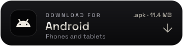
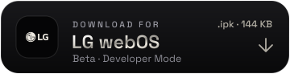
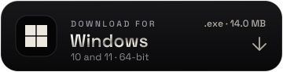
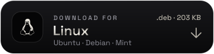

# Install and build

Back to the [README](../README.md).

## Download

<p align="center">
  <a href="https://github.com/itbelikethatbruh/MKCinema/releases/latest/download/MKCinema.apk"></a>
  <a href="https://github.com/itbelikethatbruh/MKCinema/releases/latest/download/MKCinema-TV.apk"></a>
  <a href="https://github.com/itbelikethatbruh/MKCinema/releases/latest/download/com.mkcinema.app_1.1.0_all.ipk"></a>
  <a href="https://github.com/itbelikethatbruh/MKCinema/releases/latest/download/MKCinema.exe"></a>
  <a href="https://github.com/itbelikethatbruh/MKCinema/releases/latest/download/MKCinema-1.1.1-mac.zip"></a>
  <a href="https://github.com/itbelikethatbruh/MKCinema/releases/latest/download/mkcinema_1.1_amd64.deb"></a>
  <a href="https://app.mkcinema.app"></a>
</p>

<p align="center"><sub>
  <a href="https://github.com/itbelikethatbruh/MKCinema/releases/latest">Latest release</a> (Android 1.9.1, Windows 1.3.1, Mac 1.1.1, Linux 1.1, webOS 1.1.0) &nbsp;·&nbsp;
  Linux also as <a href="https://github.com/itbelikethatbruh/MKCinema/releases/latest/download/mkcinema-1.1-linux-x86_64.tar.gz">.tar.gz</a> &nbsp;·&nbsp;
  Fire TV: type <code>tv.mkcinema.app</code> into the Downloader app &nbsp;·&nbsp;
  Samsung TV (2023+): <a href="../tizen/README.md">install with TizenBrew</a>
</sub></p>

Every app opens the same MKCinema in its own window, so it always runs the latest version. Sign in with email and your library, progress, addons and settings follow you between devices.

> [!NOTE]
> The Windows and Mac apps are not code-signed by Microsoft or Apple yet. On Windows, click **More info › Run anyway** the first time. On a Mac, open the app once, then go to **System Settings › Privacy & Security › Open Anyway**. Android asks you to allow installs from your browser; on a TV, allow the Downloader app instead. LG TVs only install store apps, so the webOS package needs Developer Mode. Only download MKCinema from this repository or [the website](https://mkcinema.app).

## Repository

| Folder | What it is |
|---|---|
| [`app/`](../app) | The web app (`index.html`), PWA files, the companion server (`mkcinema-server.js`), the Supabase schema (`supabase.sql`) and the debrid relay Edge Function. See [`app/README.md`](../app/README.md). |
| [`site/`](../site) | The website at [mkcinema.app](https://mkcinema.app). |
| [`android/`](../android) | Android, Android TV, Google TV and Fire TV app: a full-screen WebView with intent hand-off to video players, a TV launcher banner and remote control support. `MKCinema.apk` and `MKCinema-TV.apk` are the same file. |
| [`webos/`](../webos) | LG webOS app (beta): a hosted web app package. See [`webos/README.md`](../webos/README.md). |
| [`tizen/`](../tizen) | Samsung TV module for TizenBrew (beta): opens the web app and registers the remote's media keys. See [`tizen/README.md`](../tizen/README.md). |
| [`windows/`](../windows) | Windows app: Go and Microsoft Edge WebView2. |
| [`mac/`](../mac) | Mac app: WKWebView through JavaScript for Automation, packaged as a .zip (and a .dmg when the dmg tools are installed). |
| [`linux/`](../linux) | Linux app: C and WebKitGTK 4.1, packaged as .deb and .tar.gz. |

## Build from source

<details>
<summary><b>Web app and companion server</b></summary>

```sh
cd app
npm install
node mkcinema-server.js
# App:   http://127.0.0.1:7000/
# Addon: http://127.0.0.1:7000/manifest.json
```

The server adds official trailers as a source, a CORS proxy for streams that need headers, and audio rescue (EAC3, AC3, DTS and TrueHD to AAC) when ffmpeg is installed. The app also runs as static files on any host, such as Cloudflare Pages.
</details>

<details>
<summary><b>Android</b></summary>

Needs the Android SDK (build-tools 35 and platform 35) and JDK 17 or later. Create your own signing key first:

```sh
cd android
mkdir -p keystore && openssl rand -base64 24 > keystore/password.txt
keytool -genkeypair -keystore keystore/mkcinema.jks -storepass "$(cat keystore/password.txt)" \
  -alias mkcinema -keyalg RSA -keysize 4096 -validity 10000 -dname "CN=MKCinema"
ANDROID_HOME=~/Android/Sdk sh build.sh   # writes build/MKCinema.apk
```

Change `package` in `AndroidManifest.xml` for your own fork so it doesn't clash with official releases.
</details>

<details>
<summary><b>LG webOS</b></summary>

```sh
npx @webos-tools/cli ares-package webos -o build   # writes build/com.mkcinema.app_1.1.0_all.ipk
```

Install it on a TV in Developer Mode with `ares-install`. See [`webos/README.md`](../webos/README.md).
</details>

<details>
<summary><b>Windows</b></summary>

Builds from Windows, Linux or macOS with Go 1.24 or later. See [`windows/BUILD.md`](../windows/BUILD.md).

```sh
cd windows
go install github.com/akavel/rsrc@latest
rsrc -arch amd64 -ico mkcinema.ico -manifest app.manifest -o rsrc_windows_amd64.syso
GOOS=windows GOARCH=amd64 CGO_ENABLED=0 go build -trimpath -ldflags "-s -w -H windowsgui" -o MKCinema.exe .
```
</details>

<details>
<summary><b>macOS</b></summary>

The app is a standard `.app` bundle that runs `main.js` with the system's JavaScript for Automation, so it needs no compiler. To package it on Linux, install `hfsprogs` and build [mozilla/libdmg-hfsplus](https://github.com/mozilla/libdmg-hfsplus), then:

```sh
cd mac
DMGTOOLS=/path/to/libdmg-hfsplus/build sh package.sh   # writes build/MKCinema-1.1.1-mac.zip (and .dmg)
```
</details>

<details>
<summary><b>Linux</b></summary>

```sh
sudo apt install gcc libwebkit2gtk-4.1-dev python3-pil
cd linux
sh package.sh   # writes build/mkcinema_1.0_amd64.deb and the .tar.gz
```
</details>
